# Документ доски Yjs

Содержимое доски — документ Yjs: в клиенте `yjs` (`apps/web/src/realtime/boardDocument.ts`), на сервере `pycrdt` (`app.realtime.room.BoardRoom._doc`). Сервер документ не интерпретирует: применяет обновления к своей копии и пересылает их; корни документа создаёт клиент. Метаданные списка (название, папка, ссылка, избранное) хранятся в PostgreSQL и в документ не входят; присутствие и курсоры — тоже.

```mermaid
classDiagram
  direction LR
  class BoardDocument {
    <<interface>>
    createBoardDocument(doc) BoardDocument$
    moveToTrash(board, ids, deletedBy, now) string[]$
    doc: Y.Doc
    objects: Y.Map~unknown~
    trash: Y.Map~unknown~
    comments: Y.Map~unknown~
    timer: Y.Map~unknown~
    votes: Y.Map~unknown~
    notes: Y.XmlFragment
    settings: Y.Map~unknown~
  }
  class objects {
    <<Y.Map>>
    doc.getMap(objects)
    id → SceneObjectMap
  }
  class SceneObjectMap {
    <<Y.Map, объект сцены>>
    type: sticky | shape | text | document | stack | line | group
    parent: string | null
    x: number
    y: number
    width: number
    height: number
    rotation: number
    z: number
    shape?: string
    marker?: string
    fill?: string | transparent
    stroke?: string
    strokeWidth?: number
    radius?: number
    lineStyle?: straight | elbow | curved
    startCap?: none | arrow | triangle | circle | diamond
    endCap?: none | arrow | triangle | circle | diamond
    start?: LineEnd
    end?: LineEnd
    points?: Point[]
    labels?: Y.Map~LineLabelMap~
    color?: string
    fontSize?: number | auto
    fontFamily?: sans | serif | mono | hand
    fontStyle?: normal | bold | italic | bold-italic | underline | strike
    align?: left | center | right | justify
    lineHeight?: number
    background?: string
    text: Y.Text
    tags?: Y.Array~string~
    showAuthor?: false
    locked?: true
    createdBy?: string
    createdAt?: string
    updatedBy?: string
    updatedAt?: string
  }
  class RichTextContent {
    <<Y.Text с атрибутами Quill, text, document и sticky>>
    символы: bold?, italic?, underline?, strike?: true
    символы: link?: string
    перевод строки: header?: 1 | 2 | 3
    перевод строки: list?: bullet | ordered | checked | unchecked
    перевод строки: indent?: 1…8
    вставка документа: divider: true
    вставка документа: objectLink: id объекта
  }
  class settings {
    <<Y.Map>>
    doc.getMap(settings)
    background: string
    gridStep: number
  }
  class trash {
    <<Y.Map>>
    doc.getMap(trash)
    id → TrashEntry
  }
  class TrashEntry {
    <<Y.Map, interface>>
    object: unknown
    deletedAt: string
    deletedBy: string
  }
  class comments {
    <<Y.Map>>
    doc.getMap(comments)
    id → ветка комментария
  }
  class timer {
    <<Y.Map>>
    doc.getMap(timer)
    общее состояние таймера
  }
  class votes {
    <<Y.Map>>
    doc.getMap(votes)
    id сессии голосования → голоса
  }
  class notes {
    <<Y.XmlFragment>>
    doc.getXmlFragment(notes)
    заметка доски
  }
  class BoardRoom {
    <<pycrdt, app.realtime.room>>
    board_id: UUID
    peers: set~Peer~
    _doc: pycrdt.Doc
    _seq: int
    _compacted_seq: int
    _trash: pycrdt.Map
    _trashed: list~str~
    _journal: list~StoredUpdate~
    BoardRoom(board_id, journal: Journal)
    state_vector() bytes
    missing_since(state_vector) bytes
    apply(updates: Sequence~bytes~, sender, persist)
    _integrate(update, sender) JournalEntry
    compact(write) bool
    _on_trash_change(event: MapEvent)
  }
  class Journal {
    <<dataclass, app.realtime.store>>
    snapshot: Optional~bytes~
    updates: list~StoredUpdate~
    last_seq: int
  }
  class StoredUpdate {
    <<NamedTuple, app.realtime.store>>
    seq: int
    update: bytes
  }
  BoardDocument *-- objects
  BoardDocument *-- trash
  BoardDocument *-- comments
  BoardDocument *-- timer
  BoardDocument *-- votes
  BoardDocument *-- notes
  BoardDocument *-- settings
  objects *-- SceneObjectMap
  SceneObjectMap *-- RichTextContent : text (text, document, sticky)
  trash *-- TrashEntry
  BoardRoom ..> Journal : загрузка
  Journal *-- StoredUpdate
  BoardRoom ..> StoredUpdate : _journal — строки до сжатия
  BoardRoom ..> trash : observe (TRASH)
  BoardDocument .. BoardRoom : sync по /api/ws
  class sceneBounds {
    <<apps/web canvas/sceneBounds.ts>>
    sceneRects(objects) Rect[]$
    useSceneRects(objects) Rect[]$
  }
  class Rect {
    <<interface, canvas/camera.ts>>
    x: number
    y: number
    width: number
    height: number
  }
  sceneBounds ..> objects : observeDeep, чтение x, y, width, height, parent
  sceneBounds ..> Rect : для Minimap
  class sceneObjects {
    <<apps/web scene/sceneObjects.ts>>
    readScene(objects) SceneObject[]$
    createObject(objects, type, at, text: string | DeltaOp[], actor, style, size) string$
    objectMap(objects, id) Y.Map | null$
    objectText(objects, id) Y.Text | null$
    patchObjects(objects, patches, actor) void$
    writeFields(objects, changes, actor) void$
    transact(objects, write) void$
    topZ(objects) number$
    creationMeta(actor, now) ObjectMeta$
    touch(map, actor, now) void$
    newObjectId() string$
    writeTags(map, tags) void$
  }
  class SceneObject {
    <<interface, scene/sceneObjects.ts>>
    id: string
    type: string
    parent: string | null
    x, y, width, height: number
    rotation: number
    z: number
    text: string
    rich: DeltaOp[] | null
    tags: string[]
    showAuthor: boolean
    style: StyleKey → string | number
    origin: Point
    offset: Point
    locked: boolean
    meta: ObjectMeta
    line: LineShape | null
  }
  class ObjectMeta {
    <<interface, scene/sceneObjects.ts>>
    createdBy?: string
    createdAt?: string
    updatedBy?: string
    updatedAt?: string
  }
  class groups {
    <<apps/web scene/groups.ts>>
    ancestors(scene, id) SceneObject[]$
    withDescendants(scene, ids) SceneObject[]$
    topmost(scene, ids) SceneObject[]$
    selectionTarget(scene, leafId, selection) string$
    enterGroup(scene, leafId, selection) string | null$
    canGroup(units) boolean$
    groupObjects(objects, scene, units, actor) string | null$
    ungroupObjects(objects, scene, groups, actor) string[]$
    removalSet(scene, ids) string[]$
  }
  class layers {
    <<apps/web scene/layers.ts>>
    LayerOp: front | forward | backward | back
    reorder(siblings, selected, op) T[]$
    renumber(order) Map$
  }
  class lock {
    <<apps/web scene/lock.ts>>
    setLocked(objects, ids, locked, actor) void$
    unlockAll(objects, actor) void$
    lockedIds(objects) string[]$
  }
  class clipboard {
    <<apps/web scene/clipboard.ts>>
    CLIPBOARD_MIME = application/x-myboard-objects$
    DUPLICATE_OFFSET = 20$
    copyObjects(objects, scene, ids) Clip | null$
    pasteObjects(objects, clip, place, actor) string[]$
    parseClip(text) Clip | null$
    clipText(clip, label) string$
    clipHtml(clip, label) string$
    loadClip() Clip | null$
    saveClip(clip) void$
  }
  class Clip {
    <<interface, localStorage myboard.clipboard>>
    format: myboard/objects
    objects: ClipObject[]
    bounds: Rect
  }
  class ClipObject {
    <<interface>>
    id: string
    parent: string | null
    fields: поля объекта без parent, locked, автора и дат
    fields.text: string | DeltaOp[]
  }
  class ObjectTypeSpec {
    <<interface, scene/objectTypes.ts>>
    RICH_TEXT_TYPES = text, document, sticky$
    TAGGED_TYPES = sticky, stack$
    AUTO_FONT_SIZE = auto$
    STICKY_COLORS$
    FONT_SIZES$
    NO_COLOR = transparent, None$
    isRichText(type) boolean$
    type: ObjectType
    label: string
    plural: string
    width: number
    height: number
    rotatable: boolean
    editable: boolean
    style: StyleKey → string | number
  }
  class stickies {
    <<apps/web scene/stickies.ts>>
    NEXT_STICKY_GAP = 20$
    STICKY_COLOR_KEY = myboard.stickyColor$
    stickyColor(value) string — палитра или #rrggbb$
    loadStickyColor() string$
    rememberStickyColor(color) void$
    createNextSticky(objects, sticky, actor) string$
    pullSticky(objects, stack, at, actor) string$
  }
  class tags {
    <<apps/web scene/tags.ts>>
    normalizeTag(raw) string | null$
    addTag(objects, id, raw, actor) boolean$
    removeTag(objects, id, tag, actor) void$
  }
  class boardSettings {
    <<apps/web scene/boardSettings.ts>>
    DEFAULT_SETTINGS: BoardSettings$
    BACKGROUNDS$
    GRID_STEPS: 0, 10, 20, 40, 80$
    readSettings(settings) BoardSettings$
    updateSettings(settings, patch) void$
    useBoardSettings(settings) BoardSettings$
  }
  class search {
    <<apps/web scene/search.ts>>
    searchScene(scene, query) SearchHit[]$
  }
  class SearchHit {
    <<interface, scene/search.ts>>
    object: SceneObject
    snippet: string
    tags: string[]
  }
  class textBinding {
    <<apps/web scene/textBinding.ts>>
    applyTextChange(text, before, after) void$
    shiftIndex(index, delta) number$
  }
  class richDelta {
    <<apps/web richtext/delta.ts>>
    toBlocks(ops) Block[]$
    plainText(ops, label) string$
    isRich(ops) boolean$
    parseDelta(value) DeltaOp[] | null$
    normalizeDelta(ops) DeltaOp[]$
    safeLink(value) string | null$
    MAX_INDENT = 8$
  }
  class DeltaOp {
    <<interface, richtext/delta.ts>>
    insert?: string | divider | objectLink
    delete?: number
    retain?: number
    attributes?: Attributes
  }
  class richBinding {
    <<apps/web richtext/binding.ts>>
    bindQuill(quill, text: Y.Text, onEdit) unbind$
    minimalChange(change, before) DeltaOp[]$
  }
  class richHtml {
    <<apps/web richtext/html.ts>>
    deltaToHtml(ops, label) string$
    htmlToDelta(html, kind) DeltaOp[]$
  }
  class textStyle {
    <<apps/web scene/textStyle.ts, sessionStorage>>
    TEXT_STYLE_KEY = myboard.textStyle$
    loadTextStyle() fontSize?, color?$
    rememberTextStyle(key, value) void$
  }
  class LineEnd {
    <<JSON, scene/connectors.ts>>
    x: number
    y: number
    object?: string
    anchor?: n | e | s | w
  }
  class LineLabelMap {
    <<Y.Map, подпись линии>>
    text: Y.Text
    position: number 0…1
    orientation: horizontal | along
    align: left | center | right
    fontFamily: sans | serif | mono | hand
    fontSize: number
    color: string
  }
  class LineShape {
    <<interface, scene/connectors.ts>>
    start, end: LineEnd
    points: Point[]
    labels: LineLabel[]
    path: Point[] — точки на доске
    startDir, endDir: Point | null
    segments: Point[][]
  }
  class connectors {
    <<apps/web scene/connectors.ts>>
    ANCHORS = n, e, s, w$
    LABEL_DEFAULTS$
    LABEL_PLACES = start 0.1, center 0.5, end 0.9$
    readEnd(value, fallback) LineEnd$
    readLineData(record) LineData$
    anchorPoint(frame, anchor) Point$
    anchorDirection(frame, anchor) Point$
    isConnectable(type) boolean — не line и не group$
    resolveLine(data, position, frames, style) LineShape$
    findAttachment(objects, p, threshold, exclude)$
    constrainAngle(base, p, free) Point$
    routeSegments(style, path, startDir, endDir) Point[][]$
    pointAlong(route, t), projectOnto(route, p)$
  }
  class lineEdits {
    <<apps/web scene/lineEdits.ts>>
    createLine(objects, start, end, actor, style) string$
    setEnd(objects, line, name, end, actor)$
    setPoints(objects, line, points, actor)$
    removePoint(objects, line, index, actor)$
    swapEnds(objects, line, actor)$
    detachLine(objects, line, actor)$
    detachFrom(objects, scene, removed, actor)$
    addLabel(objects, lineId, position, actor) string$
    labelText(objects, lineId, labelId) Y.Text | null$
    setLabel(objects, lineId, labelId, fields, actor)$
    removeLabel(objects, lineId, labelId, actor)$
    labelValue(value), labelsValue(value) Y.Map$
  }
  SceneObjectMap *-- LineEnd : start, end (line)
  SceneObjectMap *-- LineLabelMap : labels (line)
  LineEnd ..> SceneObjectMap : object — id объекта привязки (CVS-26)
  SceneObject --> LineShape : line (у остальных типов null)
  sceneObjects ..> connectors : readLineData, resolveLine — привязанные концы по рамкам объектов
  connectors ..> LineShape
  lineEdits ..> SceneObjectMap : start, end, points, labels + touch — одной транзакцией
  lineEdits ..> LineLabelMap : Y.Map с текстом Y.Text
  lineEdits ..> sceneObjects : createObject, objectMap, transact, touch, newObjectId
  clipboard ..> lineEdits : labelsValue — подписи копии
  clipboard ..> connectors : readEnd — привязка только к скопированным
  sceneObjects ..> objects : observeDeep (useSceneObjects), запись одной транзакцией
  sceneObjects ..> SceneObject : readScene — координаты доски, по z
  sceneObjects ..> ObjectTypeSpec : OBJECT_TYPES — размер и стиль нового
  boardSettings ..> settings : observe, set
  textBinding ..> SceneObjectMap : text — минимальная замена (shape)
  richBinding ..> RichTextContent : applyDelta своей правки, observe чужих
  sceneObjects ..> richDelta : rich = Y.Text.toDelta()
  richDelta ..> DeltaOp
  SceneObject --> DeltaOp : rich
  clipboard ..> richDelta : isRich, parseDelta, plainText
  clipboard ..> richHtml : clipHtml — text/html
  textStyle ..> sceneObjects : style нового text (TXT-05)
  SceneObject *-- ObjectMeta
  sceneObjects ..> ObjectMeta : creationMeta, touch — createdBy/At, updatedBy/At
  groups ..> objects : group, parent, x, y, z — одной транзакцией
  groups ..> layers : renumber при разгруппировке
  layers ..> SceneObjectMap : z среди соседей одного parent
  lock ..> SceneObjectMap : locked через writeFields
  clipboard ..> Clip
  Clip *-- ClipObject
  clipboard ..> objects : чтение копии, вставка новыми id
  search ..> SceneObject : text, tags — без записи в документ
  search ..> SearchHit
  SearchHit --> SceneObject
  stickies ..> objects : createObject + width, height, fill, fontSize, showAuthor, tags — одной транзакцией
  stickies ..> sceneObjects : createObject, objectMap, transact, writeTags
  tags ..> SceneObjectMap : tags — push / delete в Y.Array + touch
  sceneObjects ..> ObjectTypeSpec : TAGGED_TYPES — пустой tags при создании
  class shapes {
    <<apps/web scene/shapes.ts>>
    SHAPE_SETS: basic, callout, flowchart, bpmn$
    SHAPE_KINDS: ShapeKind[]$
    DEFAULT_SHAPE = rectangle$
    SHAPE_KIND_KEY = myboard.shapeKind$
    shapeKind(value) ShapeKind$
    isShapeKind(value) boolean$
    shapeMarker(kind, value) string | null$
    textBoxOf(kind) TextBox$
    newShapeFields(kind) width, height, style$
    loadShapeKind() string$
    rememberShapeKind(kind) void$
  }
  class ShapeKind {
    <<interface, scene/shapes.ts>>
    id: string
    label: string
    set: ShapeSet
    width: number
    height: number
    roundable: boolean
    style?: поля оформления нового
    text?: TextBox
    verticalText?: boolean
    markers?: MarkerOption[]
  }
  class MarkerOption {
    <<interface, scene/shapes.ts>>
    id: string
    label: string
  }
  class TextBox {
    <<interface, scene/shapes.ts>>
    x, y, width, height: доли рамки
  }
  class styleOptions {
    <<apps/web scene/styleOptions.ts>>
    COLOR_KEYS = fill, stroke, color, background$
    RECENT_GROUP = Recent colors$
    objectStyleKeys(object) StyleKey[]$
    sharedStyleKeys(selected, recent) StyleKey[]$
    styleOptions(key, selected, recent) StyleOption[]$
  }
  class recentColors {
    <<apps/web scene/recentColors.ts, localStorage>>
    RECENT_COLORS_KEY = myboard.recentColors$
    RECENT_LIMIT = 8$
    ColorCategory: text | sticky | shape | line
    normalizeColor(value) string | null$
    colorCategory(type) ColorCategory | null$
    loadRecentColors() RecentColors$
    addRecentColor(recent, categories, color) RecentColors$
    useRecentColors() recent, remember$
  }
  shapes *-- ShapeKind : SHAPE_KINDS
  ShapeKind *-- MarkerOption : markers (BPMN)
  ShapeKind *-- TextBox : text
  SceneObjectMap ..> ShapeKind : shape — id вида, marker — id маркера
  ObjectTypeSpec ..> shapes : DEFAULT_SHAPE, SHAPE_KINDS — список Shape
  styleOptions ..> shapes : маркеры и скругление по виду
  styleOptions ..> recentColors : недавние цвета категории выделенных
  stickies ..> recentColors : normalizeColor
```

- Корни объявлены в `BoardDocument` как `unknown`; поля объекта сцены разбирает модуль `scene` (T5.2). Объект в `objects` — `Y.Map`, каждое поле — свой ключ, чтобы одновременные правки разных полей не затирали друг друга (COL-01): `type` — `sticky` | `shape` | `text` | `document` | `stack` (`OBJECT_TYPES` в `scene/objectTypes.ts`, `document` — T6.1, `stack` — T6.2, `line` — T6.4) или `group` (`GROUP_TYPE`, T5.3; другие типы — T6.5…, T7.*), `parent` (`null` — верхний уровень; `x`, `y` дочернего — относительно родителя, `readScene` прибавляет позиции предков, цикл и потерянный родитель дают 0), `width`, `height`, `rotation` (градусы вокруг центра, по умолчанию 0), `z` (целое; новый — `topZ` = наибольший `z` + 1, учитываются и записи-JSON, BUG-008), оформление по типу (`sticky` — `fill`, `fontSize`; `stack` — `fill`; `shape` — `shape`, `marker`, `fill`, `stroke`, `strokeWidth`, `radius`, `fontSize`, `color`, `align`, `lineHeight`, T6.3; `text` и `document` — `fontFamily`, `fontSize`, `color`, `fontStyle`, `align`, `lineHeight`, `background`, T6.1), `text` — `Y.Text` (у фигуры правки сливаются по символам: `applyTextChange` меняет только изменившуюся середину, `shiftIndex` держит курсор при чужой правке; у текста, документа и стикера — см. ниже; у стопки — пустой).
- Текст и документ (T6.1, TXT-01…TXT-08): `text` — тот же `Y.Text`, но с атрибутами в модели Quill (`RichTextContent`): начертание и ссылка — на символах, `header` 1–3, `list` (`bullet` | `ordered` | `checked` | `unchecked`) и `indent` 1–8 — на переводе строки своей строки; в документе ещё вставки `{ divider: true }` и `{ objectLink: id }` (id ключа в `objects`, TXT-06). Новых корней и полей-контейнеров нет; `toJSON()` текста — по-прежнему строка (поиск, подпись объекта). `readScene` кладёт дельту (`Y.Text.toDelta()`) в `SceneObject.rich` только для `RICH_TEXT_TYPES`; показ (`toBlocks`) отбрасывает неизвестные атрибуты, ссылки — только http(s), mailto, tel. Правка в редакторе (`bindQuill`) пишет в `Y.Text` минимальную разницу «было → стало» (`minimalChange`, BUG-014) одной транзакцией с origin `null` вместе с `touch` и подгонкой `height`; отметка пункта списка дел на холсте (TXT-02) — `text.format(end, 1, {list})` + `touch` одной транзакцией. Высота: текстовый блок следует за содержимым, документ только растёт; подгонка после смены оформления и вставки HTML (`useTextFit`) входит в тот же шаг отмены (`UndoHistory.amend`).
- Стикер (T6.2, STK-01…STK-04): `type: "sticky"`, `text` — `Y.Text` с атрибутами Quill, как у текста (`RICH_TEXT_TYPES` = `text`, `document`, `sticky`; правка — `bindQuill`, подгонки высоты нет: `fittedHeight` для стикера — `null`). `fill` — цвет, выбранный до постановки (`STICKY_COLORS` — палитра без чёрного; выбор вкладки — `sessionStorage` `myboard.stickyColor`, в документ не входит). `fontSize` — число или `"auto"` (`AUTO_FONT_SIZE`, у нового — `"auto"`): автоподгон считает каждый клиент при отрисовке (`useFitFont`), в документ размер не пишется. `showAuthor: false` — имя автора (`createdBy`) на стикере скрыто; нет поля — показано. `tags` — `Y.Array<string>`, у нового стикера и стопки создаётся пустым сразу в `createObject` (`TAGGED_TYPES`), чтобы первые теги двух участников слились в один массив (COL-01). Следующий стикер по Tab (`createNextSticky`, STK-04) — справа на `NEXT_STICKY_GAP` = 20, тех же `width`, `height`, `fill`, `fontSize`, `showAuthor`, без тегов, одной транзакцией.
- Фигура (T6.3, SHP-01…SHP-04): `type: "shape"`. `shape` — id вида из `SHAPE_KINDS` (`scene/shapes.ts`): наборы `basic` (Basic, 15 видов), `callout` (Callouts, 4), `flowchart` (Flowchart, 17), `bpmn` (BPMN, 11: `bpmn-task`, `bpmn-subprocess`, `bpmn-start`, `bpmn-intermediate`, `bpmn-end`, `bpmn-gateway`, `bpmn-data-object`, `bpmn-data-store`, `bpmn-pool`, `bpmn-annotation`, `bpmn-group`); нет поля или неизвестный id — `rectangle` (`shapeKind`), поэтому фигуры до T6.3 показываются прямоугольником. `marker` — id маркера BPMN (`ShapeKind.markers`: у задачи, подпроцесса, событий, шлюза и объекта данных; первый — по умолчанию, у шлюза — `exclusive`, у остальных — `none`); чужой или пустой — первый маркер вида (`shapeMarker`), у видов без маркеров поле не читается. Оформление: `fill` — цвет или `"transparent"` (`NO_COLOR`, SHP-03), `stroke`, `strokeWidth` (0 — без обводки; 0, 1, 2, 4, 6, 8), `radius` (скругление 0…48, читается только у видов с `roundable`), `fontSize`, `color`, `align`, `lineHeight`. Новая фигура (`newShapeFields`) — размер вида (`width`, `height`, передаётся в `createObject` аргументом `size`), оформление типа `shape` поверх него — `ShapeKind.style` вида, `shape` и маркер по умолчанию; всё одной транзакцией `createObject`. `text` — `Y.Text` без атрибутов (правка — `TextEditor` с `applyTextChange`, как раньше), поле правки — над областью текста вида (`TextBox` в долях рамки; у событий, шлюза и данных — подпись под фигурой). Контур и значки маркеров клиент вычисляет при отрисовке (`shapeGeometry.ts`, `bpmnMarkers.ts`) и в документ не пишет. Выбранный до постановки вид — `sessionStorage` `myboard.shapeKind` (`loadShapeKind`), в документ не входит.
- Соединительная линия (T6.4, CON-01…CON-07, CVS-26): `type: "line"`, `x`, `y` — положение линии, `width`/`height` — 0, `rotation` не пишется (`patchObjects` пропускает `width`, `height`, `rotation` линии — `derivedFrame`): рамку на сцене `readScene` вычисляет по точкам маршрута (`pointsBounds(routeOf(line))`). `start`, `end` — JSON `LineEnd` `{x, y}` относительно `x`, `y` линии; у привязанного конца ещё `object` (id ключа в `objects`) и `anchor` (`n` | `e` | `s` | `w` — середина стороны рамки с учётом поворота). `points` — JSON-массив точек изгиба относительно линии. Оформление: `lineStyle` (`straight` | `elbow` | `curved`), `startCap`/`endCap` (`none` | `arrow` | `triangle` | `circle` | `diamond`; у новой — `none`/`arrow`), `stroke`, `strokeWidth` (без 0). `labels` — `Y.Map` id → `Y.Map` подписи (`LineLabelMap`: `text` — `Y.Text`, правки сливаются по символам; `position` — доля длины 0…1; `orientation`, `align`, `fontFamily`, `fontSize`, `color`). `text` линии — пустой `Y.Text` от `createObject`; `SceneObject.text` линии — тексты подписей через перевод строки (поиск, CVS-08). Новая линия (`createLine`) — `createObject` + `start`, `end`, `points: []` одной транзакцией.
- Привязка (CVS-26) в документе — только `object`/`anchor` конца: `readScene` собирает рамки всех объектов, кроме линий и групп (`connectableFrames`, `isConnectable`), и `resolveLine` ставит привязанный конец в точку привязки текущей рамки объекта; запасные `x`, `y` конца — если объекта нет. Поэтому движение объекта не пишет в линию, а линия следует за ним у всех участников. `detachLine` и `detachFrom` записывают текущие точки концов свободными; `SceneCommands.remove` вызывает `detachFrom` в одной транзакции с `moveToTrash`. `swapEnds` меняет `start`/`end`, разворачивает `points`, подписям ставит `position = 1 − position`; наконечники не меняются. Запись-JSON подписей при первой правке заменяется `Y.Map` (`labelsMap`, `labelEntry`). Состояние вкладки (выбранная подпись `LabelState`, точки привязки под концом `ConnectHint`) в документ не входит.
- Недавние свои цвета (T6.3, SHP-04) — не данные документа: `localStorage` `myboard.recentColors` = `{"text":[],"sticky":[],"shape":[],"line":[]}` (`#rrggbb`, до 8 в категории, последний — первым), общие для всех досок браузера. Категория — по типу объекта (`colorCategory`: `text`/`document` → `text`, `sticky`/`stack` → `sticky`, `shape` → `shape`, `line` → `line`). В документ попадает только сам цвет в поле объекта (`fill`, `stroke`, `color`, `background` через `setStyle`); цвет следующего стикера (`stickyColor`) принимает и свой `#rrggbb`.
- Стопка стикеров (T6.2, STK-05): `type: "stack"`, рамка 200×200, `fill`, `tags` (`Y.Array<string>`), `text` пустой (`editable: false` — поле правки не открывается). Стикер из стопки (`pullSticky`) — новый `sticky` верхнего уровня размера типа, центром в точке, `fill` стопки и копия её тегов, одной транзакцией; сама стопка не меняется.
- Новый текст (TXT-05) получает `fontSize` и `color` из `sessionStorage` `myboard.textStyle` (`loadTextStyle`; запоминаются при выборе у текстового блока) — это поля объекта, сама память вкладки в документ не входит. `createObject` принимает текст строкой или дельтой и оформление поверх значений типа; вставка HTML внешнего документа (`htmlToDelta`, TXT-08) создаёт `text` с дельтой и оценкой высоты (`estimateHeight`) одной транзакцией.
- Id объекта — 32 hex-символа из `crypto.getRandomValues` (16 байт; `randomUUID` без HTTPS недоступен). `createObject` ставит объект верхнего уровня одной транзакцией (CVS-09). `patchObjects` пишет рамку и оформление нескольких объектов одной транзакцией (CVS-11, CVS-12, CVS-14), переводя `x`, `y` доски в координаты относительно родителя. Запись-JSON (как в тестах T5.1) читается так же и при первой правке заменяется `Y.Map` (`objectMap`, строка `text` → `Y.Text`). Неверные записи (нет `type` или числовой рамки) `readScene` пропускает.
- Группа (T5.3, CVS-17): `type: "group"`, `parent`, `x`, `y` — начало координат её объектов, `z` — среди соседей, `rotation: 0`, `width`/`height` — только на момент создания: рамку группы `readScene` считает по её объектам (`SceneObject.offset` — сдвиг рамки от записанного положения), пустая группа не рисуется. Объекты группы — `parent: <id группы>`, `x`, `y` относительно группы, `z` — порядок среди объектов группы (`readScene` отдаёт группу перед её объектами, соседей — по `z`, при равенстве по id). `groupObjects` ставит группу на `z` верхнего из объединяемых и нумерует объекты 1…n; `ungroupObjects` переносит объекты к родителю группы на её место в порядке слоёв (`renumber`) и удаляет группу. Группировать можно 2+ незаблокированных объекта одного родителя (`canGroup`).
- Порядок слоёв (CVS-18): `reorder` переставляет соседей одного `parent` (front/forward/backward/back), `renumber` подбирает целые `z` с наименьшим числом изменённых объектов; запись — `writeFields` одной транзакцией.
- Блокировка (CVS-19): `locked: true` у самого объекта; `SceneObject.locked` истинно и у объектов внутри заблокированной группы. `setLocked`, `unlockAll` (все ключи с `locked: true`) пишут через `writeFields`. Заблокированные объекты команды и жесты не меняют и не удаляют (`removalSet` оставляет группу с заблокированным объектом целиком).
- Теги (T5.5, CVS-08): необязательное поле `tags` объекта — `Y.Array<string>` (запись-JSON — массив строк), тег без «#». `readScene` (`readTags`) берёт только строки, обрезает пробелы, отбрасывает пустые и повторы; нет поля или не массив — `[]`. Интерфейс пишет теги стикера и стопки (T6.2, STK-03): `addTag` — `normalizeTag` (без «#» в начале, пробелы схлопнуты, до 40 символов, пустой отвергается), повтор не добавляется, `Y.Array.push` + `touch` одной транзакцией; `removeTag` удаляет все повторы. Запись-JSON массива при первой правке заменяется `Y.Array` (`tagArray`); вставка из буфера (`pasteObjects`) тоже кладёт `Y.Array`. Теги карточек — KBN-02, T6.8. `searchScene` читает `text` и `tags` из `SceneObject` и в документ не пишет; ссылка на объект (SHR-07) — id ключа в `objects`, в документ тоже не входит.
- Автор и даты (CVS-22): `createdBy`, `createdAt`, `updatedBy`, `updatedAt` — имя участника (`BoardScene.userName`: имя `Peer` из присутствия, до него — имя из сессии страницы) и ISO 8601. Создание (`createObject`, `groupObjects`, `pasteObjects`) пишет все четыре (`creationMeta`), любая правка — `updatedBy`/`updatedAt` (`touch` в `writeFields`/`patchObjects`, в транзакции правки текста `TextEditor.onEdit`, в `groupObjects`/`ungroupObjects`). У объектов, записанных до T5.3, полей нет. Пишет их клиент — сервер документ не разбирает.
- Буфер обмена (CVS-20): `copyObjects` берёт выделенные корни (`topmost`) с вложенными; корни — в координатах доски, вложенные — относительно родителя, без `parent`, `locked`, автора и дат. Копия — JSON `Clip` в системном буфере (тип `CLIPBOARD_MIME` + простой текст) и в `localStorage` `myboard.clipboard` — оттуда её вставляет другая доска того же браузера. `pasteObjects` создаёт объекты с новыми id одной транзакцией: корни — поверх остальных (`topZ`), центром в точку вставки с углом на сетке, дубликат (`DUPLICATE_OFFSET`) — со сдвигом 20 в той же группе; `text` — `Y.Text`, автор — вставивший, без блокировки. Текст с форматированием (T6.1) копируется в `fields.text` дельтой (`isRich`), простой — строкой; у линии (T6.4) концы копируются в их текущем положении, привязка остаётся только к объекту, скопированному вместе с линией (`clipEnd`), при вставке — к его новому id (`pastedEnd`), подписи — `Y.Map` с `Y.Text` (`labelsValue`); вставка восстанавливает `Y.Text` через `applyDelta` (`parseDelta` отвергает чужое). В системный буфер, кроме JSON, — `text/plain` (`clipText`, ссылка на объект — её подпись) и `text/html` (`clipHtml` → `deltaToHtml`, TXT-07). `parseClip` отвергает чужой формат, берёт не больше 5000 объектов. Вырезание — копия + `moveToTrash`.
- Корень `settings` (CVS-06, ответ на Q-002): `background` — `#rrggbb` (`BACKGROUNDS`: Light gray `#fafafa` по умолчанию, White, Cream, Mint, Sky, Dark), `gridStep` — шаг сетки в единицах доски (0 — без сетки и прилипания, по умолчанию 20). Неверные значения читаются как значения по умолчанию. Общий для всех участников, входит в снимки (`test_cvs06_board_settings_root_survives_compaction_and_restart`).
- Миникарта (T5.1, CVS-04) читает `objects` через `sceneRects` = `readScene` → объекты верхнего уровня (рамка группы — по её объектам, без поворота). Комментарии — T6.10, таймер и голосование — T8.1, заметки — T6.12.
- Корзина (T4.3, основа COL-08): `moveToTrash(board, ids, deletedBy)` одной транзакцией Yjs для каждого известного id кладёт в `trash[id]` `Y.Map { object: копия объекта (вложенный общий тип — `clone()`), deletedAt: ISO 8601, deletedBy: имя }` и удаляет ключ из `objects`; неизвестные id пропускаются. Восстановления из корзины пока нет (T8.2). Жизненный цикл — [states/board-object.md](states/board-object.md).
- Отложенные обновления (T6.2, BUG-018): обновление, пришедшее раньше той правки, от которой оно зависит, `pycrdt` держит отложенным — в `get_update()` и снимок оно не входит. `BoardRoom._journal` хранит строки журнала (`StoredUpdate(seq, update)`), ещё не отрезанные сжатием; `compact` оставляет в `board_updates` те из них, где есть структуры, которых нет в документе (`_has_unapplied`: разница обновления и вектора версии не пуста), и не пишет снимок, если отрезать нечего. Когда недостающая правка доезжает, следующее сжатие отрезает и их.
- Сервер не разбирает объекты, но подписан на корень `trash` своей копии (`_on_trash_change`): ключи с действием `add`/`update` в принятом обновлении (`_integrate`) попадают в `JournalEntry.trashed`, и `store.append` пишет запись `board_events` `objects_deleted` с именем из сессии соединения ([data-model.md](data-model.md)). Подписка ставится после загрузки, поэтому состояние из снимка/журнала записей не порождает.
- Интерфейс пишет в `objects`, `settings` и `trash`: создание, правки, группы, порядок слоёв, блокировку, вставку и удаление (`moveToTrash` с именем своего участника, CVS-21; вместе с выбранным — вложенные объекты и опустевшие группы, `removalSet`) — [states/board-object.md](states/board-object.md). Выделение, инструмент, черновик рамки/лассо и меню — состояние вкладки, в документ не входят. Документ создаётся заново на каждую открытую доску (`useBoardConnection`) и наполняется из `STEP2` сервера.
- Отмена и повтор (T5.4, CVS-07): `UndoHistory` (`scene/undoHistory.ts`) держит `Y.UndoManager` над корнями `objects`, `trash` и `settings` и записывает только локальные транзакции (origin `null`); обновления других участников он не отменяет. Отмена — обычная транзакция Yjs: структура документа и поля объектов не меняются, новых корней нет. Стек отмены в документ, снимки и резервные копии не входит.
- Присутствие (курсоры, вид камеры, слежение, список участников — T4.2) в документ не входит; запомненный вид камеры (CVS-05) хранится в `localStorage` браузера, а не в документе: оно идёт сообщениями `awareness`/`presence` и живёт только в памяти соединений ([ws-protocol.md](ws-protocol.md)).
- Серверная копия собирается из последнего снимка `board_snapshots` и хвоста `board_updates` при первом подключении к доске (`Hub.join` → `store.load_journal` → `BoardRoom(board_id, journal)`) и выгружается, когда уходит последнее соединение (`Hub.leave`, с этим — сжатие журнала). Снимок — полное состояние `Doc.get_update()`; присутствия в нём нет. См. [data-model.md](data-model.md), [sequences/sync.md](sequences/sync.md).

Актуально на: T6.4, e2e079f (линия: `type: line`, `start`, `end`, `points`, `lineStyle`, `startCap`, `endCap`, `labels`, привязка концов, `connectors.ts`, `lineEdits.ts`, копирование линий; T6.3, 0de9f87 — фигура: `shape`, `marker`, `strokeWidth`, `radius`, прозрачная заливка, размер вида в `createObject`, каталог `shapes.ts`, `styleOptions.ts`, недавние цвета вне документа; стикер — T6.2, ce46d3f: стикер с `Y.Text` с атрибутами, `fontSize: auto`, `showAuthor`, теги `Y.Array`, тип `stack`, отложенные обновления в журнале сервера — BUG-018; тип `document` — T6.1, 986b7b2; поле `tags`, поиск — T5.5, 044e3c2; область отмены — T5.4, e2d1150; `topZ` с записями-JSON — T5.6, 298b639, BUG-008; поля объектов — T5.3, 1c15594). Требования: CON-01…CON-07, CVS-26 (соединительные линии, подписи, привязка), SHP-01…SHP-04 (фигуры, BPMN, оформление фигуры, свой цвет), STK-01…STK-05 (стикер, теги, автор, стопка), CVS-06 (`settings`), CVS-07 (область отмены), CVS-09…CVS-14, CVS-21 (объекты сцены, их запись и удаление), CVS-15…CVS-20, CVS-22 (группы, слои, блокировка, буфер обмена, автор и даты), CVS-08 (`tags`, чтение поиском), TXT-01…TXT-08 (текст и документ, форматирование, буфер обмена), COL-01, COL-07 и COL-08 (основа: снимки, корзина), CVS-04 (чтение `objects` миникартой), COL-02…COL-04, COL-09, CVS-05 (вне документа); ARCHITECTURE.md, раздел 6 (структура документа, корзина).
