# Компоненты

Фактическое устройство кода приложения. Реализованы каркас сервера `apps/api` (T0.2), каркас интерфейса `apps/web` (T0.3), панель администратора (T1.1) и вход пользователя досок (T1.2): модуль `identity` на сервере, страницы `/admin/login`, `/admin/users`, `/login` и проверка входа в клиенте. T1.4 добавил в клиент обёртку `RequireAccount`: страницы пользователя досок следят за отзывом сессии (ACC-05); сервер в T1.4 не менялся. T2.1 добавил список досок: модуль `library` на сервере (маршруты `/api/boards*`) и одноимённый модуль клиента на страницах `/` и `/boards/:id`. T2.2 добавил папки и избранное: маршруты `/api/folders*`, `/api/boards/{board_id}/folder`, `/api/boards/{board_id}/favorite` и боковой список с перетаскиванием на странице `/`. T3.1 добавил ссылку на доску: модуль `sharing` на сервере (маршруты `/api/boards/{board_id}/share*`, `/api/share/{token}*`, гостевые сессии в `identity.sessions`) и модуль `sharing` клиента — диалог Share на `/boards/:id` и страница входа участника `/b/:token`. T4.1 добавил синхронизацию документа доски: модуль `realtime` на сервере (WebSocket `/api/ws`, `Hub`, `BoardRoom` на `pycrdt`, журнал `board_updates`) и модуль `realtime` клиента (`BoardConnection` на `yjs`, `BoardLive` со строкой состояния связи на `/boards/:id` и `/b/:token`). T4.2 добавил присутствие по тому же каналу: сообщения `awareness`/`presence` в `realtime` сервера (`BoardRoom.announce`, `update_awareness`, `announce_leave`), на клиенте — `BoardPresence`, минимальный холст `canvas` с камерой и модуль `collab` (список присутствующих, чужие курсоры, слежение). T4.3 добавил снимки и ленту: модуль `history` на сервере (таблицы `board_snapshots`, `board_events`; маршрутов пока нет), сжатие журнала в `Hub` (фоновая задача процесса, выгрузка доски, остановка) и клиентскую функцию корзины `moveToTrash`. T5.1 сделал полную камеру холста в клиенте `canvas`: масштаб кнопками, клавишами, колесом и щипком, сдвиг мышью, пальцем и стрелками, выбор поведения колеса, миникарта по объектам документа и запоминание вида в `localStorage`; на сервере в `SharedBoard` добавлено поле `id` (ключ запомненного вида участника). T5.2 добавил в клиент модуль `scene`: объекты документа на холсте (стикер, фигура, текст), панель инструментов, выделение щелчком, рамкой и лассо, панель выделения с фильтром по типу и массовыми свойствами, перемещение с прилипанием и автопрокруткой, размер и поворот, удаление в корзину, контекстные меню, долгое нажатие пальцем и общий для доски фон и шаг сетки (корень документа `settings`); сервер не менялся. T5.3 добавил в `scene` операции над объектами: выравнивание и распределение (меню Arrange и маркеры промежутка), направляющие к соседям при перемещении, группы, порядок слоёв, блокировку и Unlock all, копирование/вырезание/вставку/дублирование (в том числе между досками браузера) и автора и даты изменения у объекта; имя автора страницы передают в `BoardLive` → `BoardWorkspace` (`userName`); сервер не менялся. T5.6 добавил в клиент модуль `ui`: тему (`theme.css` — палитра, один акцент, шрифт, шкалы текста, отступов, скруглений, теней и размера элементов управления), общую раскладку экранов (`layout.css`) и базовые компоненты (`Button`, `IconButton`, `Input`, `TextField`, `Select`, `SelectField`, `Switch`, `Menu`, `MenuItem`, `Dialog`, `Tooltip`, `Tabs`, `FloatingPanel`); экраны всех модулей переведены на них, поведение и доступные имена прежние; сервер не менялся. T5.4 добавил в `scene` отмену и повтор своих правок (`undoHistory.ts` — локальный `Y.UndoManager`, кнопки Undo/Redo), закреплённые инструменты и полный список (`pinnedTools.ts`, диалог `ToolListDialog`) и горячие клавиши инструментов и отмены (`keymap.ts`); в `ui` — чистые серые темы (R = G = B), одна высота кнопок панели Selection (BUG-009) и закрытие `Dialog` по Escape с первого нажатия; сервер не менялся. T5.5 добавил в `scene` поиск по тексту и тегам объектов (`search.ts`, панель `BoardSearch`, кнопка Search в Board actions) с переходом вида к объекту (`camera.focusOn`), поле объекта `tags` в `SceneObject`, а в `sharing` — ссылку на объект (`objectLink.ts`, диалог `ObjectLinkDialog`, пункт Copy link to object) и переход по `/b/{token}?object={id}` после первой сверки документа (`BoardLive`); сервер не менялся. T6.1 добавил в клиент модуль `richtext`: редактор форматированного текста на Quill (`RichTextEditor` — панель B/I/U/S/Link, списки и списки дел, заголовки, быстрая разметка, меню «/», выбор объекта для ссылки `ObjectPicker`), показ на холсте (`RichText`), привязку к `Y.Text` (`bindQuill`) и обмен HTML с внешними редакторами; в `scene` — тип `document` (инструмент Document, клавиша D), свойства текста (шрифт, начертание, выравнивание, интервал, фон — кнопка Text style), запоминание размера и цвета (`textStyle.ts`), подгонку высоты (`useTextFit`, `textHeight.ts`) и буфер с `text/html`; сервер не менялся. T6.2 добавил в `scene` стикеры (текст с форматированием в редакторе `richtext`, палитра цвета до постановки `StickyPalette` с перетаскиванием образца `useDragToBoard`, размер шрифта Auto — `richtext/fitFont.ts`, теги `tags.ts` и показ автора в панели Selection, Tab — следующий стикер `stickies.ts`) и тип `stack` — стопку стикеров (инструмент Sticky stack, клавиша K); в `richtext` — сдвиг панели форматирования от края (BUG-017) и шаги отмены в поле как в браузере; в `realtime` — по BUG-018: клиент копит правки до открытия сокета и шлёт их сразу после `STEP1`, сервер вычитывает сокет отдельной задачей (`inbox`), пишет пачку правок одной транзакцией и не отрезает при сжатии отложенные обновления; HTTP-маршруты и сообщения WebSocket не менялись. T6.3 добавил в `scene` наборы фигур, маркеры BPMN, оформление фигуры и недавние свои цвета. T6.4 добавил в `scene` соединительные линии: модель и геометрию (`connectors.ts`), правки (`lineEdits.ts`), жесты (`lineGestures.ts` — рисование, концы с привязкой к объектам, точки изгиба, подписи), отрисовку (`LineView`, `LineHandles`, `ConnectOverlay`, `lineLayout.ts`) и кнопки панели Selection (`LineControls`); сервер не менялся. T6.5 добавил в `scene` рисование: тип `drawing` (`drawingShape.ts`, `drawEdits.ts`, `DrawingView`), инструменты Pen, Marker, Eraser, Laser (`kind: "draw"` в `tools.ts`, жесты `drawGestures.ts`), панель `DrawPanel` и настройки браузера `drawSettings.ts`, лазерную указку (`laser.ts`, `LaserView`, в `collab` — `RemoteLasers`, поле `laser` состояния присутствия в `realtime/messages.ts`); в `canvas` — отсев ладони и стилус (`BoardCanvas`, MOB-04); на сервере менялись только комментарий `protocol` и тест.

## Сервер `apps/api`

```mermaid
flowchart TB
  entry["app.__main__.main()<br/>python -m app"]
  subgraph core [app.core]
    settings["settings<br/>Settings (snapshot_interval_seconds = 300),<br/>load_settings(), SettingsError, secure_cookies"]
    db["db<br/>Base (NAMING_CONVENTION), create_engine(),<br/>create_session_factory(), get_session / SessionDep"]
    migrations["migrations<br/>alembic_config(), upgrade_to_head()"]
    health["health.router<br/>GET /health → Health"]
  end
  main["app.main<br/>create_app(settings), lifespan,<br/>API_PREFIX = /api, MODULE_ROUTERS,<br/>app.state.admin_login_limiter,<br/>app.state.user_login_limiter, app.state.hub"]
  subgraph identity [app.identity]
    irouter["router<br/>include_router(admin_router, account_router)"]
    iadmin["admin_router (prefix /admin, тег admin)<br/>POST /login, POST /logout, GET /session,<br/>GET /users, POST /users, PATCH /users/{user_id};<br/>require_admin / AdminDep"]
    iaccount["account_router (тег account)<br/>POST /login, POST /logout, GET /session;<br/>require_user / UserDep"]
    ihttp["http<br/>LOGIN_FAILED, TOO_MANY_ATTEMPTS, settings_of,<br/>client_address, ensure_attempt_allowed, login_failed"]
    ischemas["schemas<br/>Credentials, AdminSession, AccountSession,<br/>UserOut, UserCreate, UserUpdate, normalize_email"]
    iservice["service<br/>ensure_first_admin, authenticate_admin,<br/>authenticate_user, active_user, list_users,<br/>create_user, update_user, EmailTakenError"]
    isessions["sessions<br/>ADMIN_COOKIE = myboard_admin,<br/>USER_COOKIE = myboard_session, USER_COOKIE_MAX_AGE,<br/>create_session(…, board_id, display_name),<br/>find_subject, find_board_session, delete_session,<br/>delete_subject_sessions, delete_board_sessions,<br/>set/clear_session_cookie"]
    ipasswords["passwords<br/>hash_password, verify_password<br/>(argon2-cffi, Argon2id)"]
    ilimit["rate_limit<br/>LoginRateLimiter: 10 неудач / 60 с"]
    imodels["models<br/>Admin, User, Session (board_id, display_name),<br/>SubjectType: admin | user | guest"]
  end
  subgraph library [app.library]
    lrouter["router<br/>include_router(board_router, folder_router)"]
    lboards["board_router (prefix /boards, тег library)<br/>GET '', GET /recent, POST '',<br/>GET, PATCH, DELETE /{board_id},<br/>PUT /{board_id}/folder,<br/>PUT, DELETE /{board_id}/favorite; UserDep"]
    lfolders["folder_router (prefix /folders, тег library)<br/>GET '' (?q=), POST '',<br/>PUT /{folder_id}/position,<br/>PUT, DELETE /{folder_id}/favorite; UserDep"]
    lerrors["errors<br/>BOARD_NOT_FOUND, FOLDER_NOT_FOUND → 404,<br/>FOLDER_CYCLE → 409, not_found()"]
    lschemas["schemas<br/>BoardOut, BoardCreate, BoardRename, BoardMove,<br/>FolderOut, FolderCreate, FolderMove,<br/>BoardSort (updated | created | title),<br/>Title, DEFAULT_TITLE = Untitled board"]
    lservice["service<br/>list_boards, recent_boards (RECENT_LIMIT = 8),<br/>get_board, create_board, rename_board,<br/>touch_board, move_board, delete_board; _owned"]
    lfolderSvc["folders<br/>list_folders, get_folder, create_folder,<br/>move_folder; _lock_owned (FOR UPDATE), _is_within;<br/>FolderNotFoundError, FolderCycleError"]
    lfav["favorites<br/>favorite_ids, set_favorite<br/>(INSERT … ON CONFLICT DO NOTHING / DELETE)"]
    lsearch["text_search<br/>contains(): ILIKE, экранирование % _ \\"]
    lmodels["models<br/>Board (share_token, share_token_revoked_at),<br/>Folder, Favorite, FavoriteType,<br/>TITLE_MAX_LENGTH = 200"]
  end
  subgraph sharingMod [app.sharing]
    srouter["router (тег sharing)<br/>GET /boards/{board_id}/share,<br/>POST /boards/{board_id}/share/reset (UserDep);<br/>GET /share/{token}, POST /share/{token}/join;<br/>LINK_UNAVAILABLE = Link is not available"]
    sschemas["schemas<br/>ShareLink {token, url}, SharedBoard {id, title, participant},<br/>Participant {name}, JoinRequest {name: Name}"]
    sservice["service<br/>new_token (token_urlsafe(32)), board_cookie_name,<br/>current_token, reset_token, board_by_token,<br/>participant, join; TOKEN_MAX_LENGTH = 64"]
  end
  subgraph realtimeApi [app.realtime]
    rrouter["router (тег realtime)<br/>WebSocket /ws?board= | ?token=: board_socket<br/>(accept → create_task(_read) до join), _serve,<br/>_same_origin, _read, _receive, _handle, _watch_access;<br/>ACCESS_CHECK_SECONDS = 5,<br/>POLICY_VIOLATION = 1008, INVALID_PAYLOAD = 1007"]
    rinbox["inbox<br/>Inbox (очередь без ограничения): put, get,<br/>take_updates — правки подряд с начала;<br/>Closed {corrupted}, Inbound, is_update (BUG-018)"]
    raccess["access<br/>AccessRequest {board, token, cookies},<br/>BoardAccess {board_id, guest, name},<br/>authorize → _owner | _participant"]
    rprotocol["protocol<br/>MessageType SYNC/AWARENESS/PRESENCE,<br/>SyncKind STEP1/STEP2/UPDATE, SyncMessage,<br/>AwarenessMessage, PresencePeer, ClientMessage,<br/>encode_sync, encode_awareness, encode_presence,<br/>decode, ProtocolError, MAX_AWARENESS_BYTES = 4096"]
    rhub["hub<br/>Hub: join, leave (+ сжатие), persist(entries), compact_all,<br/>run_compaction(interval), close_participants,<br/>_compact, _write_snapshot;<br/>ACCESS_REVOKED = 4403, hub_of"]
    rroom["room<br/>BoardRoom (pycrdt.Doc): state_vector,<br/>missing_since, apply(updates) — пачка одной записью,<br/>_integrate, announce, announce_leave, update_awareness,<br/>compact (оставляет отложенные, _has_unapplied),<br/>_on_trash_change, _journal;<br/>Peer {id, name, guest, awareness}: send, close;<br/>EMPTY_UPDATE, TRASH, Persist, WriteSnapshot"]
    rstore["store<br/>Journal, JournalEntry, StoredUpdate {seq, update},<br/>load_journal, append(entries), compact(…, keep)"]
    rmodels["models<br/>BoardUpdate (board_updates)"]
  end
  subgraph historyMod [app.history]
    history["router<br/>пустой APIRouter (маршруты — T8.2)"]
    hsnap["snapshots<br/>latest_state, add_snapshot"]
    hevents["events<br/>EventType.OBJECTS_DELETED,<br/>add_objects_deleted"]
    hmodels["models<br/>BoardSnapshot (board_snapshots),<br/>BoardEvent (board_events)"]
  end
  subgraph modules [Модули: пустые APIRouter, маршрутов пока нет]
    media[media.router]
    backup[backup.router]
  end
  alembic["app.migrations<br/>env.py, versions/0001_baseline, 0002_identity,<br/>0003_library_boards, 0004_library_folders,<br/>0005_sharing_link,<br/>0006_realtime_board_updates,<br/>0007_history_snapshots_events"]
  pg[(PostgreSQL)]

  entry -->|"1. load_settings()<br/>ошибка → stderr, exit 1"| settings
  entry -->|"2. create_app(settings)"| main
  entry -->|"3. uvicorn.run :8000,<br/>proxy_headers"| main
  main -->|"lifespan: upgrade_to_head()<br/>до приёма трафика"| migrations
  migrations --> alembic
  alembic -->|"target_metadata = Base.metadata"| db
  main -->|"lifespan: engine, app.state.session_factory"| db
  main -->|"lifespan: ensure_first_admin(ADMIN_EMAIL, ADMIN_PASSWORD)"| iservice
  main -->|"include_router(prefix=/api)"| health
  main -->|"include_router(prefix=/api)"| irouter
  main -->|"include_router(prefix=/api)"| lrouter
  main -->|"include_router(prefix=/api)"| srouter
  main -->|"include_router(prefix=/api)"| rrouter
  main -->|"include_router(prefix=/api)"| modules
  main -->|"lifespan: Hub(session_factory)"| rhub
  main -->|"lifespan: create_task(run_compaction(snapshot_interval_seconds));<br/>при остановке cancel, compact_all"| rhub
  main -->|"include_router(prefix=/api)"| history
  irouter --> iadmin & iaccount
  iadmin & iaccount --> ihttp & ischemas & iservice & isessions
  iadmin -->|"admin_login_limiter"| ilimit
  iaccount -->|"user_login_limiter"| ilimit
  ihttp --> ilimit
  ihttp -->|"secure_cookies"| settings
  iservice --> ipasswords
  iservice --> isessions
  iservice --> imodels
  isessions --> imodels
  imodels -->|"Base"| db
  health -->|"SessionDep: SELECT 1"| db
  lrouter --> lboards & lfolders
  lboards & lfolders -->|"UserDep = require_user"| iaccount
  lboards & lfolders --> lschemas & lerrors & lfav
  lboards & lfolders -->|"SessionDep"| db
  lboards --> lservice
  lfolders --> lfolderSvc
  lservice -->|"move_board: get_folder,<br/>FolderNotFoundError"| lfolderSvc
  lservice & lfolderSvc --> lsearch
  lservice & lfolderSvc & lfav --> lmodels
  lschemas -->|"TITLE_MAX_LENGTH"| lmodels
  lmodels -->|"Base; owner_id, user_id → users.id"| db
  srouter -->|"UserDep, settings_of, set_session_cookie"| iaccount & ihttp & isessions
  srouter -->|"_owned_board: get_board, BOARD_NOT_FOUND"| lservice & lerrors
  srouter --> sschemas & sservice
  srouter -->|"SessionDep"| db
  sschemas -->|"Name"| ischemas
  sservice -->|"create_session(GUEST), find_board_session,<br/>delete_session, delete_board_sessions"| isessions
  sservice -->|"Board.share_token"| lmodels
  srouter -->|"reset_share_link: close_participants"| rhub
  rrouter -->|"authorize"| raccess
  rrouter -->|"decode, encode_sync, AwarenessMessage"| rprotocol
  rrouter -->|"_read: put; _receive: get, take_updates"| rinbox
  rinbox -->|"ClientMessage, SyncKind"| rprotocol
  rrouter -->|"hub_of: join, leave, persist"| rhub
  rrouter -->|"apply, missing_since, state_vector,<br/>announce, announce_leave, update_awareness"| rroom
  rrouter -->|"session_factory"| db
  raccess -->|"find_subject, find_board_session, active_user"| isessions & iservice
  raccess -->|"get_board"| lservice
  raccess -->|"board_by_token, board_cookie_name"| sservice
  rhub --> rroom
  rhub -->|"load_journal, append, compact"| rstore
  rroom -->|"encode_sync, encode_awareness,<br/>encode_presence, ProtocolError"| rprotocol
  rstore -->|"touch_board"| lservice
  rstore --> rmodels
  rstore -->|"latest_state, add_snapshot"| hsnap
  rstore -->|"add_objects_deleted"| hevents
  hsnap & hevents --> hmodels
  hmodels -->|"Base; board_id → boards.id"| db
  hmodels -.->|"NAME_MAX_LENGTH"| imodels
  rmodels -->|"Base; board_id → boards.id"| db
  db -->|"SQLAlchemy async, psycopg 3"| pg
  alembic -->|"синхронный движок psycopg"| pg
```



- Все маршруты под префиксом `/api`: `GET /api/health` (`{"status":"ok"}`), `GET /api/openapi.json` (OpenAPI 3.1), `GET /api/docs` (Swagger UI). Неизвестный путь `/api/*` — `404` JSON.
- Маршруты панели (тег `admin`): `POST /api/admin/login` → `204` / `401` / `429`, `POST /api/admin/logout` → `204`, `GET /api/admin/session` → `200 AdminSession`, `GET /api/admin/users` → `200 [UserOut]`, `POST /api/admin/users` → `201` / `409`, `PATCH /api/admin/users/{user_id}` → `200` / `404` / `409`. Маршруты `/users*` требуют сессию администратора (`require_admin`, иначе `401`).
- Маршруты пользователя досок (тег `account`): `POST /api/login` → `204` + cookie `myboard_session` / `401 Invalid email or password` / `429`, `POST /api/logout` → `204`, `GET /api/session` → `200 AccountSession` (без сессии — `authenticated: false`; живую сессию продлевает). `require_user` (`401 Sign in`) защищает маршруты досок. Сценарии — [sequences/login.md](sequences/login.md), таблицы — [data-model.md](data-model.md).
- Ссылка на доску (тег `sharing`, T3.1): `GET /api/boards/{board_id}/share` → `200 ShareLink {token, url}` (токен выдаётся при первом запросе, `url` = `{PUBLIC_BASE_URL}/b/{token}`, SHR-01), `POST /api/boards/{board_id}/share/reset` → `200 ShareLink` с новым токеном (SHR-06) — оба только для владельца (`401` без сессии пользователя, `404 Board not found` для чужой доски). `GET /api/share/{token}` → `200 SharedBoard {id, title, participant}` (`participant: null` без сессии этой доски; `id` — uuid доски, ключ запомненного вида камеры участника, CVS-05, T5.1), `POST /api/share/{token}/join {name}` → `200 SharedBoard` + cookie `myboard_board_{board_id.hex}` (SHR-02, SHR-03); недействующий токен — `404 Link is not available` (SHR-05). Сценарии — [sequences/link-join.md](sequences/link-join.md), [sequences/link-reset.md](sequences/link-reset.md), состояния — [states/share-link.md](states/share-link.md).
- Маршруты досок (тег `library`, только для пользователя досок, иначе `401`): `GET /api/boards?q=&sort=updated|created|title&modified_since=` → `200 [BoardOut]` (ACC-04, BRD-04…BRD-06), `GET /api/boards/recent` → `200 [BoardOut]` (8 последних изменённых, BRD-04), `POST /api/boards` → `201 BoardOut` (без названия — Untitled board, BRD-01), `GET /api/boards/{board_id}` → `200` / `404`, `PATCH /api/boards/{board_id}` → `200` / `404` / `422` (BRD-02), `DELETE /api/boards/{board_id}` → `204` / `404` (BRD-03). Чужая, удалённая и несуществующая доска — одинаковый `404 Board not found`; название — 1…200 символов после обрезки пробелов, лишние поля тела — `422`. Таблицы — [data-model.md](data-model.md).
- Папки и избранное (тег `library`, T2.2): `GET /api/folders?q=` → `200 [FolderOut]` — все папки пользователя по `position` (дерево строит клиент; `q` — поиск по части названия, BRD-06), `POST /api/folders {title, parent_id?}` → `201 FolderOut` (последней среди соседей, BRD-09) / `404 Folder not found`, `PUT /api/folders/{folder_id}/position {parent_id, position}` → `200` / `404` / `409 A folder cannot be moved into itself or its subfolder` (BRD-10), `PUT /api/boards/{board_id}/folder {folder_id}` → `200 BoardOut` / `404` (BRD-10, `updated_at` не меняется), `PUT|DELETE /api/boards/{board_id}/favorite` и `PUT|DELETE /api/folders/{folder_id}/favorite` → `204` / `404` (BRD-07, повтор ничего не меняет). В `BoardOut` — `folder_id`, `favorite`; `FolderOut` — `id, parent_id, title, position, favorite, created_at`. Чужая и несуществующая папка неразличимы (`404`).
- `create_folder` и `move_folder` блокируют все папки владельца (`SELECT … FOR UPDATE`): создания и переносы одного владельца идут по очереди. `move_folder` отвергает вложение в себя или потомка (`_is_within`) до изменений, вставляет папку на индекс `position` (больше числа соседей — в конец) и перенумеровывает соседей нового родителя с 0.
- Лимиты попыток входа в панель и входа пользователя — два отдельных экземпляра `LoginRateLimiter` в `app.state`.
- `Settings` — семь обязательных переменных (`PUBLIC_BASE_URL`, `SECRET_KEY`, `DATABASE_URL`, `MEDIA_ROOT`, `ADMIN_EMAIL`, `ADMIN_PASSWORD`, `MAX_UPLOAD_BYTES`) и необязательная `SNAPSHOT_INTERVAL_SECONDS` (> 0, по умолчанию 300, T4.3); пустое значение обязательной равно отсутствию. `MAX_UPLOAD_BYTES` > 0, `PUBLIC_BASE_URL` — `http://` или `https://`; свойство `secure_cookies` истинно только для `https://` и задаёт флаг `Secure` cookie сессии.
- Миграции только вперёд: `0001` пустая, `0002` создаёт `admins`, `users`, `sessions`, `0003` — `boards`, `0004` — `folders`, `favorites` и `boards.folder_id`, `0005` — `boards.share_token`, `boards.share_token_revoked_at`, `sessions.board_id`, `sessions.display_name`, `0006` — `board_updates`, `0007` — `board_snapshots`, `board_events`; `downgrade()` бросает `NotImplementedError`.
- WebSocket `/api/ws` (тег `realtime`, T4.1): владелец — `?board={id}` с cookie `myboard_session`, участник — `?token={token}` с cookie своей доски; нет права или чужой `Origin` — `403` на рукопожатие. Сообщения `sync` (`STEP1`/`STEP2`/`UPDATE`), коды закрытия `1007` и `4403` — [ws-protocol.md](ws-protocol.md); сценарий — [sequences/sync.md](sequences/sync.md). Один процесс держит все соединения: `Hub` хранит `BoardRoom` открытых досок в памяти и выгружает доску, когда уходит последнее соединение.
- `POST /api/boards/{board_id}/share/reset` после записи нового токена вызывает `Hub.close_participants` — открытые каналы участников этой доски закрываются `4403` (SHR-06), остальные сразу получают `presence` без них.
- Снимки и лента (T4.3): модуль `history` хранит таблицы и функции записи, а пишет в них `realtime.store` — он держит открытые документы. `Hub` сжимает журнал открытой доски раз в `SNAPSHOT_INTERVAL_SECONDS`, при уходе последнего соединения (`router` доводит `leave` до конца в `anyio.CancelScope(shield=True)`) и при остановке процесса; сценарий — [sequences/sync.md](sequences/sync.md), таблицы — [data-model.md](data-model.md). Лента пишется только для удаления объектов (`objects_deleted`) — [states/board-object.md](states/board-object.md).
- Чтение сокета (T6.2, BUG-018): Uvicorn вычитывает следующий кадр, только когда приложение забрало предыдущий, поэтому сразу после `accept` (до `hub.join`) `board_socket` запускает задачу `_read`: она кладёт разобранные кадры в `Inbox` соединения, поток всегда кончается `Closed` (повреждённый кадр — `corrupted`, закрытие `1007`). `_receive` берёт кадры по порядку; правка (`UPDATE` или `STEP2` клиента) забирает с собой все правки, стоящие в очереди подряд (`take_updates`), и `BoardRoom.apply` применяет их, пишет одной транзакцией (`Hub.persist` → `store.append(entries)`) и рассылает по одной. Повреждённое обновление в пачке: принятые до него записываются и рассылаются, соединение закрывается `1007`. Сжатие оставляет в журнале отложенные строки (`compact(…, keep)`, [board-document.md](board-document.md)).
- Присутствие (T4.2): `authorize` возвращает имя соединения (`BoardAccess.name`: имя учётки владельца или `display_name` участника); `Peer` хранит случайный `id` и последнее состояние `awareness` только в памяти. Сообщения и порядок — [ws-protocol.md](ws-protocol.md), сценарий — [sequences/presence.md](sequences/presence.md).

Актуально на: T6.2, ce46d3f (`inbox`, пачки правок и отложенные строки журнала в `realtime` — BUG-018; остальное — T5.1, 34125f1). Требования: ADM-01…ADM-07, ACC-01…ACC-03 (модуль `identity`), ACC-04, BRD-01…BRD-07, BRD-09…BRD-11 (модуль `library`), SHR-01…SHR-03, SHR-05, SHR-06, CVS-05 (`SharedBoard.id`) (модуль `sharing`), COL-01, COL-02, COL-04, COL-09, SHR-04 (канал и присутствие, модуль `realtime`), COL-07 и COL-08 (основа: снимки и лента, модуль `history`); каркас — ARCHITECTURE.md, разделы 3, 5, 6, 7, 10, 11.

## Клиент `apps/web`

```mermaid
flowchart TB
  html["index.html<br/>div#root, meta color-scheme = light (UI-01)"]
  main["main.tsx<br/>import ui/theme.css, ui/ui.css, ui/layout.css<br/>раньше стилей экранов; createRoot(#root), StrictMode"]
  routes["routes.tsx<br/>AppRoutes: wouter Switch / Route,<br/>/admin → Redirect /admin/users,<br/>/, /boards/:id, /templates в RequireAccount"]
  subgraph pages [pages]
    placeholder["PagePlaceholder({title})<br/>auth-card: h1 + This page is not available yet."]
    login["LoginPage<br/>/login: auth-card, Sign in (ACC-01, ACC-02)"]
    boards["BoardsPage<br/>/: page-header Boards, имя, Sign out (ACC-03);<br/>library-layout: боковой список + library-content;<br/>version: перезагрузка списков и дерева после правок;<br/>reveal(folderId), moved(move): раскрыть путь"]
    board["BoardPage<br/>/boards/:id: board-header ← All boards, название доски<br/>или Board unavailable, Share (primary) → ShareDialog; BoardLive (owner,<br/>userName = имя учётки из useCurrentAccount,<br/>boardLink = shareUrl: getShareLink(id).url, SHR-07),<br/>ownerHasAccess: getBoard, 401/404 → false"]
    templates["TemplatesPage<br/>/templates"]
    tcopy["TemplateCopyPage<br/>/t/:token"]
    alogin["AdminLoginPage<br/>/admin/login: auth-card, Admin sign in"]
    ausers["AdminUsersPage<br/>/admin/users: page-header Users, Sign out"]
    shared["SharedBoardPage + NameForm<br/>/b/:token: auth-card Your name, Join board (SHR-03) →<br/>board-header You joined as …, BoardLive (participant,<br/>userName = participant.name, objectId = linkedObjectId(useSearch()),<br/>boardLink = sharedBoardUrl(token), SHR-07);<br/>Board unavailable (SHR-05, и с ?object=); participantHasAccess, recheck"]
    embed["EmbeddedBoardPage<br/>/b/:token/embed"]
    nf["NotFoundPage<br/>любой другой путь: auth-card Page not found"]
  end
  subgraph accountMod [account]
    requireAcc["RequireAccount<br/>useAccountSession({watch: true});<br/>loading → Loading… (страница не монтируется, BUG-002);<br/>signedOut → Redirect /login (ACC-03, ACC-05)"]
    ctx["accountContext.ts<br/>AccountSessionContext, useCurrentAccount()"]
    useAccount["useAccountSession({watch?})<br/>loading | signedOut | signedIn(name, email);<br/>watch: опрос каждые SESSION_CHECK_INTERVAL_MS = 2000,<br/>visibilitychange, focus, onUnauthorized"]
    accountApi["accountApi.ts<br/>signIn, signOut, getSession,<br/>AccountApiError, errorMessage"]
  end
  subgraph libraryMod [library]
    newBoard["NewBoardButton<br/>New board → navigate /boards/{id} (BRD-01)"]
    recent["RecentBoards({version})<br/>Recent, карточки со ссылками (BRD-04)"]
    list["BoardList({version, folders, onChange, onRevealFolder})<br/>All boards: Search boards and folders (SEARCH_DELAY_MS = 300),<br/>Sort by, Modified (ACC-04, BRD-04…BRD-06)"]
    brow["BoardRow<br/>ссылка /boards/{id}, Rename (BRD-02),<br/>Delete → Yes, delete (BRD-03),<br/>Favorite (BRD-07), Drag (BRD-10)"]
    fsearch["FolderSearchResults<br/>Matching folders: путь Work / Projects / Alpha,<br/>нажатие → onReveal (BRD-06)"]
    tree["useLibraryTree(version)<br/>{folders, boards}: listFolders + listBoards(sort=title)"]
    expanded["useExpandedFolders()<br/>expanded, toggle, expand;<br/>localStorage myboard.expandedFolders (BRD-11)"]
    sidebar["FolderSidebar<br/>aside Folders and favorites: Favorites (BRD-07),<br/>Folders, New folder, useRootDrop (BRD-09, BRD-10)"]
    fitem["FolderItem (рекурсивно)<br/>aria-expanded (BRD-11), + → New folder in …,<br/>Contents of …: подпапки и доски, useFolderDrop"]
    nfolder["NewFolderForm({parentId})<br/>Folder name, Create (BRD-09)"]
    favBtn["FavoriteButton({kind, id, favorite})<br/>Favorite, aria-pressed (BRD-07)"]
    dnd["LibraryDnd({folders, onMoved, onError})<br/>@dnd-kit/core DndContext, PointerSensor (4 px),<br/>DragOverlay; cycle → FOLDER_CYCLE (BRD-10)"]
    handle["DragHandle({dragId, item, title})<br/>Drag {title}, useDraggable"]
    drops["dropTargets.ts<br/>useFolderDrop, useRootDrop, IndicatorContext,<br/>collision, targetOf, executeMove"]
    ftree["folderTree.ts<br/>buildTree, siblingsOf, pathTo, isWithin,<br/>zoneAt (¼ before, ¾ after, середина inside),<br/>planMove → Move | cycle | null"]
    fmt["formatDate(iso)<br/>toLocaleString, medium + short"]
    libApi["libraryApi.ts<br/>listBoards(BoardQuery), recentBoards, createBoard,<br/>getBoard, renameBoard, deleteBoard, moveBoard,<br/>listFolders(search), createFolder, moveFolder,<br/>setFavorite(kind, id, favorite), FOLDER_CYCLE,<br/>LibraryApiError, errorMessage"]
  end
  subgraph sharingWeb [sharing]
    sdialog["ShareDialog({boardId, onClose})<br/>Dialog Share board: Board link, Copy link (SHR-01),<br/>Reset link → Reset / Cancel в диалоге (SHR-06), Close, Esc"]
    copy["copyText(text, field)<br/>navigator.clipboard, иначе execCommand(copy)"]
    olink["objectLink.ts<br/>OBJECT_PARAM = object, objectLink(boardUrl, objectId) → …/b/{token}?object={id},<br/>linkedObjectId(search) → id | null,<br/>sharedBoardUrl(token, origin = window.location.origin) (SHR-07)"]
    oldialog["ObjectLinkDialog({objectId, boardLink, onClose})<br/>Dialog Link to object: Loading… → Object link (readOnly), Copy link →<br/>Link copied. | Copy failed…; ошибка boardLink → sharingErrorMessage;<br/>Close, Esc (SHR-07)"]
    sApi["sharingApi.ts<br/>getShareLink, resetShareLink, openSharedBoard,<br/>joinSharedBoard, SharingApiError, LINK_UNAVAILABLE,<br/>sharingErrorMessage"]
  end
  subgraph adminMod [admin]
    useSession["useAdminSession()<br/>loading | signedOut | signedIn(email)"]
    accounts["UserAccounts<br/>таблица Accounts (ADM-02)"]
    create["CreateUserForm<br/>Create user (ADM-03, ADM-07)"]
    row["UserRow + EditUserForm<br/>Edit, Disable / Enable (ADM-04…ADM-06)"]
    adminApi["adminApi.ts<br/>signIn, signOut, getSession, listUsers,<br/>createUser, updateUser, AdminApiError, errorMessage"]
  end
  subgraph apiMod [api]
    client["client.ts<br/>createApiClient(origin = window.location.origin),<br/>api = openapi-fetch createClient&lt;paths&gt;,<br/>onUnauthorized(listener): 401 любого ответа"]
    schema["schema.d.ts<br/>paths, components, operations<br/>(openapi-typescript)"]
  end
  subgraph realtimeMod [realtime]
    sock["socketUrl.ts<br/>socketUrl(page = window.location):<br/>https: → wss:, иначе ws:; host страницы + /api/ws"]
    live["BoardLive({boardId, target, checkAccess, onClosed, userName,<br/>objectId, boardLink})<br/>p.board-status role=status: Connecting to the board… /<br/>Live: changes are shared… / Offline. Your changes… /<br/>This board is no longer available. (COL-01);<br/>loaded — после первого status online;<br/>не closed → BoardWorkspace key = boardId, board,<br/>focusObject = loaded ? objectId : null, boardLink (SHR-07)"]
    useConn["useBoardConnection(target, checkAccess)<br/>{board, presence, status}; boardSocketUrl(target):<br/>?board={id} | ?token={token}"]
    conn["BoardConnection({doc, url, presence, onStatus, checkAccess})<br/>connecting | online | offline | closed;<br/>retryDelays 500…8000 мс, destroy();<br/>unsent: свои правки без открытого сокета (Y.mergeUpdates) →<br/>в onopen сразу после STEP1 кадром UPDATE (BUG-018);<br/>onopen → presence.attach, onclose → detach"]
    bpres["BoardPresence<br/>setLocal, attach, detach, receive,<br/>subscribe / getSnapshot → {peers: PeerPresence[]};<br/>AWARENESS_INTERVAL_MS = 50; своё начальное laser: null"]
    usePres["usePresence(presence)<br/>useSyncExternalStore"]
    bdoc["boardDocument.ts<br/>BoardDocument, createBoardDocument():<br/>objects, trash, comments, timer, votes, notes, settings;<br/>TrashEntry, moveToTrash(board, ids, deletedBy)"]
    msgs["messages.ts<br/>MessageType Sync/Awareness/Presence, SyncKind,<br/>CloseCode, Point, CameraView, AwarenessState {cursor, camera,<br/>following, laser}, LaserTrail (DRW-05), PresencePeer, ServerMessage,<br/>parseState: laser — null или линии чисел чётной длины;<br/>encodeSync, encodeAwareness, decodeMessage (lib0)"]
  end
  subgraph collabMod [collab]
    workspace["BoardWorkspace({boardId, board, presence, userName,<br/>focusObject, boardLink})<br/>camera (usePersistentCamera), viewport, wheelMode,<br/>rects (useSceneRects(board.objects)), following, cursorsShown,<br/>selfName (имя своего peer, до присутствия — userName, CVS-22); FloatingPanel board-bar: CameraControls +<br/>BoardSettingsControls; BoardScene с worldOverlay (курсоры)<br/>и stageOverlay (Minimap, Following … / Stop following);<br/>move(): following = null + своя камера; рамка цвета участника<br/>(CVS-01…CVS-05, MOB-02, COL-02…COL-04);<br/>onLaser → setLocal({laser}), worldOverlay: RemoteLasers + курсоры (DRW-05)"]
    ppanel["PresencePanel<br/>aside People on this board: On this board (N),<br/>… (you), · following …, Follow …,<br/>Hide cursors / Show cursors (COL-03, COL-04, COL-09)"]
    rcursors["RemoteCursors({peers, zoom})<br/>стрелка и имя, aria-label …'s cursor;<br/>свой не рисуется (COL-02)"]
    pcolor["peerColor(peer)<br/>hsl по id соединения"]
    rlasers["RemoteLasers({peers})<br/>чужие state.laser → LaserView цветом peerColor,<br/>aria-label … 's laser; свой не рисуется (DRW-05)"]
  end
  subgraph canvasMod [canvas]
    bcanvas["BoardCanvas({camera, wheelMode, background, dotColor, gridStep,<br/>gestures: CanvasGestures, canvasRef, onMove, onPointer, onResize})<br/>data-testid board-canvas, data-grid-step, board-world: scale(zoom) translate(-x, -y);<br/>фон и точки сетки с шагом gridStep (0 — нет; шаг на экране удваивается до ≥ 8 px, CVS-06);<br/>Session: press, gesture, moved, view; gestures.start(press, longPress) → Gesture | null;<br/>move/end — после сдвига дальше TAP_TOLERANCE (мышь 4, палец 10 px),<br/>иначе click | cancel, без жеста — tap (BUG-004); LONG_PRESS_MS = 500 (MOB-03);<br/>contextmenu, dblclick; autoscroll каждые 16 мс по edgeVelocity (CVS-13);<br/>без жеста: левая/средняя кнопка или один палец → panBy,<br/>два пальца → pinch (MOB-02), колесо (passive: false) → wheelAction;<br/>touchmove (passive: false) → preventDefault, кроме data-canvas-ignore (BUG-020);<br/>pointermove → onPointer(screenToBoard), во время щипка — нет;<br/>ResizeObserver → onResize;<br/>T6.5, MOB-04: palms — указатели-ладони до отпускания, lastPen;<br/>isPalm: касание в PEN_GRACE_MS = 600 после стилуса, при штрихе стилусом<br/>или второе касание после начала движения жеста ink;<br/>стилус → dropTouches (отмена штриха пальцем, касания — в palms);<br/>пятно > PALM_CONTACT_PX = 40 не начинает жест ink"]
    camera["camera.ts<br/>HOME, MIN_ZOOM = 0.1, MAX_ZOOM = 8, ZOOM_STEP = 1.25,<br/>Size, Rect, clampZoom, zoomBy, centerOn,<br/>FOCUS_MARGIN = 48, focusOn(rect, size): центр рамки,<br/>масштаб min(1, вписать с полями) (CVS-08, SHR-07), viewRect,<br/>screenToBoard, boardToScreen, panBy, zoomAt, pinch"]
    controls["CameraControls({zoom, onZoomIn, onZoomOut, wheelMode, onWheelMode})<br/>toolbar View: IconButton Zoom out, Zoom level (N%), Zoom in;<br/>SelectField Mouse wheel: Zooms / Scrolls (Ctrl/⌘ + wheel zooms)<br/>(CVS-02, CVS-03)"]
    minimap["Minimap({camera, viewport, rects, onNavigate})<br/>svg role=img Minimap 160×110: rect.minimap-object,<br/>minimap-view (рамка вида поверх объектов, BUG-003); щелчок / перетаскивание →<br/>onNavigate(toBoard), fit заморожен, пока зажато (CVS-04)"]
    mfit["minimapFit.ts<br/>minimapWorld (объекты + вид + начало координат,<br/>поле MARGIN = 0.1), MinimapFit, fitWorld,<br/>toMinimap, toBoard; visibleFrame:<br/>рамка вида не меньше MIN_VIEW_FRAME 12×9 px (BUG-003)"]
    scene["sceneBounds.ts<br/>sceneRects(objects) = readScene → верхний уровень<br/>(рамка группы — по её объектам); useSceneRects: observeDeep"]
    wheel["wheel.ts<br/>WheelMode zoom | scroll, DEFAULT_WHEEL_MODE = zoom,<br/>wheelAction → zoom(factor) | pan(dx, dy);<br/>loadWheelMode, saveWheelMode:<br/>localStorage myboard.wheelMode (CVS-03)"]
    keys["keyboard.ts<br/>cameraKeyAction: + = → zoomBy, - _ − → zoomBy,<br/>стрелки → panBy ARROW_STEP = 100;<br/>Ctrl/⌘/Alt → null; isTypingTarget"]
    ukeys["useCameraKeys(onMove)<br/>keydown на window, кроме полей ввода (CVS-02)"]
    upcam["usePersistentCamera(boardId)<br/>loadCamera ?? HOME, saveCamera при каждом изменении"]
    cstore["cameraStorage.ts<br/>loadCamera, saveCamera:<br/>localStorage myboard.camera.{boardId} → {x, y, zoom} (CVS-05)"]
  end
  subgraph sceneMod [scene]
    bscene["BoardScene({board, boardId, camera, wheelMode, userName, stageStyle,<br/>stageAttributes, onMove, onPointer, onResize, worldOverlay, stageOverlay,<br/>focusObject, boardLink})<br/>состояние вкладки: tool, selection, draft, guides, menu, editing, stickyColor (STK-01),<br/>searching, linkFor, linkMissing; viewport — размер из onResize;<br/>goTo(id): selection = [id], onMove(focusOn) или false (CVS-08, SHR-07);<br/>focusObject — goTo один раз на id, нет объекта → board-notice<br/>The linked object is not on this board. + Dismiss;<br/>actor = userName (автор правок, CVS-22); create (createObject с actor);<br/>history, canUndo, canRedo = useUndoHistory(board);<br/>gestures = withUndoSteps(useSceneGestures, history);<br/>editing.id ≠ null → history.begin … end — сеанс текста (CVS-07);<br/>pinned = usePinnedTools (CVS-24);<br/>commands = useSceneCommands,<br/>useSceneShortcuts(commands, {onEscape, onTool, history});<br/>pastePoint: указатель или центр вида; drop(type, client);<br/>menu: Object menu, Arrange menu, Board menu (clip = loadClip)<br/>из sceneMenus (CVS-23); Board actions в ToolPanel:<br/>Undo, Redo (disabled без шага, aria-keyshortcuts),<br/>Search (aria-pressed) → BoardSearch, Paste, Unlock all;<br/>copyLink в objectMenu — boardLink и один объект → ObjectLinkDialog;<br/>editText — не для заблокированных (CVS-19);<br/>текст и документ — RichTextEditor (onEdit: touch + fittedHeight),<br/>остальные — TextEditor; SelectionBar скрыт, пока правят isRichText;<br/>richHandlers: onCheck (text.format list + touch, TXT-02),<br/>onOpenObject → goTo (TXT-06), objectLabel; picker → ObjectPicker;<br/>новый text — loadTextStyle (TXT-05); fitText = useTextFit;<br/>create(type, at, {fill, shape}): sticky/stack — fill ?? stickyColor (STK-01, STK-05),<br/>shape — newShapeFields(shapeKind(shape ?? shapeChoice)): размер и стиль вида;<br/>shapeChoice = loadShapeKind, ShapePalette при tool shape,<br/>её onDrop → drop(shape, client, {shape}) (SHP-01, SHP-02);<br/>recentColors = useRecentColors; colors (ColorActions):<br/>pick → setStyle + remember(категории выделенных) (SHP-04);<br/>TextEditor фигуры — style: shapeEditorStyle (область текста вида, SHP-03);<br/>pull → pullSticky (STK-05); StickyPalette при tool sticky | stack,<br/>её onDrop → drop(sticky, client, {fill}), onCustom — свой цвет + remember(sticky); стикер в RichTextEditor —<br/>autoFit (fontSize auto, STK-02), onTab → nextSticky: history.end/begin,<br/>createNextSticky, editText нового (STK-04, CVS-07); editorStyle —<br/>прозрачный фон стикера; tags (TagActions: addTag, removeTag),<br/>author (AuthorToggle: writeFields showAuthor) — один незаблокированный (STK-03);<br/>editText — только typeSpec.editable (у stack текста нет);<br/>T6.4: hint (ConnectHint) → ConnectOverlay, lineLabel (LabelState) — выбранная подпись;<br/>create(line) — createLine горизонтальной длины DEFAULT_LINE_LENGTH центром в точке;<br/>lineActions (LineActions: swapEnds, detachLine — если isAttached,<br/>addLabel посередине, label: setLabel, edit, removeLabel) → SelectionBar line;<br/>LabelEditor — TextEditor Line label на месте подписи (labelText, labelEditorStyle),<br/>onDone → dropEmptyLabel; правка подписи — один шаг отмены (CON-01…CON-04, CVS-26);<br/>T6.5: drawing = useDrawSettings, ink (InkDraft) → InkOverlay, laser = useLaser(onLaser) →<br/>LaserView Your laser (OWN_LASER_COLOR); erase(ids): detachFrom + moveToTrash<br/>одной транзакцией, ids уходят из выделения (DRW-03);<br/>DrawPanel при drawTool(tool) ≠ null, свой цвет — remember(drawing) (DRW-01, DRW-02, MOB-05);<br/>T6.6: visible = scene без hidden — в SceneLayer, жесты, выделение, Select all, BoardSearch (FRM-04);<br/>create — одна транзакция doc: frame → sendToBack + adoptContained,<br/>прочие → placeInFrames (FRM-01); frame (FrameActions) → SelectionBar:<br/>lock = lockFrames, content = frameContent, keepRatio (FRM-03…FRM-05);<br/>T6.7: create(table) — createTable 3×3 + placeInFrames одной транзакцией (TBL-01);<br/>cells (CellSelection), cellEdit — ячейка ввода, pasteGrid — внешняя таблица из буфера;<br/>selectCell, editCell (не у заблокированной); useTableKeys — пока выделены ячейки;<br/>TextEditor Table cell поверх ячейки (cellEditorStyle, caretAtEnd,<br/>стрелка на краю и Tab → editorExit + cellAfter, TBL-04); tableActionsFor → SelectionBar table;<br/>SceneLayer tables (выделенные ячейки, маркеры границ); PasteTableChoice →<br/>commands.pasteTable / pasteStickies (TBL-06, TBL-07);<br/>T6.8: create(kanban) — createKanban + placeInFrames одной транзакцией (KBN-01);<br/>column, columnEdit, columnDelete — выбранный столбец, столбец в правке, вопрос об удалении;<br/>selectColumn, editColumn (не у заблокированного) → SceneLayer kanban;<br/>TextEditor Column title поверх заголовка (columnEditorStyle, columnTitle);<br/>kanbanActions (KanbanActions: addCard → addCard + editText, addColumn → editColumn нового,<br/>renameColumn, deleteColumn — пустой столбец сразу, иначе DeleteColumnDialog) → SelectionBar kanban;<br/>removeColumn → deleteColumn с ColumnFate (KBN-02, KBN-03);<br/>T6.9: create mindmap — createMindmap + placeInFrames одной транзакцией (MAP-01);<br/>mindmap = useMindmapNodes → жесты selectNode, editNode, toggleNode, dragNode, dropNode,<br/>SceneLayer mindmap, SelectionBar mindmap, editor и dialog; editingKey — шаг отмены названия (CVS-07);<br/>T6.10: comments = useBoardComments({comments: board.comments, scene: visible, boardId, self: actor, goTo → centerOn});<br/>startComment(object, at) — закрыть поиск + comments.start: жест comment, Add comment (угол x + width, y), Add comment here;<br/>Board actions: Comments (aria-pressed, aria-label Comments, N unread, data-unread, comment-badge) — toggle,<br/>Comments и Search закрывают друг друга; comments.pins в BoardCanvas, comments.panel поверх (CMT-01…CMT-04)"]
    tpanel["ToolPanel({tool, pinned, onTool, onPinned, onDrop, children})<br/>FloatingPanel tool-panel, toolbar Tools: закреплённые инструменты<br/>в порядке pinned (aria-pressed, aria-keyshortcuts, title с клавишей),<br/>затем All tools (aria-haspopup dialog) → ToolListDialog (CVS-24);<br/>перетаскивание кнопки создания (useDragToBoard) → onDrop<br/>(CVS-09, CVS-10); children — группа Board actions"]
    tlist["ToolListDialog({tool, pinned, onTool, onPinned, onClose})<br/>Dialog All tools, список allTools(pinned): кнопка инструмента<br/>(onTool + onClose), kbd клавиши, Switch Pin …,<br/>IconButton Move … up / Move … down; Done, Escape (CVS-24)"]
    pinnedT["pinnedTools.ts<br/>PINNED_TOOLS_KEY = myboard.pinnedTools,<br/>DEFAULT_PINNED — все, кроме LISTED_ONLY: document (T6.1), stack (T6.2),<br/>line (T6.4), marker, eraser, laser (T6.5), frame (T6.6), table (T6.7), kanban, card (T6.8), mindmap (T6.9), comment (T6.10); pen закреплён;<br/>loadPinned, savePinned, togglePin (в конец), movePinned,<br/>allTools (закреплённые, затем остальные);<br/>usePinnedTools → {pinned, update} (CVS-24)"]
    keymap["keymap.ts<br/>UNDO_KEYS, REDO_KEYS (aria-keyshortcuts);<br/>historyKey: Ctrl/⌘+Z → undo, Ctrl/⌘+Shift+Z, Ctrl+Y → redo;<br/>toolKey: KeyboardEvent.code без модификаторов → ToolId<br/>(CVS-07, CVS-25)"]
    undoH["undoHistory.ts<br/>UndoHistory(board): attach — Y.UndoManager([objects, trash, settings],<br/>captureTimeout 0), detach, undo, redo, begin / end (один шаг),<br/>amend(write) — в тот же шаг (подгонка высоты, T6.1),<br/>subscribe, snapshot → {canUndo, canRedo};<br/>useUndoHistory(board); withUndoSteps(gestures, history):<br/>жест от start до end / click / cancel — один шаг (CVS-07)"]
    cmds["useSceneCommands(CommandContext) → SceneCommands<br/>units (topmost), editable (не locked); команды или null:<br/>remove (removalSet → detachFrom + moveToTrash + arrangeKanbans одной транзакцией, CVS-26, KBN-02), copy, cut, paste, pasteText,<br/>duplicate (CVS-20), align (2+), distribute (3+) (CVS-15),<br/>layer (CVS-18), group, ungroup (CVS-17), lock — без фреймов в выделении,<br/>lockFrames(withContent) — с фреймами (lockWithFrames, FRM-05),<br/>frameContent {hidden, toggle} — setContentHidden и у заблокированных (FRM-04),<br/>keepRatio {on, set} — один фрейм (setKeepRatio, FRM-03), unlock,<br/>unlockAll (CVS-19), setStyle (+ onTextLayout, rememberTextStyle, TXT-05),<br/>pasteText(text, html): htmlToDelta + estimateHeight (TXT-08),<br/>pasteTable — pasteTableGrid, pasteStickies — stickiesFromGrid (TBL-06, TBL-07);<br/>duplicate — в том же родителе и ячейке (TBL-05), карточка — + arrangeKanbans (KBN-02); objectLabel; actor во всех правках (CVS-22)"]
    skeys["useSceneShortcuts(commands, {onEscape, onTool, history})<br/>window keydown вне полей ввода и без открытого<br/>[aria-modal=true] (dialogOpen): historyKey → history.undo / redo (CVS-07),<br/>toolKey → onTool: V, L, N, S, T, D, K, C, P, M, E, R, F, B, J, A, I, O (CVS-25), Ctrl/⌘+C, X, V, D,<br/>Delete/Backspace, Escape; события copy/cut/paste:<br/>CLIPBOARD_MIME + text/plain (clipText) + text/html (clipHtml, TXT-07),<br/>текст или HTML → объект text (CVS-09, TXT-08);<br/>TSV или HTML table → onTable(grid) — выбор вставки (TBL-06, TBL-07);<br/>без события буфера — копия из localStorage;<br/>copyToClipboard(commands, cut): execCommand(copy) (CVS-20, CVS-21)"]
    smenus["sceneMenus.ts<br/>arrangeMenu: Align left…bottom, Distribute horizontally/vertically,<br/>Bring to front, Bring forward, Send backward, Send to back;<br/>boardMenu Add … here — только placeableTypes (без drawing);<br/>objectMenu: Edit text, Copy, Cut, Duplicate,<br/>Copy link to object (SHR-07), Group, Ungroup,<br/>Lock, Lock frame only, Lock frame and content (FRM-05), Unlock,<br/>Hide content / Show content (FRM-04), слои, Delete / Delete N objects;<br/>Add comment — один выделенный (CMT-01);<br/>boardMenu: Paste here, Add … here, Add comment here (CMT-01), Select all, Unlock all"]
    bsearch["BoardSearch({scene, onGoTo, onClose})<br/>FloatingPanel role=search Search board: Input type=search<br/>Search text and tags (autoFocus), Close; status N result(s) | Nothing found.;<br/>Search results: тип, отрывок, #теги, aria-current у текущего;<br/>щелчок → onGoTo, Enter — следующий по кругу,<br/>Escape на любом элементе панели → onClose (CVS-08, BUG-010)"]
    ssearch["search.ts<br/>SearchHit {object, snippet, tags};<br/>searchScene(scene, query): без учёта регистра, подстрока текста и тегов,<br/>#… — только теги; порядок y, затем x;<br/>SNIPPET_LENGTH = 80, SNIPPET_LEAD = 24 (CVS-08)"]
    arrange["arrange.ts<br/>AlignOp, Axis, Placed; alignDeltas, distributeDeltas<br/>(крайние на месте), spacingDeltas, gapFor (CVS-15)"]
    guides["guides.ts<br/>Guide {axis, value, from, to}, GUIDE_SNAP_PX = 6;<br/>snapToNeighbors (край/центр к соседу), guidesFor (CVS-16)"]
    groups["groups.ts<br/>ancestors, withDescendants, topmost, selectionTarget,<br/>enterGroup — по groupChain: объект во фрейме выделяется сам (FRM-01), canGroup, groupObjects, ungroupObjects,<br/>removalSet (CVS-17, CVS-19, CVS-21)"]
    layers["layers.ts<br/>LayerOp front | forward | backward | back,<br/>reorder (среди соседей), renumber (CVS-17, CVS-18)"]
    lock["lock.ts<br/>setLocked, unlockAll, lockedIds (CVS-19)"]
    clip["clipboard.ts<br/>Clip, CLIPBOARD_MIME, DUPLICATE_OFFSET = 20,<br/>copyObjects, pasteObjects (новые id, поверх, автор — вставивший),<br/>parseClip, clipText(clip, label), clipHtml (TXT-07), loadClip, saveClip:<br/>localStorage myboard.clipboard (CVS-20); текст text/document/sticky — дельтой;<br/>tags вставляются Y.Array (STK-03);<br/>линия: clipEnd — концы на месте, привязка только к скопированным,<br/>pastedEnd — к новым id, labelsValue — подписи (T6.4);<br/>таблица: clipText — TSV, clipHtml — table, корень без cell,<br/>tableFieldValue — Y-типы при вставке; дубликат — в ячейке оригинала (T6.7);<br/>канбан: kanbanFieldValue — columns, titles Y-типами при вставке (T6.8);<br/>интеллект-карта: mindmapFieldValue — nodes Y-типами при вставке (T6.9)"]
    tools["tools.ts<br/>Tool: select | lasso | create {label, hint, key} | draw (DrawToolId pen | marker | eraser | laser, T6.5) | comment (T6.10), TOOLS, ToolId;<br/>key — KeyboardEvent.code: KeyV, KeyL, KeyN, KeyS, KeyT, KeyD, KeyK, KeyC, KeyP, KeyM, KeyE, KeyR, KeyF, KeyB, KeyJ (kanban), KeyA (card), KeyI (mindmap), KeyO (comment) (CVS-25);<br/>placeableTypes() — типы с инструментом создания, drawTool(id) → DrawToolId | null;<br/>createHint — у линии подсказка про протяжку, Shift и Alt (T6.4), у фрейма — про содержимое (T6.6), у таблицы — про ячейки (T6.7), у канбана и карточки — про столбцы (T6.8), у интеллект-карты — про узлы и перетаскивание (T6.9);<br/>toolById, keyLabel (KeyV → V), toolTitle,<br/>placement(type, at, gridStep, size) (центр в точке, угол на сетку;<br/>size — размер вида фигуры, SHP-01)"]
    otypes["objectTypes.ts<br/>ObjectType sticky | shape | text | document | stack | line | drawing | frame | table | kanban | card | mindmap, ObjectTypeSpec,<br/>PlaceableType = без drawing, isPlaceable;<br/>drawing — 1×1, rotatable, не editable, stroke #1f2937, strokeWidth 4 (T6.5);<br/>frame — 640×480, не rotatable, не editable, appearance fill, fill #ffffff (T6.6);<br/>table — 480×144, не rotatable, не editable, без стиля (T6.7);<br/>kanban — 840×480, не rotatable, не editable, без стиля, card — 240×96, не rotatable, editable, fill #ffffff (T6.8);<br/>mindmap — 400×120, не rotatable, не editable, без стиля (T6.9);<br/>OBJECT_TYPES (размер, rotatable, editable, стиль; sticky — fontSize auto;<br/>shape — shape rectangle, strokeWidth 2, radius 0, текст по центру;<br/>line — 0×0, lineStyle straight, startCap none, endCap arrow, stroke, strokeWidth 2), typeSpec,<br/>GROUP_TYPE = group, typeName, RICH_TEXT_TYPES (text, document, sticky), isRichText,<br/>AUTO_FONT_SIZE = auto, TAGGED_TYPES (sticky, stack, card — KBN-02), COLORS,<br/>STICKY_COLORS (без чёрного, STK-01), FONT_SIZES, NO_COLOR (transparent, None),<br/>StyleKey appearance | shape | marker | lineStyle | startCap | endCap | fill | stroke | strokeWidth | radius | fontFamily |<br/>fontSize | color | fontStyle | align | lineHeight | background,<br/>StyleOption {value, label, group?}; STYLE_KEYS: Frame style — Fill, Border only,<br/>No background (FRM-02), Shape (виды с группами наборов),<br/>Marker (по виду), Line type, Start, End — CAPS None…Diamond (CON-01, CON-07),<br/>Border width 0…8, Corners Square…48 (SHP-01…SHP-03); FONT_STACKS,<br/>MORE_TEXT_KEYS (под Text style), styleKeysOf (TXT-01)"]
    sobj["sceneObjects.ts<br/>SceneObject (offset, locked, meta, tags, showAuthor, rich — дельта text/document/sticky),<br/>writeTags (Y.Array), пустой tags у нового sticky/stack (STK-03),<br/>ObjectMeta, ObjectPatch,<br/>newObjectId, readScene (группа перед своими объектами;<br/>readTags: строки без пустых и повторов, CVS-08),<br/>createObject(…, text: строка | дельта, actor, style, size), objectMap,<br/>objectText, patchObjects, writeFields,<br/>transact, topZ (и z записей-JSON, BUG-008), creationMeta, touch (CVS-22);<br/>T6.4: SceneObject.line (LineShape | null) — readLineData + resolveLine по рамкам<br/>connectableFrames, рамка линии — pointsBounds(routeOf), text линии — тексты подписей;<br/>patchObjects не пишет width, height, rotation линии (derivedFrame);<br/>T6.5: SceneObject.drawing (DrawingShape | null) — readDrawing у type drawing;<br/>T6.6: фрейм перед своими детьми; SceneObject.frameOptions — readFrameFields + contentLocked,<br/>hidden — потомки фрейма с contentHidden (FRM-04); locked детей — кроме lockContent false (FRM-05);<br/>T6.7: SceneObject.table (readTable), cell — дети в ячейке со сдвигом cellRect (TBL-05),<br/>рамка таблицы — TableShape.width/height, text — тексты ячеек;<br/>patchObjects: размер таблицы — resizeTable (derivedFrame);<br/>T6.8: SceneObject.kanban (readKanban), рамка канбана — KanbanShape.width/height,<br/>text — названия столбцов; slotRect — ячейка таблицы или столбец канбана (columnRect),<br/>карточка в столбце со сдвигом slotOffset (KBN-02);<br/>T6.9: SceneObject.mindmap (readMindmap), рамка — MindmapShape.width/height, верх — y − anchorY,<br/>text — названия всех узлов (CVS-08), derivedFrame — width, height, rotation карты не пишутся"]
    usobj["useSceneObjects(objects)<br/>readScene на любую правку (observeDeep)"]
    ugest["useSceneGestures(controls: SceneControls)<br/>→ CanvasGestures: start (create, lasso, маркеры размера,<br/>поворота и промежутка spacing-x/y, объект — selectionTarget,<br/>Shift / долгое нажатие → рамка), tap, contextMenu,<br/>doubleClick → enterGroup или editText; locked → still (CVS-19);<br/>невыделенная стопка без Shift → pull: при первом движении<br/>controls.pull (стикер едет за указателем, затем выделен), click → выделить стопку (STK-05);<br/>маркер размера без движения — click → checkUnder (флажок, BUG-016);<br/>neighborsOf, порог GUIDE_SNAP_PX / zoom (CVS-16);<br/>T6.4: инструмент line → drawLineGesture; у одной выделенной линии (editableLine)<br/>маркеры line-start/line-end → endGesture, line-point-i / line-add-i → pointGesture,<br/>data-label-id → labelGesture; doubleClick: line-point-i — удалить точку (CON-06),<br/>подпись — editLabel, линия — addLabel в точке (projectOnto) + editLabel (CON-03);<br/>T6.5: drawingWith(press) — выбранный инструмент рисования или pen для стилуса<br/>при Select и stylusDraws (MOB-05) → draw: drawGesture | eraseGesture | laserGesture<br/>раньше всех прочих жестов; doubleClick при рисовании ничего не делает;<br/>T6.6: settle(ids) → placeInFrames после moveGesture.end и onCommit штриха (FRM-01);<br/>угол одного фрейма → frameResizeGesture (дети на месте, keepRatio — FRM-03),<br/>иначе resizeGesture по scaledLeaves; рамка и лассо (roots) — объекты не из групп;<br/>T6.7: hit → data-cell; маркер col:id / row:id выделенной таблицы → lineResizeGesture (TBL-01);<br/>щелчок по ячейке → selectCell, Shift — диапазон; doubleClick по ячейке → editCell (TBL-02…TBL-04);<br/>settle → placeInFrames — и в ячейки таблиц (TBL-05);<br/>T6.8: hit → data-column-title; щелчок по заголовку столбца → выделить канбан + selectColumn,<br/>doubleClick по заголовку → editColumn (KBN-03); settle — карточка в столбец под центром (KBN-02);<br/>T6.9: hit → data-node, data-node-toggle; кнопка ветки → toggleNode (MAP-03);<br/>узел одной выделенной незаблокированной карты, кроме корня → nodeDragGesture (MAP-02),<br/>иначе — движение карты, щелчок без движения → selectNode; doubleClick по узлу → editNode;<br/>T6.10: инструмент comment → setTool(select) + controls.comment(объект под указателем | null, точка) → still (CMT-01)"]
    gest["gestures.ts<br/>Gesture {move, end, cancel, click?, autoscroll?, ink? — жест рисования, MOB-04},<br/>ScenePointer, AreaDraft marquee | lasso;<br/>moveGesture (сосед важнее сетки, onGuides; Shift — ось,<br/>Alt — без прилипания, CVS-12, CVS-16), resizeGesture,<br/>rotateGesture (Shift — 15°, CVS-14), spacingGesture (CVS-15),<br/>areaGesture (CVS-10); правки с actor (CVS-22)"]
    geom["geometry.ts<br/>Frame, Corner, MIN_SIZE = 10, ROTATION_STEP = 15,<br/>boundsOf, rectContains, polygonContains, frameInside,<br/>snap, lockAxis, resizeFrame, groupScale, scaleFrame,<br/>rotateFrame, EDGE_ZONE = 40, EDGE_SPEED = 18,<br/>edgeVelocity (CVS-13), placeMenu (BUG-005)"]
    layer["SceneLayer({objects, selected, editing, rich: RichTextHandlers})<br/>SceneObjectView: text/document/sticky — RichText (onCheck — null у locked),<br/>stack — stack-hint Drag to add a sticky note, shape — ShapeView<br/>(data-shape, data-marker — shapeKind, shapeMarker), line — LineView (label: LabelState),<br/>drawing — DrawingView (T6.5), frame — data-appearance, data-content-hidden,<br/>пометка frame-hidden-note Content hidden (FRM-02, FRM-04), table — TableView (T6.7),<br/>kanban — KanbanView (columns — KanbanColumnsState, T6.8),<br/>mindmap — MindmapView (nodes — MindmapNodesState из MindmapLayerState, T6.9),<br/>прочие — scene-label;<br/>sticky с fontSize auto — useFitFont, data-font-fit=auto (STK-02);<br/>StickyFooter (sticky, stack, card): ul Tags, sticky-author (createdBy, если showAuthor, STK-03);<br/>data-object-id, data-type, aria-label (typeName), aria-selected,<br/>data-locked + lock-badge (CVS-19), группа — невидимая;<br/>AreaOverlay: selection-marquee, selection-lasso;<br/>GuidesOverlay: alignment-guide data-axis, data-value (CVS-16)"]
    ostyle["objectStyle.ts<br/>frameStyle (left, top, rotate), objectStyle:<br/>fill | background, borderColor — кроме shape (контур SVG, SHP-03), textStyle — FONT_STACKS, начертание,<br/>textAlign, lineHeight (TXT-01);<br/>frame — frameLook(style): fill — фон цветом; border — граница цветом, фон #ffffff;<br/>outline — граница цветом, фон transparent (FRM-02)"]
    soverlay["SelectionOverlay({selected})<br/>selection-frame (data-locked), Resize nw|ne|sw|se,<br/>Rotate — если rotatable у всех (CVS-14);<br/>от 2 объектов — spacing-x, spacing-y (CVS-15);<br/>у заблокированного маркеров нет;<br/>одна незаблокированная линия — LineHandles вместо рамки (T6.4);<br/>одна интеллект-карта — без маркеров размера (T6.9)"]
    sbar["SelectionBar({selected, onFilter, onStyle, onEditText, onDelete,<br/>onLock, onUnlock, onGroup, onUngroup, onArrange, onMore, tags, author, colors, line, frame, table, kanban, mindmap})<br/>table → TableControls (T6.7), kanban → KanbanControls (T6.8), mindmap → MindmapControls (T6.9);<br/>line → LineControls (T6.4); frame (FrameActions, T6.6): Switch Keep proportions (FRM-03),<br/>Hide content / Show content (FRM-04), Lock (aria-expanded) → LockChoice: group Lock frame —<br/>Lock what?, Frame only, Frame and content (FRM-05); подписи свойств — styleLabel (Line color, Line width у линий);<br/>свойства — sharedStyleKeys, значения — styleOptions(key, selected, recent),<br/>optgroup по StyleOption.group (наборы фигур, Recent colors);<br/>Shape, Marker — только у одного вида BPMN с маркерами (SHP-01, SHP-02);<br/>Custom color (aria-expanded) → group Custom color: CustomColor —<br/>input type=color Custom fill | border | text color | background,<br/>change → colors.pick (ColorActions, SHP-04);<br/>Switch Show author (AuthorToggle), Tags (N) (aria-expanded) → TagEditor:<br/>group Tags — Remove tag …, Add tag + Add (TagActions, STK-03);<br/>Font size стикера — Auto | 12…72 (styleOptions, STK-02);<br/>FloatingPanel, toolbar Selection (на телефоне — одна строка, BUG-007): N selected, Keep only → Only … (n),<br/>общие свойства, Mixed; Arrange, Group, Ungroup, Lock, Unlock,<br/>Edit text, Delete, More — если доступно (CVS-11, CVS-15…CVS-19, CVS-21);<br/>ObjectInfo — Object info: object-created, object-modified (CVS-22);<br/>StyleSelect (styleValue: записанное, значение типа, у marker — shapeMarker;<br/>свой цвет не из списка — отдельной строкой; Mixed); Text style (aria-expanded) →<br/>group Text style: MORE_TEXT_KEYS (TXT-01)"]
    cmenu["ContextMenu({label, at, items, onClose})<br/>Menu / MenuItem role=menu, позиция placeMenu до отрисовки;<br/>Escape, нажатие вне меню (CVS-23)"]
    teditor["TextEditor({object, text: Y.Text, style, label, onEdit, onDone})<br/>textarea Object text (label — Line label у подписи линии) поверх фигуры (style — область текста вида);<br/>Escape, уход фокуса → onDone (COL-01)"]
    tstyle["textStyle.ts<br/>TEXT_STYLE_KEY = myboard.textStyle (sessionStorage),<br/>loadTextStyle, rememberTextStyle: fontSize, color (TXT-05)"]
    theight["textHeight.ts<br/>estimateHeight(delta, style) — новый text из HTML,<br/>fittedHeight(type, current, measured): text — по содержимому,<br/>document — только растёт, прочие (sticky) — null"]
    stickies["stickies.ts<br/>NEXT_STICKY_GAP = 20, STICKY_COLOR_KEY = myboard.stickyColor<br/>(sessionStorage), stickyColor (палитра или свой #rrggbb, SHP-04), loadStickyColor, rememberStickyColor (STK-01);<br/>createNextSticky — справа, тот же размер, fill, fontSize, showAuthor (STK-04);<br/>pullSticky — цвет и теги стопки, центр в точке (STK-05)"]
    stags["tags.ts<br/>normalizeTag (без #, пробелы схлопнуты, ≤ 40),<br/>addTag (без повторов), removeTag — Y.Array + touch (STK-03)"]
    spalette["StickyPalette({color, recent, onColor, onCustom, onDrop})<br/>FloatingPanel toolbar Sticky note color: Yellow … White,<br/>затем Custom #rrggbb — недавние свои цвета стикера (aria-pressed);<br/>щелчок — цвет следующего, перетаскивание образца → onDrop(color, client) (STK-01);<br/>input type=color Custom color, change → onCustom (SHP-04)"]
    shpalette["ShapePalette({kind, onKind, onDrop})<br/>FloatingPanel toolbar Shapes: Tabs Shape sets — Basic, Callouts,<br/>Flowchart, BPMN; IconButton вида с ShapePreview (aria-pressed у выбранного);<br/>щелчок → onKind (вид следующей фигуры), перетаскивание → onDrop(kind, client)<br/>(SHP-01, SHP-02)"]
    shapesM["shapes.ts<br/>ShapeSet basic | callout | flowchart | bpmn, SHAPE_SETS,<br/>ShapeKind {id, label, set, width, height, roundable, style, text, verticalText, markers},<br/>SHAPE_KINDS (15 + 4 + 17 + 11), DEFAULT_SHAPE = rectangle, shapeKind, isShapeKind,<br/>MarkerOption, shapeMarker (записанный или первый маркер вида), TextBox, textBoxOf,<br/>newShapeFields (размер, стиль вида, shape, marker);<br/>SHAPE_KIND_KEY = myboard.shapeKind (sessionStorage), loadShapeKind, rememberShapeKind"]
    shview["ShapeView({object, editing})<br/>svg shape-outline: ShapeGraphic — path контура (fill, stroke, stroke-width)<br/>и детали, g shape-marker — значки; div.shape-text в области текста;<br/>ShapePreview({kind}) — образец для палитры (SHP-01…SHP-03)"]
    shgeom["shapeGeometry.ts<br/>ShapePart {d, filled, noStroke, dashed}, polygon (скругление r — Q),<br/>ellipse, shapeParts(kind, width, height, radius) — радиус только у roundable"]
    bpmnM["bpmnMarkers.ts<br/>IconPart, IconPlacement; markerIcon(marker, filled) — 24×24,<br/>закрашенные у bpmn-end; parallelBars, collapsedIcon (+ подпроцесса),<br/>markerPlacement, shapeIcons(kind, marker, w, h) (SHP-02)"]
    shtext["shapeText.ts<br/>textBoxStyle(kind, w, h) — область текста, vertical-rl у пула;<br/>shapeEditorStyle(object) — поле правки с поворотом рамки (SHP-03)"]
    sopts["styleOptions.ts<br/>COLOR_KEYS fill, stroke, color, background; RECENT_GROUP = Recent colors;<br/>objectStyleKeys (marker — у видов с маркерами, radius — у roundable),<br/>sharedStyleKeys, styleOptions: Auto у стикеров (STK-02), маркеры одного вида,<br/>None у заливки фигур, недавние цвета одной категории (SHP-02…SHP-04);<br/>styleLabel — Line color, Line width у линий; strokeWidth линии без 0 (T6.4);<br/>у рисунков — Color, Thickness (THICKNESSES) (T6.5, DRW-01);<br/>у фреймов — Frame color (T6.6, FRM-02)"]
    rcolors["recentColors.ts<br/>ColorCategory text | sticky | shape | line | drawing, colorCategory(type),<br/>RECENT_COLORS_KEY = myboard.recentColors (localStorage), RECENT_LIMIT = 8,<br/>normalizeColor (#rrggbb), loadRecentColors, addRecentColor,<br/>useRecentColors → {recent, remember} (SHP-04)"]
    udrag["useDragToBoard(onDrop)<br/>handlers(value, label): после DRAG_THRESHOLD = 6 px —<br/>tool-ghost под указателем, отпускание → onDrop(value, client);<br/>consumeClick — click после перетаскивания не выбор (CVS-09, STK-01)"]
    tfit["useTextFit(objects, layer, history, actor)<br/>после отрисовки мерит .rich-text (contentHeight),<br/>writeFields height в history.amend (BUG-011)"]
    olabel["objectLabel.ts<br/>objectLabel(scene, id): «Type: начало текста» (40) | null (TXT-06)"]
    tbind["textBinding.ts<br/>applyTextChange (общие префикс и суффикс),<br/>shiftIndex (курсор при чужой правке)"]
    bsettings["boardSettings.ts<br/>BoardSettings {background, gridStep}, DEFAULT_SETTINGS,<br/>BACKGROUNDS, GRID_STEPS, readSettings, updateSettings,<br/>useBoardSettings, isDark (CVS-06)"]
    bsctl["BoardSettingsControls({settings})<br/>group Board settings: SelectField Background, Grid (Off, 10…80 px)"]
    conns["connectors.ts<br/>LineStyle straight | elbow | curved, Cap none | arrow | triangle | circle | diamond,<br/>Anchor n | e | s | w, ANCHORS, LineEnd, LineLabel, LineData, LineShape,<br/>LABEL_DEFAULTS, LABEL_PLACES; readEnd, readLineData; anchorPoint, anchorDirection,<br/>isConnectable (не line, не group), resolveLine, lineStyle, findAttachment (CVS-26);<br/>constrainAngle — 45° без Shift (CON-05); routeSegments, curveControls (CON-01),<br/>routeOf, pointsBounds, pointAlong, projectOnto, segmentMiddle, uprightAngle,<br/>svgPath, capPath, isCap, endAngle (CON-01, CON-07)"]
    ledits["lineEdits.ts<br/>BoardEnd, EndName, linePosition; createLine, setEnd, setPoints, removePoint,<br/>boardPoints (CON-01, CON-06), swapEnds (CON-02), isAttached, detachLine,<br/>detachFrom (CVS-26); addLabel, labelText, setLabel, removeLabel,<br/>labelValue, labelsValue (CON-03, CON-04); каждая правка — touch (CVS-22)"]
    lgest["lineGestures.ts<br/>ATTACH_PX = 16, DEFAULT_LINE_LENGTH = 200, ConnectHint, LineGestureContext;<br/>endAt — привязка (Alt — нет, CVS-26), иначе constrainAngle (CON-05);<br/>drawLineGesture (протяжка, щелчок — длина 200), endGesture, pointGesture<br/>(insert — новая точка изгиба), labelGesture (вдоль линии, щелчок — выбрать),<br/>dropEmptyLabel"]
    llayout["lineLayout.ts<br/>linePaint (stroke, strokeWidth), labelPlace (точка и угол подписи),<br/>labelTextStyle (FONT_STACKS, размер, цвет, выравнивание)"]
    lview["LineView.tsx<br/>LineView({object, label}): svg — path line-hit (полоса нажатий),<br/>line-stroke (data-line-style), line-cap (data-end, data-cap),<br/>line-label (data-label-id, data-orientation, data-active);<br/>LineHandles — line-start, line-end, line-point-i, line-add-i;<br/>ConnectOverlay — connect-point (data-active); LabelState"]
    dshape["drawingShape.ts<br/>Brush pen | marker, BRUSHES, MARKER_OPACITY = 0.5, DrawingShape {brush, points};<br/>readDrawing(record, width, height) — точки × размер / baseWidth, baseHeight (DRW-06);<br/>touchesStroke(stroke, p, radius) — с поворотом и половиной толщины (DRW-03);<br/>straightStroke (DRW-04), strokePath — путь SVG, одна точка — точка"]
    dedits["drawEdits.ts<br/>StrokeStyle {brush, color, width};<br/>createDrawing(objects, points, style, actor): рамка по точкам, точки с шагом 0.1,<br/>createObject + brush, points, baseWidth, baseHeight, без text — одна транзакция (DRW-01)"]
    dgest["drawGestures.ts<br/>POINT_STEP_PX = 2, ERASER_RADIUS_PX = 10, InkDraft;<br/>drawGesture — черновик onDraft, запись при end/click, затем onCommit(id) (T6.6), Shift — прямой (DRW-01, DRW-04),<br/>cancel — ничего не пишет; eraseGesture — задетые незаблокированные drawing,<br/>путь с шагом не больше радиуса (DRW-03); laserGesture — begin/add (DRW-05);<br/>все — ink: true"]
    dsettings["drawSettings.ts<br/>DRAW_SETTINGS_KEY = myboard.drawSettings (localStorage), THICKNESSES 1…32,<br/>BrushSettings {color, presets [3], preset}, DrawSettings {pen, marker, stylusDraws},<br/>DEFAULT_DRAW_SETTINGS (pen 2/4/8, marker 12/16/24), brushWidth, setPresetWidth,<br/>loadDrawSettings, useDrawSettings → {settings, setBrush, setStylusDraws} (DRW-02, MOB-05)"]
    dpanel["DrawPanel({tool, settings, recent, onTool, onBrush, onCustomColor, onStylusDraws})<br/>FloatingPanel toolbar Drawing: group Drawing tool — Pen, Marker, Eraser, Laser (aria-pressed);<br/>у пера и маркера BrushControls: group Pen color / Marker color (COLORS, Custom #rrggbb,<br/>Custom color), group Pen presets / Marker presets — Preset N: w, SelectField Thickness;<br/>Switch Stylus draws (DRW-01, DRW-02, MOB-05)"]
    dview["DrawingView.tsx<br/>DrawingView({object}): svg drawing-svg — path drawing-hit (полоса нажатий),<br/>path drawing-stroke (data-brush, stroke, stroke-width, у маркера stroke-opacity);<br/>InkOverlay({ink}) — svg ink-draft, штрих до отпускания"]
    fopts["frameOptions.ts<br/>FRAME_TYPE = frame, FrameFields {keepRatio, contentHidden, lockContent},<br/>FrameOptions + contentLocked, readFrameFields (lockContent — нет поля = true)"]
    framesM["frames.ts<br/>isFrame, Container {parent, cell}, containerUnder (верхний фрейм, ячейка таблицы или столбец канбана под центром,<br/>slotUnder: фрейм — не скрытый и не contentLocked, таблица — не заблокированная, не таблица, не канбан и не интеллект-карта, TBL-05,<br/>канбан — не заблокированный, только card, columnAt, KBN-02),<br/>placeInFrames (+ arrangeKanbans старых и новых канбанов, KBN-02), adoptContained,<br/>reparent — parent, cell (slotRect), x, y на доске на месте, z поверх соседей (FRM-01);<br/>sendToBack; setContentHidden (FRM-04); setKeepRatio, resizeKeepingRatio (FRM-03);<br/>lockWithFrames (FRM-05); frameResizeGesture — дети на месте доски;<br/>scaledLeaves — дети выделенного фрейма или таблицы не масштабируются"]
    tdata["tableData.ts<br/>TABLE_TYPE = table, DEFAULT_COLUMN_WIDTH = 160, DEFAULT_ROW_HEIGHT = 48,<br/>MIN_CELL_SIZE = 24, NEW_TABLE_SIZE = 3, CellStyleKey, CELL_STYLE_KEYS, CELL_DEFAULTS;<br/>TableShape, TableLine, TableCell, CellRect, CellBox; cellKey, splitKey, readTable,<br/>ownerOf, cellRect, cellAt, cellIndex, keyAt, tableGrid;<br/>запись: initTable, cellMap, cellText, syncFrame, setLineSize, resizeTable,<br/>insertLine, deleteLine, expandBox, boxCells, mergeCells, unmergeCells,<br/>setCellStyle, clearCells, tableFieldValue (TBL-01…TBL-03)"]
    tablesM["tables.ts<br/>CellSelection {table, anchor, focus}, STICKY_GRID_STEP = 220; emptyGrid,<br/>createTable, pasteTableGrid (TBL-06), stickiesFromGrid (TBL-07) — + placeInFrames;<br/>selectionBox, selectedCells, neighborCell, stepCell, editorExit, cellAfter (TBL-04);<br/>editTable — правка + touch одной транзакцией; addLine, removeLine —<br/>объекты ячеек к родителю таблицы; mergeSelection — объекты в объединённую (TBL-05);<br/>lineResizeGesture — граница столбца или строки (TBL-01)"]
    texch["tableExchange.ts<br/>Grid, MAX_GRID_ROWS = 500, MAX_GRID_COLUMNS = 100;<br/>gridToTsv, gridToHtml (TBL-06), parseTsv (кавычки), parseHtmlTable (rowspan, colspan),<br/>tabularGrid(text, html) — таблица или null (обычный текст)"]
    tacts["tableActions.ts<br/>TableContext; tableActionsFor → TableActions: оформление выделенных ячеек,<br/>merge, unmerge, editCell, addRow, addColumn, deleteRow, deleteColumn,<br/>size (Column width, Row height); null у заблокированной (CVS-19)"]
    tctl["TableControls({table: TableActions})<br/>group Cells: N cell(s), Text color, Style, Align, Vertical align, Cell fill (Mixed);<br/>Edit cell, Merge cells, Unmerge cells, Rows #amp; columns (aria-expanded) →<br/>group Rows and columns: Add row above/below, Add column left/right,<br/>Delete row, Delete column, Column width, Row height (TBL-01…TBL-04)"]
    tview["TableView({object, cells, handles})<br/>table-cell data-cell, data-selected, data-focus; table-cell-text;<br/>маркеры table-resize data-handle col:id / row:id (TBL-01)"]
    tstyle["tableStyle.ts<br/>place(rect), cellLook(cell) — цвет, начертание, выравнивание, заливка;<br/>cellEditorStyle(object, key) — поле ввода поверх ячейки"]
    tkeys["useTableKeys(target)<br/>стрелки (Shift — диапазон), Tab / Shift+Tab, Enter / F2 — ввод,<br/>Delete / Backspace — очистить текст, Escape — снять выделение ячеек (TBL-04)"]
    pastetbl["PasteTableChoice({grid, onTable, onStickies, onCancel})<br/>FloatingPanel dialog Paste table: Paste R × C table as — Table, Sticky notes, Cancel"]
    kdata["kanbanData.ts<br/>KANBAN_TYPE = kanban, CARD_TYPE = card, COLUMN_WIDTH = 280, HEADER_HEIGHT = 48,<br/>CARD_PADDING = 20, CARD_GAP = 12, KANBAN_HEIGHT = 480, DEFAULT_COLUMNS To do, In progress, Done;<br/>KanbanColumn, KanbanShape, ColumnRect; columnId, readKanban, columnRect, columnAt,<br/>columnTitle, titleMap, columnList, kanbanFieldValue (KBN-01…KBN-03)"]
    kanbansM["kanbans.ts<br/>CARD_WIDTH = 240, NEW_COLUMN_TITLE = New column, ColumnFate move | delete;<br/>createKanban (KBN-01); columnCards — по середине по вертикали, arrangeKanban, arrangeKanbans,<br/>kanbansOf, addCard (KBN-02); addColumn, deleteColumn — карточки в другой столбец<br/>или detachFrom + moveToTrash (KBN-03); columnEditorStyle"]
    kctl["KanbanControls.tsx<br/>KanbanControls({kanban: KanbanActions}) — group Kanban: Column: название<br/>или Click a column title to select it, Add card, Add column, Rename column, Delete column;<br/>DeleteColumnDialog({title, cards, targets, onDelete, onCancel}) — Dialog Delete column …?,<br/>Move cards to, Move cards and delete column, Delete column and cards, Cancel (KBN-02, KBN-03)"]
    kview["KanbanView({object, columns})<br/>kanban-column data-column, data-active,<br/>kanban-column-header data-column-title, kanban-column-title (KBN-01, KBN-03)"]
    mdata["mindmapData.ts<br/>MINDMAP_TYPE = mindmap, NODE_HEIGHT = 40, ROOT_HEIGHT = 56,<br/>NODE_MIN_WIDTH = 96, NODE_MAX_WIDTH = 280, LEVEL_GAP = 56, SIBLING_GAP = 12, TOGGLE_SIZE = 20,<br/>ROOT_COLOR #81d4fa, NEW_ROOT_TEXT Main topic, NEW_CHILD_TEXTS Idea 1, Idea 2;<br/>MindmapNode, MindmapShape, DropPlace, NodeDrop; nodeId, nodeWidth,<br/>readMindmap — дерево и раскладка, узел без пути к корню — под корень;<br/>subtree, dropAt (четверти узла — before, after, середина и корень — child),<br/>nodeMaps, nodeMap, nodeText, createNode, mindmapFieldValue (MAP-01…MAP-03)"]
    mapsM["mindmaps.ts<br/>createMindmap — корень и 2 дочерних (MAP-01);<br/>addChild, addSibling, deleteNode, moveNode (MAP-02); toggleNode (MAP-03);<br/>recolorNode с withChildren (MAP-02, MAP-04); каждая — одна транзакция с touch;<br/>nodeEditorStyle — поле правки поверх узла"]
    mgest["mindmapGesture.ts<br/>NodeDragContext {show, drop, select}, nodeDragGesture —<br/>узел за указателем, цель dropAt подсвечена,<br/>отпускание на цели — drop, без движения — select (MAP-02)"]
    mnodes["useMindmapNodes({objects, scene, selection, select, actor}) → MindmapNodes<br/>picked, edit, recolor, drag; карта не заблокирована (CVS-19);<br/>selectNode, editNode, toggleNode, dragNode, dropNode, editingKey;<br/>layer (MindmapLayerState), actions (MindmapActions), editor — TextEditor Node title,<br/>dialog — RecolorDialog у узла с детьми, без детей — сразу (MAP-04);<br/>useNodeKeys — Tab, Enter, F2, Delete и Backspace, Escape,<br/>у корня Delete и Backspace поглощаются (BUG-025)"]
    mctl["MindmapControls.tsx<br/>MindmapControls({mindmap: MindmapActions}) — group Mind map: Node: название<br/>или Click a node to select it, Add child, Add sibling, Rename, Node color,<br/>Collapse или Expand, Delete node (у корня нет Add sibling и Delete node);<br/>RecolorDialog — Dialog Recolor child nodes too?, Recolor all, Only this node, Cancel (MAP-02…MAP-04)"]
    mview["MindmapView({object, nodes})<br/>svg.mindmap-branches path — ветки цвета узла,<br/>узел data-node, data-root, data-active, data-drop, пустое название — New idea,<br/>button data-node-toggle Collapse или Expand — − или число скрытых узлов (MAP-01…MAP-03)"]
    laserM["laser.ts<br/>LASER_FADE_MS = 3000, LASER_MAX_POINTS = 100, LASER_TICK_MS = 100;<br/>TimedTrail, beginLine, extendLine, fade, encodeTrail (целые координаты), trailPoints;<br/>useLaser(share) → {trail, begin, add}: угасание по таймеру, каждое изменение → share,<br/>пустой след → null (DRW-05)"]
    laserV["LaserView({lines, color, label})<br/>svg laser-trail role=img (Your laser | … 's laser), path laser-line"]
    lctl["LineControls({line: LineActions})<br/>Swap ends (CON-02), Detach (CVS-26), Add label;<br/>Label: Label position Start / Center / End, Label direction, Label align,<br/>Label font, Label size, Label color, Edit label, Delete label (CON-03, CON-04)"]
  end
  subgraph commentsMod [comments]
    ubcomments["useBoardComments({comments, scene, boardId, self, goTo})<br/>threads (useThreads — readThreads на observeDeep), open, active, draft (CommentAnchor),<br/>color (localStorage myboard.commentColor), chosen, hideResolved;<br/>start(object, at) → draft = anchorAt; openThread(id) → goTo(pinPoint);<br/>активная ветка → markRead всех её сообщений (CMT-02);<br/>onPost → createThread + markRead, onReply → addReply + markRead,<br/>onResolve → setResolved, onColor → setThreadColor + последний цвет (CMT-03),<br/>onFilter → chosen, hideResolved (CMT-04);<br/>→ {open, toggle, close, start, pins, panel, unreadTotal}"]
    cdata["commentData.ts<br/>CommentAnchor (object, u, v | object null, x, y), CommentMessage, CommentThread,<br/>COMMENT_COLORS Yellow … Gray, DEFAULT_COMMENT_COLOR;<br/>readThreads, createThread, addReply, setResolved, setThreadColor,<br/>anchorAt (доли рамки без поворота), pinPoint (по текущей рамке, нет объекта — null),<br/>participants, filterThreads (CMT-01…CMT-04)"]
    creads["commentReads.ts<br/>COMMENT_READS_PREFIX = myboard.commentReads., ключ boardId.имя, не больше 2000 id;<br/>loadReads, unreadCount — чужие непрочитанные,<br/>useCommentReads(boardId, self) → {unread, markRead} (CMT-02)"]
    cpins["CommentPins({threads, scene, active, draft, unread, onOpen})<br/>div.comment-pins в слое доски: button.comment-pin data-comment-id,<br/>data-unread, data-resolved, aria-pressed, aria-label Comment by …, resolved, N unread,<br/>текст — число сообщений или ✓, --comment-color, data-canvas-ignore;<br/>span data-comment-draft + у новой ветки (CMT-01…CMT-03)"]
    cpanel["CommentPanel({view, threads, filter, unread, onOpen, onBack, onClose,<br/>onPost, onReply, onResolve, onColor, onFilter})<br/>FloatingPanel role=region Comments, Escape и Close → onClose;<br/>list — group Filter by people (aria-pressed), Switch Hide resolved,<br/>Comment threads data-comment-item (N new, Resolved, ответы);<br/>thread — All comments, Resolve / Reopen, Comment color, Messages, Reply + Send;<br/>draft — New comment, On … | On the board, radiogroup Comment color,<br/>Comment, Post, Cancel; Enter — отправить, Shift+Enter — строка"]
  end
  subgraph richtextMod [richtext]
    rteditor["RichTextEditor({type, text: Y.Text, style, camera, objectLabel,<br/>onEdit(height), onDone, onPickObject, autoFit, onTab})<br/>autoFit → useFitFont (STK-02); onTab — Tab без Shift вне меню «/»<br/>до клавиатуры Quill (STK-04); сдвиг панели toolbarShift (BUG-017);<br/>Quill в contenteditable role=textbox Object text поверх объекта;<br/>панель B, I, U, S (aria-keyshortcuts), Link → LinkForm (TXT-02);<br/>Tab / Shift+Tab — вложенный список; text-change: applyShortcut (TXT-03),<br/>«/» в начале строки или после пробела → меню slashMatches:<br/>стрелки, Enter/Tab, Escape (TXT-04); Link to object → onPickObject (TXT-06);<br/>расстановка панели и меню — measurePlacement (BUG-012);<br/>Escape, уход фокуса → onDone"]
    rtview["RichText({ops, placeholder, actions: RichTextActions})<br/>div.rich-text: p, h1…h3, ol > li[data-list], hr;<br/>checkbox Done → onCheck без редактора (TXT-02);<br/>a target=_blank; button.rt-object-link → onOpenObject,<br/>нет объекта — Missing object (TXT-06)"]
    rtpicker["ObjectPicker({objects, onPick, onClose})<br/>Dialog Choose object to link: TextField Find object,<br/>список Board objects, No objects found., Cancel (TXT-06)"]
    rtbind["binding.ts<br/>bindQuill(quill, text, onEdit): своя правка → minimalChange →<br/>text.applyDelta в транзакции (origin null, CVS-07) + onEdit;<br/>чужая (observe) → updateContents со сбросом INLINE_FORMATS (COL-01)"]
    rtquill["quill.ts<br/>Quill.register: bold, italic, underline, strike, link, header,<br/>list, indent, DividerBlot (divider), ObjectLinkBlot (objectLink);<br/>INLINE_FORMATS, TEXT_FORMATS, DOCUMENT_FORMATS,<br/>createQuill (history userOnly, без list autofill),<br/>EditHistory (modules/history): набор и удаление — разные шаги отмены,<br/>minimalChange (BUG-014), setObjectLabel"]
    rtdelta["delta.ts<br/>DeltaOp, Block, Inline, Marks, ListKind, MAX_INDENT = 8;<br/>toBlocks, plainText, isRich, parseDelta, normalizeDelta,<br/>safeLink (http(s), mailto, tel)"]
    rthtml["html.ts<br/>deltaToHtml (p, h1…h3, вложенные ul/ol, ☐/☑, strong, em, u, s, a, hr, TXT-07),<br/>htmlToDelta(html, kind) — clipboard.convert Quill + normalizeDelta (TXT-08)"]
    rtshort["shortcuts.ts<br/>LINE_PREFIXES: #, ##, ###, - *, 1., [], [x];<br/>-- → —; insertedAt, applyShortcut (TXT-03)"]
    rtslash["slashCommands.ts<br/>SLASH_COMMANDS: Text, Heading 1…3, Bulleted, Numbered,<br/>To-do list, Divider (только документ); OBJECT_LINK_COMMAND;<br/>slashMatches(query, isDocument), afterBreak (BUG-013)"]
    rtplace["placement.ts<br/>fits, toolbarPlacement → {below, shift}: над полем или под ним,<br/>slideRight — вправо за мешающую панель (BUG-017), menuPlacement,<br/>measurePlacement → EditorPlacement {toolbarBelow, toolbarShift,<br/>menuAbove, menuShift}: видимая часть холста без .ui-panel и .minimap (BUG-012)"]
    rtfit["fitFont.ts<br/>MIN_FIT_FONT = 6, MAX_FIT_FONT = 64, fitFontSize (двоичный поиск),<br/>fitBoxFont(box) — .rich-text по высоте внутри полей,<br/>useFitFont(ref, enabled, deps): MutationObserver + ResizeObserver (STK-02)"]
    rtmeasure["measure.ts<br/>contentHeight(box, content) — без масштаба вида"]
  end
  quillLib["quill 2 (quill/core)"]
  subgraph uiMod [ui]
    uindex["index.ts<br/>публичный вход модуля (UI-03)"]
    utheme["theme.css<br/>:root color-scheme light; --gray-* — чистые серые #f7f7f7 … #1c1c1c<br/>(R = G = B), тени и затемнение rgb(28 28 28 / …); один акцент --color-accent,<br/>--color-*, --focus-ring, --font-family, --font-size-*,<br/>--space-*, --radius-*, --shadow-*, --layer-*;<br/>--control-size 44px при max-width 640px или pointer coarse<br/>(UI-01, UI-02, UI-04)"]
    ucss["ui.css<br/>.ui-button--primary|secondary|danger|ghost, .ui-icon-button,<br/>.ui-input, .ui-select, .ui-switch, .ui-menu, .ui-menu-item,<br/>.ui-dialog, .ui-tooltip, .ui-tab, .ui-panel;<br/>:hover, :active, :focus-visible, :disabled, aria-pressed (UI-03)"]
    ulayout["layout.css<br/>.auth-page, .auth-card (вход, 404, заглушки),<br/>.page, .page-header, .page-user, .page-section (UI-02)"]
    ubutton["Button({variant = secondary}), IconButton<br/>ui-button ui-button--{variant}, ui-icon-button"]
    ucls["classNames.ts<br/>classNames(...), ButtonVariant,<br/>buttonClass(variant) — ссылка в виде кнопки"]
    ufield["TextField.tsx<br/>Input, TextField({label}), Select, SelectField({label})"]
    uswitch["Switch<br/>input role=switch + ui-switch-track"]
    umenu["Menu({label}) role=menu, MenuItem role=menuitem"]
    udialog["Dialog({title, onClose}) role=dialog, aria-modal,<br/>Escape → onClose: один обработчик keydown на всё время<br/>диалога, onClose — через ref (закрытие с первого нажатия)"]
    utip["Tooltip({text, children(describedBy)}) role=tooltip,<br/>наведение и фокус, Escape, aria-describedby"]
    utabs["Tabs({label, tabs: TabItem[], selected, onSelect})<br/>tablist / tab / tabpanel; стрелки, Home, End"]
    upanel["FloatingPanel<br/>div.ui-panel — белая плавающая панель"]
  end
  yjs["yjs, lib0"]
  oas["openapi.json<br/>pnpm api:fetch ← $PUBLIC_BASE_URL/api/openapi.json"]
  server["apps/api: /api/*"]

  html --> main --> routes
  main -->|"import CSS"| utheme & ucss & ulayout
  uindex --> ubutton & ucls & ufield & uswitch & umenu & udialog & utip & utabs & upanel
  ubutton & ufield & umenu & upanel & uswitch & udialog --> ucls
  pages & libraryMod & sharingWeb & adminMod & collabMod & canvasMod & sceneMod -->|"Button, IconButton, TextField, Input,<br/>Select(Field), Menu, Dialog, FloatingPanel, Switch, Tabs"| uindex
  routes --> login & tcopy & alogin & ausers & shared & embed & nf
  routes -->|"/, /boards/:id, /templates"| requireAcc
  requireAcc -->|"signedIn"| boards & board & templates
  requireAcc -->|"Provider value = session"| ctx
  requireAcc --> useAccount
  templates & tcopy & embed --> placeholder
  board -->|"sharing"| sdialog
  sdialog --> copy
  sdialog -->|"getShareLink, resetShareLink"| sApi
  shared -->|"openSharedBoard, joinSharedBoard"| sApi
  shared -->|"linkedObjectId, sharedBoardUrl"| olink
  board -->|"shareUrl: getShareLink"| sApi
  live -->|"objectId, boardLink"| workspace
  bscene --> bsearch & oldialog
  bsearch -->|"searchScene"| ssearch
  bsearch -->|"typeName"| otypes
  ssearch -->|"type SceneObject"| sobj
  oldialog -->|"objectLink"| olink
  oldialog --> copy
  oldialog -->|"sharingErrorMessage"| sApi
  sApi -->|"types ShareLink, SharedBoard"| schema
  sApi --> client
  login -->|"без watch; signedIn → Redirect /"| useAccount
  login -->|"signIn → navigate /"| accountApi
  boards -->|"useCurrentAccount: имя"| ctx
  boards -->|"signOut → navigate /login"| accountApi
  boards --> newBoard & recent & list
  boards -->|"folders, onMoved, onError"| dnd
  boards -->|"tree, actions, onReveal"| sidebar
  boards --> tree & expanded
  boards -->|"pathTo"| ftree
  list -->|"onChange → version + 1"| brow
  list -->|"search, allFolders"| fsearch
  recent & brow --> fmt
  brow --> favBtn & handle
  sidebar --> fitem & nfolder & favBtn
  sidebar -->|"buildTree"| ftree
  sidebar -->|"useRootDrop"| drops
  fitem --> fitem
  fitem --> nfolder & favBtn & handle
  fitem -->|"useFolderDrop"| drops
  dnd -->|"targetOf, executeMove, IndicatorContext"| drops
  dnd -->|"planMove"| ftree
  drops -->|"zoneAt"| ftree
  fsearch -->|"pathTo"| ftree
  newBoard -->|"createBoard"| libApi
  recent -->|"recentBoards"| libApi
  list -->|"listBoards"| libApi
  brow -->|"renameBoard, deleteBoard"| libApi
  board -->|"getBoard"| libApi
  board & shared --> live
  shared -->|"onClosed → recheck: openSharedBoard"| sApi
  live --> useConn
  live -->|"boardId, board, presence"| workspace
  useConn --> conn & bdoc & bpres
  conn -->|"attach, detach, receive"| bpres
  bpres -->|"types"| msgs
  workspace -->|"setLocal, subscribe"| bpres
  workspace --> usePres
  usePres --> bpres
  workspace --> ppanel & rcursors & controls & minimap
  workspace -->|"board, boardId, camera, onMove, overlays"| bscene
  workspace -->|"board.settings"| bsctl
  bscene -->|"gestures, background, gridStep, canvasRef"| bcanvas
  bscene --> tpanel & layer & soverlay & sbar & cmenu & teditor
  bscene -->|"useSceneObjects, useBoardSettings"| usobj & bsettings
  bscene -->|"createObject, objectMap, objectText, readScene, touch"| sobj
  bscene -->|"useSceneCommands"| cmds
  bscene -->|"useSceneShortcuts, copyToClipboard"| skeys
  bscene -->|"arrangeMenu, objectMenu, boardMenu"| smenus
  bscene -->|"loadClip"| clip
  bscene -->|"topmost"| groups
  skeys -->|"commands"| cmds
  skeys -->|"CLIPBOARD_MIME, parseClip, clipText, loadClip"| clip
  skeys -->|"isTypingTarget"| keys
  skeys -->|"historyKey, toolKey"| keymap
  skeys -->|"UndoHistory: undo, redo"| undoH
  bscene -->|"useUndoHistory, withUndoSteps,<br/>history.begin / end"| undoH
  bscene -->|"usePinnedTools"| pinnedT
  bscene -->|"UNDO_KEYS, REDO_KEYS"| keymap
  tpanel -->|"listOpen"| tlist
  tlist -->|"allTools, togglePin, movePinned"| pinnedT
  tlist -->|"toolById, keyLabel, toolTitle"| tools
  pinnedT & keymap -->|"TOOLS"| tools
  undoH -->|"Y.UndoManager"| yjs
  undoH -->|"type BoardDocument"| bdoc
  undoH -->|"type CanvasGestures"| bcanvas
  smenus -->|"OBJECT_TYPES"| otypes
  cmds -->|"moveToTrash"| bdoc
  cmds -->|"alignDeltas, distributeDeltas"| arrange
  cmds -->|"copyObjects, pasteObjects, saveClip"| clip
  cmds -->|"canGroup, groupObjects, ungroupObjects,<br/>removalSet, topmost"| groups
  cmds -->|"reorder, renumber"| layers
  cmds -->|"setLocked, unlockAll"| lock
  cmds -->|"createObject, patchObjects, readScene, writeFields"| sobj
  cmds -->|"placement"| tools
  groups -->|"renumber"| layers
  groups & clip -->|"creationMeta, newObjectId, objectMap,<br/>touch, transact, topZ"| sobj
  groups & clip -->|"boundsOf"| geom
  lock -->|"writeFields"| sobj
  clip -->|"Y.Map, Y.Text"| yjs
  bscene -->|"placement"| tools
  bscene -->|"useSceneGestures"| ugest
  bscene -->|"createNextSticky, pullSticky,<br/>loadStickyColor, rememberStickyColor"| stickies
  bscene -->|"addTag, removeTag"| stags
  bscene -->|"tool = sticky или stack"| spalette
  bscene -->|"tool = shape"| shpalette
  bscene -->|"loadShapeKind, rememberShapeKind,<br/>newShapeFields, shapeKind"| shapesM
  bscene -->|"shapeEditorStyle"| shtext
  bscene -->|"useRecentColors, colorCategory"| rcolors
  shpalette -->|"SHAPE_SETS, SHAPE_KINDS"| shapesM
  shpalette -->|"ShapePreview"| shview
  shpalette -->|"useDragToBoard"| udrag
  layer -->|"ShapeView"| shview
  layer -->|"shapeKind, shapeMarker"| shapesM
  shview --> shgeom & bpmnM
  shview -->|"textBoxStyle"| shtext
  shtext & shgeom & bpmnM -->|"ShapeKind, textBoxOf"| shapesM
  otypes -->|"DEFAULT_SHAPE, SHAPE_KINDS, SHAPE_SETS"| shapesM
  sopts -->|"STYLE_KEYS, COLORS, FONT_SIZES, NO_COLOR"| otypes
  sopts -->|"shapeKind"| shapesM
  sopts -->|"colorCategory"| rcolors
  sbar -->|"sharedStyleKeys, styleOptions, COLOR_KEYS"| sopts
  sbar -->|"shapeKind, shapeMarker"| shapesM
  stickies -->|"normalizeColor"| rcolors
  bscene -->|"createLine, swapEnds, detachLine, isAttached,<br/>addLabel, labelText, setLabel, removeLabel"| ledits
  bscene -->|"DEFAULT_LINE_LENGTH, dropEmptyLabel"| lgest
  bscene -->|"ConnectOverlay"| lview
  bscene -->|"labelPlace, labelTextStyle"| llayout
  bscene -->|"LABEL_PLACES"| conns
  ugest -->|"drawLineGesture, endGesture,<br/>pointGesture, labelGesture"| lgest
  ugest -->|"addLabel, boardPoints, setPoints"| ledits
  ugest -->|"projectOnto, routeOf"| conns
  lgest -->|"createLine, setEnd, setPoints, setLabel, removeLabel"| ledits
  lgest -->|"findAttachment, anchorPoint, constrainAngle, projectOnto"| conns
  lgest -->|"readScene"| sobj
  ledits -->|"createObject, objectMap, transact, touch, newObjectId"| sobj
  ledits -->|"LABEL_DEFAULTS"| conns
  ledits -->|"Y.Map, Y.Text"| yjs
  sobj -->|"readLineData, resolveLine, pointsBounds, routeOf"| conns
  layer -->|"LineView"| lview
  soverlay -->|"LineHandles"| lview
  lview -->|"svgPath, capPath, segmentMiddle"| conns
  lview --> llayout
  llayout -->|"pointAlong, uprightAngle"| conns
  sbar -->|"LineControls"| lctl
  lctl -->|"COLORS, FONT_SIZES, STYLE_KEYS"| otypes
  clip -->|"readEnd"| conns
  clip -->|"labelsValue"| ledits
  cmds -->|"detachFrom"| ledits
  bscene -->|"useDrawSettings"| dsettings
  bscene -->|"useLaser"| laserM
  bscene -->|"InkOverlay"| dview
  bscene -->|"LaserView"| laserV
  bscene -->|"tool pen, marker, eraser, laser"| dpanel
  bscene -->|"detachFrom (erase)"| ledits
  bscene -->|"moveToTrash (erase)"| bdoc
  bscene -->|"drawTool"| tools
  dpanel -->|"THICKNESSES, brushWidth, setPresetWidth"| dsettings
  dpanel -->|"COLORS"| otypes
  dpanel -->|"toolById"| tools
  ugest -->|"drawGesture, eraseGesture, laserGesture"| dgest
  ugest -->|"brushWidth"| dsettings
  ugest -->|"drawTool"| tools
  dgest -->|"createDrawing"| dedits
  dgest -->|"touchesStroke"| dshape
  dedits -->|"createObject, objectMap, transact"| sobj
  sobj -->|"readDrawing"| dshape
  dshape -->|"center, rotateVector"| geom
  layer -->|"DrawingView"| dview
  dview -->|"strokePath, MARKER_OPACITY"| dshape
  laserV -->|"strokePath"| dshape
  bscene -->|"sendToBack, adoptContained, placeInFrames"| framesM
  ugest -->|"placeInFrames, frameResizeGesture, scaledLeaves"| framesM
  cmds -->|"isFrame, lockWithFrames, setContentHidden, setKeepRatio"| framesM
  framesM -->|"objectMap, patchObjects, writeFields, transact, touch"| sobj
  framesM -->|"ancestors"| groups
  framesM -->|"boundsOf, rectContains, resizeFrame, cornerPoint"| geom
  framesM --> fopts
  sobj -->|"readFrameFields, FRAME_TYPE"| fopts
  sobj -->|"readTable, cellRect, resizeTable, TABLE_TYPE"| tdata
  framesM -->|"cellAt, cellRect"| tdata
  tablesM --> tdata
  tablesM -->|"createObject, objectMap, transact, touch, readScene"| sobj
  tablesM -->|"placeInFrames, reparent"| framesM
  tablesM -->|"type Grid"| texch
  tacts -->|"addLine, removeLine, mergeSelection, editTable, selectedCells"| tablesM
  tacts -->|"setCellStyle, setLineSize, unmergeCells"| tdata
  bscene -->|"createTable, editTable, editorExit, cellAfter"| tablesM
  bscene -->|"tableActionsFor"| tacts
  bscene --> tkeys & pastetbl
  bscene -->|"cellEditorStyle"| tstyle
  tkeys -->|"neighborCell, stepCell, cellAfter"| tablesM
  ugest -->|"lineResizeGesture"| tablesM
  cmds -->|"pasteTableGrid, stickiesFromGrid"| tablesM
  sbar --> tctl
  layer --> tview
  tview -->|"place, cellLook"| tstyle
  tstyle -->|"cellRect"| tdata
  clip -->|"readTable, tableGrid, tableFieldValue"| tdata
  clip -->|"gridToTsv, gridToHtml"| texch
  skeys -->|"tabularGrid"| texch
  sobj -->|"readKanban, columnRect, KANBAN_TYPE"| kdata
  framesM -->|"columnAt, CARD_TYPE"| kdata
  framesM -->|"arrangeKanbans, kanbansOf"| kanbansM
  kanbansM --> kdata
  kanbansM -->|"createObject, objectMap, readScene, writeFields, transact, touch"| sobj
  kanbansM -->|"moveToTrash"| bdoc
  kanbansM -->|"detachFrom"| ledits
  bscene -->|"createKanban, addCard, addColumn, deleteColumn,<br/>columnCards, columnEditorStyle"| kanbansM
  bscene -->|"columnTitle"| kdata
  bscene -->|"DeleteColumnDialog"| kctl
  cmds -->|"arrangeKanbans, kanbansOf"| kanbansM
  clip -->|"kanbanFieldValue"| kdata
  sbar --> kctl
  layer --> kview
  kview -->|"COLUMN_WIDTH"| kdata
  sobj -->|"readMindmap, MINDMAP_TYPE"| mdata
  mapsM --> mdata
  mapsM -->|"createObject, objectMap, transact, touch"| sobj
  mgest -->|"dropAt"| mdata
  ugest -->|"nodeDragGesture"| mgest
  bscene -->|"createMindmap"| mapsM
  bscene -->|"useMindmapNodes"| mnodes
  mnodes -->|"addChild, addSibling, deleteNode, moveNode,<br/>recolorNode, toggleNode, nodeEditorStyle"| mapsM
  mnodes -->|"nodeText"| mdata
  mnodes -->|"objectMap, readScene, touch"| sobj
  mnodes -->|"RecolorDialog"| mctl
  mnodes --> teditor
  sbar --> mctl
  bscene -->|"useBoardComments, startComment"| ubcomments
  ubcomments -->|"readThreads, createThread, addReply, setResolved,<br/>setThreadColor, anchorAt, pinPoint, participants, filterThreads"| cdata
  ubcomments -->|"useCommentReads"| creads
  ubcomments --> cpins & cpanel
  ubcomments -->|"objectLabel — подпись места"| olabel
  cpins -->|"pinPoint"| cdata
  cpanel -->|"COMMENT_COLORS"| cdata
  creads --> cdata
  cdata -->|"newObjectId, center, rotateVector"| sobj
  cpanel -->|"Button, FloatingPanel, Switch"| uindex
  layer --> mview
  mview -->|"TOGGLE_SIZE"| mdata
  clip -->|"mindmapFieldValue"| mdata
  sopts -->|"THICKNESSES"| dsettings
  dsettings -->|"normalizeColor"| rcolors
  workspace --> rlasers
  rlasers -->|"trailPoints"| laserM
  rlasers --> laserV & pcolor
  laserM -->|"type LaserTrail"| msgs
  bscene -->|"writeFields showAuthor"| sobj
  spalette & tpanel -->|"useDragToBoard"| udrag
  spalette -->|"STICKY_COLORS"| otypes
  stickies -->|"OBJECT_TYPES, STICKY_COLORS"| otypes
  stickies & stags -->|"createObject, objectMap, transact,<br/>writeTags, touch"| sobj
  stags -->|"Y.Array"| yjs
  layer & rteditor -->|"useFitFont"| rtfit
  ugest -.->|"controls.pull"| bscene
  bscene -->|"screenToBoard, focusOn"| camera
  bscene -->|"isTypingTarget"| keys
  ugest -->|"areaGesture, moveGesture,<br/>resizeGesture, rotateGesture"| gest
  ugest -->|"toolById"| tools
  ugest -->|"ancestors, withDescendants, topmost,<br/>selectionTarget, enterGroup"| groups
  ugest -->|"GUIDE_SNAP_PX"| guides
  gest -->|"snapToNeighbors, guidesFor"| guides
  gest -->|"spacingDeltas, gapFor"| arrange
  gest --> geom
  gest -->|"patchObjects"| sobj
  usobj --> sobj
  sobj -->|"OBJECT_TYPES"| otypes
  sobj -->|"Y.Map, Y.Text"| yjs
  tools --> otypes
  tools -->|"snap"| geom
  tpanel -->|"toolById, keyLabel, toolTitle"| tools
  layer & sbar & soverlay -->|"typeSpec, typeName, STYLE_KEYS"| otypes
  layer & soverlay & teditor --> ostyle
  soverlay -->|"boundsOf"| geom
  cmenu -->|"placeMenu"| geom
  teditor --> tbind
  bscene -->|"RichTextEditor, ObjectPicker"| rteditor & rtpicker
  bscene -->|"objectLabel"| olabel
  bscene -->|"loadTextStyle"| tstyle
  bscene -->|"fittedHeight"| theight
  bscene -->|"useTextFit"| tfit
  layer -->|"RichText"| rtview
  rteditor -->|"bindQuill"| rtbind
  rteditor -->|"createQuill, minimalChange, setObjectLabel"| rtquill
  rteditor -->|"applyShortcut, insertedAt"| rtshort
  rteditor -->|"SLASH_COMMANDS, slashMatches, afterBreak"| rtslash
  rteditor -->|"measurePlacement"| rtplace
  rteditor & tfit -->|"contentHeight"| rtmeasure
  rtview -->|"toBlocks"| rtdelta
  rtbind -->|"INLINE_FORMATS, minimalChange"| rtquill
  rtbind -->|"Y.Text: applyDelta, observe"| yjs
  rthtml -->|"createQuill, clipboard.convert"| rtquill
  rthtml -->|"toBlocks, normalizeDelta"| rtdelta
  rtquill --> quillLib
  rtshort & rtslash -->|"type Quill"| rtquill
  rteditor & rtpicker -->|"Button, Menu, TextField, Dialog"| uindex
  clip -->|"isRich, parseDelta, plainText"| rtdelta
  clip -->|"deltaToHtml"| rthtml
  skeys -->|"clipHtml"| clip
  cmds -->|"htmlToDelta"| rthtml
  cmds -->|"plainText"| rtdelta
  cmds -->|"objectLabel"| olabel
  cmds -->|"estimateHeight"| theight
  cmds -->|"loadTextStyle, rememberTextStyle"| tstyle
  tfit -->|"fittedHeight"| theight
  tfit -->|"objectMap, writeFields"| sobj
  tfit -->|"amend"| undoH
  theight -->|"toBlocks"| rtdelta
  sobj -->|"type DeltaOp"| rtdelta
  olabel -->|"typeName"| otypes
  ostyle -->|"FONT_STACKS"| otypes
  bsctl --> bsettings
  bsettings -->|"Y.Map settings: observe, set"| yjs
  bcanvas -->|"edgeVelocity"| geom
  workspace -->|"zoomBy(ZOOM_STEP), centerOn"| camera
  workspace -->|"usePersistentCamera(boardId)"| upcam
  workspace -->|"useCameraKeys(move)"| ukeys
  workspace -->|"useSceneRects(objects)"| scene
  workspace -->|"loadWheelMode, saveWheelMode"| wheel
  bcanvas -->|"panBy, pinch, zoomAt, screenToBoard"| camera
  minimap -->|"visibleFrame"| mfit
  bcanvas -->|"wheelAction"| wheel
  controls -->|"MIN_ZOOM, MAX_ZOOM"| camera
  minimap -->|"viewRect"| camera
  minimap -->|"minimapWorld, fitWorld, toMinimap, toBoard"| mfit
  ukeys -->|"cameraKeyAction, isTypingTarget"| keys
  keys -->|"zoomBy, panBy"| camera
  upcam -->|"loadCamera, saveCamera"| cstore
  upcam -->|"HOME"| camera
  cstore -->|"MIN_ZOOM, MAX_ZOOM"| camera
  scene -->|"Y.Map objects, observeDeep"| yjs
  scene -->|"readScene"| sobj
  ppanel & rcursors & workspace --> pcolor
  useConn -->|"socketUrl"| sock
  conn --> msgs
  conn & bdoc & msgs --> yjs
  conn -->|"WebSocket к происхождению страницы, /api/ws"| server
  tree -->|"listFolders, listBoards"| libApi
  fsearch -->|"listFolders(q)"| libApi
  nfolder -->|"createFolder"| libApi
  favBtn -->|"setFavorite"| libApi
  drops -->|"moveBoard, moveFolder"| libApi
  libApi -->|"types BoardOut, FolderOut, BoardSort"| schema
  libApi --> client
  useAccount -->|"getSession"| accountApi
  useAccount -->|"onUnauthorized, кроме /api/login и /api/admin/*"| client
  accountApi -->|"type AccountSession"| schema
  accountApi --> client
  alogin --> useSession
  alogin -->|"signIn → navigate /admin/users"| adminApi
  ausers --> useSession
  ausers -->|"signOut → navigate /admin/login"| adminApi
  ausers -->|"signedIn"| accounts
  accounts --> create & row
  accounts -->|"listUsers"| adminApi
  create -->|"createUser"| adminApi
  row -->|"updateUser"| adminApi
  useSession -->|"getSession"| adminApi
  adminApi -->|"types UserOut, UserCreate, UserUpdate, AdminSession"| schema
  adminApi --> client
  client -->|"import type paths"| schema
  oas -->|"pnpm api:types"| schema
  client -->|"HTTP к происхождению страницы, пути /api/…"| server
```

- Потребители `api` — модули `account`, `admin`, `library` и `sharing`; `realtime` ходит в API только через WebSocket (`socketUrl` → `boardSocketUrl`), проверку доступа после разрыва ему передают страницы (`checkAccess`). В `schema.d.ts` — `GET /api/health`, маршруты `/api/admin/*`, `/api/login`, `/api/logout`, `/api/session`, `/api/boards*`, `/api/folders*` и `/api/share/*` (T3.1). Внешняя библиотека модуля `library` — `@dnd-kit/core` (перетаскивание указателем: мышь, палец, перо).
- `libraryApi` переводит ответы в текст: `404` Board not found., `422` Enter a board name up to 200 characters., прочие — Something went wrong. Try again., сетевой сбой — Network error. Try again. `getBoard` отвечает на `422` (неверный формат `id`) тем же Board not found. Поиск, сортировку и фильтр выполняет сервер: `BoardList` передаёт `q` (после паузы 300 мс), `sort` и `modified_since` (Any time, Last 24 hours, Last 7 days, Last 30 days). После переименования, удаления, создания папки, переноса и смены избранного `BoardsPage` увеличивает `version`, и `RecentBoards`, `BoardList` и `useLibraryTree` загружаются заново; пустой блок Recent скрыт.
- Боковой список (T2.2): дерево строится на клиенте из плоских `GET /api/folders` и `GET /api/boards` (`buildTree`: папки по `position`, в папке — подпапки и её доски; доски верхнего уровня в дереве не показываются). Раздел Favorites — папки и доски с `favorite = true`; папка по нажатию раскрывается в дереве (`reveal`: раскрыть путь, подсветить и сфокусировать). Новая папка свёрнута; развёрнутые папки хранятся в `localStorage` (BRD-11). При запросе в поиске под ним появляется Matching folders (BRD-06).
- Перетаскивание (BRD-10): ручка `Drag …` у строк All boards, досок и папок дерева. Над строкой папки для папки — верхняя четверть «перед», нижняя «после», середина «внутрь»; для доски — вся строка «внутрь»; свободное место раздела Folders — верхний уровень. `planMove` превращает сброс в `PUT /api/folders/{id}/position` или `PUT /api/boards/{id}/folder`; попытка вложить папку в себя или потомка до запроса даёт `FOLDER_CYCLE` в строке ошибки бокового списка (`role=alert`), ответ `409` сервера — тот же текст. После переноса раскрывается папка назначения.
- `libraryApi` для папок: `404` Folder not found., `409` A folder cannot be moved into itself or its subfolder., `422` Enter a folder name up to 200 characters.
- `sharingApi` (T3.1): владельцу `404` — Board not found.; участнику `404` — This link is not available. (`/b/:token` переходит в Board unavailable), `422` — Enter your name up to 200 characters.; прочие — Something went wrong. Try again., сетевой сбой — Network error. Try again. `copyText` сначала пробует Clipboard API, а по `http://` (не защищённый контекст) — выделяет поле и вызывает `document.execCommand("copy")`; неудача — Copy failed. Select the link and copy it. Двойник API в тестах — `sharing/fakeSharingServer.ts`.
- `accountApi` показывает одно скупое сообщение для `401` и `422` — Invalid email or password. (ACC-02); `429` — Too many sign-in attempts. Try again later.; сетевой сбой — Network error. Try again.
- `adminApi` переводит коды ответа в текст для администратора: `401` Invalid email or password., `404` User not found., `409` Email is already in use., `422` Enter a name, a valid email and a password., `429` Too many sign-in attempts. Try again later.
- Cookie сессий скрипту не видны (`HttpOnly`), поэтому состояние входа страницы узнают из `GET /api/session` и `GET /api/admin/session`. `/login` у вошедшего перенаправляет на `/`; `/`, `/boards/:id`, `/templates` обёрнуты в `RequireAccount`: без сессии и после её отзыва — `Redirect /login` (replace). Отзыв замечается опросом `GET /api/session` раз в 2 с у видимой вкладки, сразу при возврате на вкладку и по любому ответу `401`, кроме `POST /api/login` и `/api/admin/*` (ACC-05, состояния — [states/session.md](states/session.md)); `/admin/login` при действующей сессии перенаправляет на `/admin/users`, `/admin/users` без сессии показывает приглашение со ссылкой Sign in.
- `/boards/:id` за `RequireAccount` показывает название своей доски, строку состояния связи `BoardLive` и сцену с объектами и присутствием; до ответа `GET /api/session` страницы под `RequireAccount` не монтируются и своих запросов не шлют (BUG-002); чужая, удалённая и несуществующая — Board unavailable / Board not found. `/templates` — заглушка за `RequireAccount`; `/t/:token`, `/b/:token/embed` — заглушки без проверки входа. `/b/:token` без `RequireAccount`: сессию участника хранит cookie этой доски, страница узнаёт имя из `GET /api/share/{token}`, затем открывает `BoardLive` по токену; закрытый без доступа канал (сброс ссылки) ведёт к повторному `GET /api/share/{token}` и Board unavailable без перезагрузки. Холст с присутствием — как у владельца.
- Присутствие (T4.2): `useBoardConnection` создаёт вместе с документом `BoardPresence`, `BoardConnection` передаёт ему кадры `awareness`/`presence` и шлёт своё состояние; `BoardWorkspace` рисует сцену `BoardScene` (внутри — холст `BoardCanvas`) с чужими курсорами, плашку слежения и `PresencePanel`. Сценарий — [sequences/presence.md](sequences/presence.md).
- Камера (T5.1): вид — центр `{x, y}` в координатах доски и `zoom` (10 %…800 %), сдвиг не ограничен (CVS-01). Все свои движения вида идут через `BoardWorkspace.move` — он снимает слежение (COL-04) и меняет камеру: кнопки и клавиши `+`/`=`, `-` — `zoomBy` ×1,25 вокруг центра, стрелки — `panBy` на 100 px экрана (клавиши слушаются на всей странице, кроме полей ввода, без Ctrl/⌘/Alt; CVS-02); колесо по `WheelMode`: `zoom` — масштаб вокруг указателя, `scroll` — сдвиг (Shift — по горизонтали), масштаб с Ctrl/⌘ (CVS-03); перетаскивание левой или средней кнопкой и один палец — сдвиг, два пальца — `pinch`, точка между пальцами идёт за ними (MOB-02, `touch-action: none` на холсте и миникарте); миникарта — `centerOn` в выбранную точку (CVS-04). Камера уходит в `awareness` как раньше (`setLocal({camera})`).
- Запоминание (CVS-05): `localStorage` `myboard.camera.{boardId}` — вид каждой доски, `myboard.wheelMode` — режим колеса для всех досок этого браузера. `boardId` владельцу даёт `BoardPage` (`board.id`), участнику — `SharedBoardPage` (`SharedBoard.id`); `BoardLive` пересоздаёт `BoardWorkspace` (`key = boardId`) при смене доски. Недоступное хранилище или испорченная запись — начальный вид `HOME` (0; 0; 100 %).
- Миникарта (CVS-04) читает объекты верхнего уровня из `objects` документа (`useSceneRects`, пересчёт на любую правку) и показывает их, рамку вида и начало координат; поле вписывания замораживается, пока указатель зажат.
- Модуль `realtime` (T4.1): `moveToTrash` (T4.3) — перенос объектов в корзину документа, его вызывает `BoardScene` (CVS-21). Один `Y.Doc` на открытую доску (`useBoardConnection`), `BoardConnection` — провайдер документа поверх `/api/ws` (сценарий — [sequences/sync.md](sequences/sync.md), кадры — [ws-protocol.md](ws-protocol.md)). Внешние библиотеки — `yjs`, `lib0`. Двойник сокета в тестах — `realtime/fakeSocket.ts`.
- Адреса API и WebSocket строятся из адреса страницы (`window.location`), `localhost` в клиенте нет; тестовая среда Vitest (jsdom) открыта по `http://192.168.1.20:8080/`, API в тестах подменяют `admin/fakeAdminServer.ts`, `account/fakeAccountServer.ts` и `library/fakeLibraryServer.ts` (подключается к двойнику входа через `extraRoute`).
- Параметр `?object={id}` на `/b/{token}` отдельным маршрутом не выделен: его читает `SharedBoardPage` (`linkedObjectId(useSearch())`). Ссылка `/boards/{id}?object=` владельцу не поддерживается — ссылка на объект всегда через токен (SHR-07).
- Сцена (T5.2): `BoardScene` держит своё для вкладки (инструмент, выделение, черновик области, меню, редактируемый текст) и пишет в документ только объекты, `settings` и корзину. Холст не знает об инструментах: жесты ему отдаёт `useSceneGestures` через `CanvasGestures`; нажатие, не ставшее жестом (`start` → `null`), двигает вид, как в T5.1. Инструмент создания: щелчок ставит объект центром в точку (угол — на сетку), выделяет его, открывает `TextEditor` и возвращает Select; та же кнопка, перетащенная на холст, ставит объект в точке отпускания. Выделение: щелчок, Shift+щелчок, Shift+перетаскивание пустого места — рамка, Lasso — область; попадает объект, все углы которого внутри (CVS-10). Перемещение пишет только изменившийся сдвиг; общая рамка прилипает углом к сетке `gridStep` (CVS-12). У края холста (`EDGE_ZONE` 40 px) жест с `autoscroll` сдвигает вид, объект идёт за указателем (CVS-13). MOB-03: короткое движение пальцем по невыделенному объекту двигает вид, касание выделяет, долгое нажатие (500 мс, сдвиг ≤ 10 px) выделяет и тянет объект или начинает рамку; выделенный объект палец тянет сразу.
- Операции над объектами (T5.3): `BoardScene` собирает команды `useSceneCommands` над выделенным (`units` — без вложенных в выделенную группу, `editable` — без заблокированных) и раздаёт их панели «Selection», меню (`sceneMenus`) и клавишам (`useSceneShortcuts`); недоступная команда — `null`, её кнопка и пункт не показываются. Выравнивание — 2+ незаблокированных, распределение — 3+, крайние на месте; маркеры `spacing-x`/`spacing-y` ставят объекты с равным шагом, который следует за указателем (CVS-15). При перемещении край или центр общей рамки прилипает к краю или центру соседа ближе 6 экранных px, сосед важнее сетки, Alt отключает оба; `GuidesOverlay` рисует линии только во время жеста (CVS-16). Щелчок по объекту группы выделяет группу, двойной «входит» на уровень ниже (CVS-17). Заблокированное выделяется и копируется, но жест его не двигает (`still`), маркеров нет, команды его не меняют (CVS-19).
- Буфер обмена (CVS-20): Ctrl/⌘+C/X/V и пункты `Copy`/`Cut` пишут копию в событие `copy`/`cut` (тип `application/x-myboard-objects` + текст) и в `localStorage` `myboard.clipboard`; `Paste here` и кнопка `Paste` берут её из `localStorage` (без HTTPS браузер не даёт читать буфер по кнопке). Вставка на другой доске того же браузера — новые id, поверх, центром под указателем. `Duplicate`/Ctrl/⌘+D — копия со сдвигом 20 в той же группе.
- Автор (CVS-22): имя для правок — `selfName` (имя своего `Peer` от сервера: имя учётки или введённое участником), до первого `presence` — `userName` страницы. Поля пишет клиент; `ObjectInfo` показывает Created/Modified с `<time datetime>`.
- Поиск (T5.5, CVS-08): `BoardSearch` ищет на клиенте по уже загруженному документу (`readScene` → `searchScene`), без запросов к серверу; список пересчитывается при любой правке документа, в том числе чужой. Ищутся `text` и `tags` объектов в `objects` (корзина и комментарии — нет; у текста и документа — простой текст `Y.Text`). Переход — `goTo`: выделение и `focusOn` через `onMove` (снимает слежение, вид запоминается, CVS-05). Escape закрывает панель при фокусе на любом её элементе и выделение не снимает (BUG-010, исправлено в T6.1). Клавиши сцены в поле не срабатывают (`isTypingTarget`).
- Ссылка на объект (T5.5, SHR-07): `Copy link to object` есть в меню объекта при одном выделенном и наличии `boardLink`; `ObjectLinkDialog` берёт действующую ссылку доски — владельцу `GET /api/boards/{id}/share` (`url` из `PUBLIC_BASE_URL`), участнику — `sharedBoardUrl(token)` из адреса страницы — и добавляет `?object={id}`. По ссылке `SharedBoardPage` после входа передаёт id в `BoardLive`, тот — в сцену после первого `online` (документ сверен с сервером); нет объекта — `board-notice` с `Dismiss`, вид не меняется. Отозванный токен с `?object=` — тот же отказ, канал не открывается. Сценарий — [sequences/link-join.md](sequences/link-join.md).
- Оформление (T5.6, UI-01…UI-04): один светлый стиль на всех экранах. Цвета, шрифт, размеры текста, отступы, скругления и тени — переменные `ui/theme.css`; модульные CSS-файлы экранов своих цветов, теней и шрифтов не задают (проверяет `ui/theme.test.ts`). Тёмной темы нет: `color-scheme: light`, `prefers-color-scheme: dark` вид не меняет. Цвета содержимого доски (фон доски, заливки объектов, цвета участников) — данные документа и присутствия, а не переменные темы.
- Раскладка экранов (T5.6): `/login`, `/admin/login`, `/b/:token` до входа и с отказом, 404 и заглушки — карточка `.auth-card` по центру; `/`, `/admin/users` — шапка-панель `.page-header` и панели содержимого; `/boards/:id` и `/b/:token` после входа — `.board-header` (← All boards, название, Share), `.board-status`, панель вида `.board-bar`, панель инструментов `.tool-panel`, холст и `.presence` вокруг холста; поверх холста — панель Selection, меню, миникарта и баннер слежения. `Switch` — Show author (T6.2) и Pin в All tools (T5.4), `Tabs` — наборы фигур `ShapePalette` (T6.3); `Tooltip` на экранах пока не используется.
- Отмена и повтор (T5.4, CVS-07): `UndoHistory` — локальный `Y.UndoManager` над корнями `objects`, `trash` и `settings`; в стек попадают только транзакции этого клиента (origin `null`), правки других участников приходят с origin соединения и не откатываются. Шаг — одно действие: транзакция команды, весь жест (`withUndoSteps`: `begin` при `start`, `end` при `end`/`click`/`cancel`) или сеанс правки текста (`begin`/`end` по `editing.id`); вне жеста `captureTimeout = 0` — каждая транзакция отдельно. Удаление отменяется возвратом из `trash`. Стек живёт в памяти вкладки (пересоздаётся с документом доски), правки отмены уходят обычным `sync`.
- Закреплённые инструменты (T5.4, CVS-24): `localStorage` `myboard.pinnedTools` — массив `ToolId` в порядке панели, общий для всех досок браузера; по умолчанию закреплены все; испорченная запись — набор по умолчанию, неизвестные id отбрасываются. Диалог All tools выбирает любой инструмент, в том числе откреплённый.
- Горячие клавиши (T5.4, CVS-25): `useSceneShortcuts` — инструменты (V, L, N, S, T по `KeyboardEvent.code`, без модификаторов — в любой раскладке), отмена/повтор, буфер и дубликат (T5.3, по `event.key`), Delete/Backspace, Escape; `useCameraKeys` — «+»/«−» и стрелки (T5.1). Клавиши сцены не срабатывают в полях ввода и при открытом модальном диалоге (`[aria-modal="true"]`). Клавиша показана в `title` и `aria-keyshortcuts` кнопок.
- Телефон (UI-04, BUG-006, BUG-007, BUG-009): при `max-width: 640px` или `pointer: coarse` высота элементов управления и ссылок — 44 px, на компьютере — 36 px у всех кнопок, в том числе панели Selection (`--control-size-sm` удалена); маркеры размера и поворота видимо 14 px, область нажатия при `pointer: coarse` — 44×44 (псевдоэлемент). Панель вида, панель инструментов и Selection — по одной строке с прокруткой вбок. Холст: `calc(100vh - 190px)` на компьютере, `calc(100svh - 250px)` при ширине ≤ 640 px.
- Текст и документ (T6.1, TXT-01…TXT-08): двойной щелчок или новый объект типа `text`/`document` открывает `RichTextEditor` вместо `TextEditor`; пока он открыт, панель Selection скрыта — над полем своя панель B/I/U/S/Link (под полем, если сверху её закрывает край холста или панель интерфейса). Формат данных — `Y.Text` с атрибутами Quill ([board-document.md](board-document.md)); внешняя библиотека — `quill` 2 (только `quill/core` и зарегистрированные форматы, своя привязка вместо `y-quill`; docs/decisions.md, T6.1). Быстрая разметка и меню «/» срабатывают по уже введённому тексту, поэтому работают и с экранной клавиатуры. Флажок списка дел и ссылка на объект на холсте нажимаются без входа в редактирование (`data-canvas-ignore`); ссылка на объект ведёт `goTo` (выделение и вид). Буфер: копия объектов — JSON (текст с форматированием — дельтой) + `text/plain` + `text/html`; вставка на холст вне редактора — HTML внешнего документа становится текстовым блоком с базовым форматированием, в редакторе — вставка Quill. Свойства текста меняет панель Selection: Font size и Text color в строке, остальные — в группе Text style; размер и цвет текстового блока запоминаются в `sessionStorage` вкладки (TXT-05). Инструмент Document — клавиша D, есть в All tools, по умолчанию не закреплён.
- Стикеры (T6.2, STK-01…STK-05): пока выбран инструмент Sticky note (N) или Sticky stack (K), над холстом — `StickyPalette`; выбранный цвет помнит вкладка (`sessionStorage` `myboard.stickyColor`), образец, перетащенный на холст, ставит стикер этого цвета. Стикер правится тем же `RichTextEditor`, что и текст (панель Selection скрыта); при `fontSize: auto` шрифт подгоняет `useFitFont` — на холсте (`SceneObjectView`) и в поле правки, пересчёт при вводе, чужой правке и изменении размера; размер не пишется в документ. Tab в поле стикера — `nextSticky`: создание следующего стикера — отдельный шаг отмены, фокус в его поле; в тексте и документе Tab — отступ списка. Теги (`Tags` → `TagEditor`) и `Show author` — у одного незаблокированного стикера (у стопки — только теги); на холсте — `StickyFooter`. Стопка: невыделенную тянут — `useSceneGestures` при первом движении вызывает `pull` и ведёт новый стикер `moveGesture`, затем выделяет его; щелчок выделяет стопку, выделенную тянут как обычный объект; стопка в группе тянется как группа. Отмена в поле Quill (`EditHistory`) делит набор и удаление на разные шаги.
- Фигуры (T6.3, SHP-01…SHP-04): пока выбран инструмент Shape (S), над холстом слева внизу — `ShapePalette` с вкладками наборов; выбранный вид помнит вкладка (`sessionStorage` `myboard.shapeKind`), щелчок по холсту ставит фигуру этого вида центром в точку, образец, перетащенный на холст, — в точку отпускания; кнопка Shape, перетащенная с панели Tools, ставит выбранный вид. Размер и оформление новой фигуры — вида (`newShapeFields`). Фигура рисуется `ShapeView`: контур SVG (`shapeParts`) несёт заливку, обводку, её толщину и скругление (рамка элемента без фона и границы, `objectStyle`), значки маркера BPMN — `shapeIcons`, текст — в области текста вида (`textBoxStyle`), правка — `TextEditor` над этой областью. Панель Selection показывает `Shape` (виды по наборам), `Marker` (только когда все выделенные — один вид BPMN с маркерами), `Fill` (с None), `Border`, `Border width`, `Corners` (только у видов с углами), `Font size`, `Text color`, в Text style — `Align`, `Line spacing` (`objectStyleKeys`, `sharedStyleKeys`). Свой цвет (SHP-04): кнопка Custom color открывает поля `input type=color` для цветовых свойств выделенных; цвет пишется `setStyle` по событию `change` и запоминается в недавних цветах категорий выделенных (`useRecentColors`, `localStorage` `myboard.recentColors`, общие для досок браузера); недавние показываются группой Recent colors в списках цветов, только если все выделенные одной категории; у стикеров — ещё образцы `Custom #rrggbb` и поле Custom color в `StickyPalette`. Поля выбора цвета — `var(--control-size)` (44×44 на телефоне), группа Custom color на телефоне переносится по ширине панели (BUG-019, `scene.css`). Палитра линии — с T6.4 (ниже). Внешних библиотек не добавлено.
- Холст и касания (T6.3, BUG-020): `BoardCanvas` отменяет `touchmove` по умолчанию (слушатель `passive: false`), кроме полей правки (`data-canvas-ignore`): пальцы на холсте ведёт только холст (MOB-02), браузер не начинает свою прокрутку с инерцией, после которой Chromium терял `click` первого касания кнопки вне холста (повторный Follow, COL-04).
- Соединительные линии (T6.4, CON-01…CON-07, CVS-26): инструмент Line (клавиша C, в All tools, по умолчанию не закреплён) — протяжка рисует линию (`drawLineGesture`: `createLine` при нажатии, дальше тянется конец), щелчок без протяжки — горизонтальная линия 200 от точки; кнопка, перетащенная с панели, и пункт `Add line here` — горизонтальная линия центром в точке (`create`). Конец, отпущенный на объекте или ближе `ATTACH_PX` = 16 экранных px, привязывается к ближайшей середине стороны (`findAttachment`), пока его тянут, видны точки привязки (`ConnectOverlay`); Alt — без привязки; свободный конец без Shift — под углом, кратным 45° к соседней точке (CON-05). У одной выделенной незаблокированной линии вместо рамки — маркеры концов, точек изгиба и середин участков (`LineHandles`); нажатия ловит полоса `line-hit` вдоль линии. Панель Selection линии: `Line type`, `Start`, `End`, `Line color`, `Line width` (свой цвет — `Custom line color`, недавние — категория `line`, SHP-04), `Swap ends`, `Detach` (только у привязанной), `Add label` и группа `Label` выбранной подписи (`LineControls`). Двойной щелчок по линии — подпись в этом месте и поле `Line label` (`TextEditor`); пустая подпись после правки удаляется. Удаление объекта отвязывает линии на месте (`detachFrom`). Привязка к линиям и группам не делается. Внешних библиотек не добавлено (docs/decisions.md, T6.4).
- Рисование (T6.5, DRW-01…DRW-06, MOB-04, MOB-05): инструменты Pen (P, закреплён по умолчанию), Marker (M), Eraser (E), Laser (R) — `kind: "draw"` в `tools.ts`, в All tools и в `DrawPanel` (видна, пока выбран любой из них); после штриха инструмент остаётся выбранным. Перо и маркер: пока тянут, штрих — черновик вкладки (`InkOverlay`), при отпускании `createDrawing` пишет его одной транзакцией (один шаг отмены); касание без движения — точка; Shift — прямой отрезок. Цвет — палитра `COLORS`, недавние свои (категория `drawing`) и `Custom color`; толщина — три пресета, `Thickness` меняет значение выбранного; всё это и `Stylus draws` хранится в `localStorage` `myboard.drawSettings`. У выделенного штриха панель Selection показывает `Color` и `Thickness`; масштаб за маркеры рамки растягивает точки, поворот — как у прочих. Ластик: путь радиусом 10 экранных px задевает штрихи (`touchesStroke`), каждый задетый незаблокированный — в корзину целиком (`erase`); другие типы не трогает. Лазер: след вкладки (`useLaser`), каждая точка гаснет через 3 с; след уходит в `awareness` (`onLaser` → `BoardPresence.setLocal({laser})`), чужие следы рисует `RemoteLasers` в `worldOverlay`; в документ лазер не пишет. Отсев ладони (MOB-04) — в `BoardCanvas`: правила `isPalm`, `dropTouches`, `isWideContact`; два пальца до начала движения — по-прежнему щипок. MOB-05: при `stylusDraws` стилус (`pointerType: pen`) с инструментом Select рисует пером, пальцы двигают вид и выделяют. Внешних библиотек не добавлено (docs/decisions.md, T6.5).
- Фреймы (T6.6, FRM-01…FRM-05): инструмент Frame (клавиша F, в All tools, по умолчанию не закреплён) — щелчок ставит фрейм 640×480 центром в точке, меню пустого места — `Add frame here`. Новый фрейм встаёт под объекты и забирает лежащие в нём целиком; перемещённый, поставленный или нарисованный объект попадает во фрейм под своим центром или выходит из него (`placeInFrames`) — это запись документа, поэтому объекты фрейма двигаются вместе с ним и у второго участника. Щелчок по объекту во фрейме выделяет объект (`groupChain` поднимается только по группам), рамка и лассо выбирают и объекты внутри фреймов. Линия привязывается к фрейму как к любому объекту (CVS-26), сама во фрейм не переходит. Панель Selection у фрейма: `Frame style`, `Frame color` (FRM-02), `Keep proportions` у одного незаблокированного (FRM-03), `Hide content`/`Show content` — и у заблокированного (FRM-04), `Lock` с выбором `Frame only`/`Frame and content` вместо обычной блокировки, в меню объекта — `Lock frame only`, `Lock frame and content` (FRM-05). Скрытое содержимое отсеивает `BoardScene` (`visible`): оно не рисуется, не выделяется, не ищется, не стирается.
- Таблицы (T6.7, TBL-01…TBL-07): инструмент Table (клавиша B, в All tools, по умолчанию не закреплён) — щелчок ставит таблицу 3×3 (столбцы 160, строки 48) центром в точке, меню пустого места — `Add table here`; новая таблица попадает во фрейм под собой. Щелчок по ячейке выделяет таблицу и ячейку (`selectCell`), Shift+щелчок — диапазон, стрелки, Tab, Enter/F2, Delete, Escape — `useTableKeys`; двойной щелчок, Enter или `Edit cell` открывают обычное поле `Table cell` поверх ячейки (`TextEditor`), стрелка на краю текста и Tab переводят ввод в соседнюю ячейку. Выделенные ячейки — состояние вкладки `BoardScene` (`CellSelection`), снимаются при другом выделении; у заблокированной таблицы ячейки не выделяются и панель таблицы не показывается. Панель Selection у одной незаблокированной таблицы — `TableControls` (оформление и заливка ячеек, `Merge cells`/`Unmerge cells`, `Rows & columns`); границы столбцов и строк тянут маркеры `col:<id>`/`row:<id>` (`lineResizeGesture`), угловой маркер рамки меняет все столбцы и строки пропорционально (`resizeTable`). Объекты попадают в ячейки тем же `placeInFrames` (`containerUnder`), что и во фреймы. Копия таблицы — ещё TSV и HTML-таблица; внешняя таблица из буфера (`tabularGrid`) открывает `PasteTableChoice` и вставляется таблицей (`pasteTableGrid`) или стикерами (`stickiesFromGrid`); обычный текст вставляется текстом, как раньше.
- Канбан (T6.8, KBN-01…KBN-03): инструменты Kanban (клавиша J) и Card (клавиша A) — в All tools, по умолчанию не закреплены; щелчок или `Add kanban here` ставит канбан 840×480 центром в точке со столбцами To do, In progress, Done, он попадает во фрейм под собой. Карточка — инструментом, `Add card here` или `Add card` панели канбана; отпущенная центром в столбце становится его карточкой и встаёт по порядку (`placeInFrames` → `arrangeKanbans`), столбец, откуда она ушла, смыкается. Щелчок по заголовку столбца выделяет канбан и выбирает столбец (`selectColumn`), двойной щелчок или `Rename column` — правка названия (`TextEditor` `Column title`); `Add column` — справа от выбранного; `Delete column` — у столбца с карточками `DeleteColumnDialog` (перенести в другой столбец или удалить в корзину), пустой — сразу, последний не удаляется. У заблокированного канбана столбцы не выбираются (CVS-19).
- Интеллект-карты (T6.9, MAP-01…MAP-04): инструмент Mind map (клавиша I) — в All tools, по умолчанию не закреплён; щелчок или `Add mind map here` ставит карту с корнем `Main topic` и узлами `Idea 1`, `Idea 2`, она попадает во фрейм под собой. Нажатие на узел невыделенной карты или на корень двигает карту целиком, щелчок без движения выделяет карту и выбирает узел (`selectNode`); у выделенной карты узел, кроме корня, перетаскивается на другой узел (`nodeDragGesture` → `moveNode`). Двойной щелчок, `Rename` или F2 — правка названия (`TextEditor` `Node title`); `Add child` / Tab, `Add sibling` / Enter — новый узел сразу в правке; `Delete node` / Delete — узел с веткой, корень не удаляется. Кнопка справа от узла с детьми и `Collapse`/`Expand` сворачивают ветку; выбор цвета у узла с детьми открывает `RecolorDialog` (MAP-04). У заблокированной карты узлы не выбираются (CVS-19), у одной выделенной карты нет маркеров размера.
- Комментарии (T6.10, CMT-01…CMT-04): модуль клиента `comments`, сервер не менялся — ветки лежат в корне `comments` документа ([board-document.md](board-document.md)). Начать ветку: инструмент Comment (клавиша O, `kind: "comment"`, в All tools, по умолчанию не закреплён) — щелчок по объекту привязывает к объекту, по пустому месту — к точке, после щелчка снова Select; `Add comment` в меню одного объекта (у правого верхнего угла), `Add comment here` в меню холста. Ветка пишется только с первым сообщением (`Post`); до него метка `data-comment-draft`. Метки (`CommentPins`) — в слое доски внутри `BoardCanvas`, двигаются с камерой; объекты для них — `visible` (без скрытого содержимого фреймов). Панель `CommentPanel` и поиск `BoardSearch` занимают одно место — открыта одна. Непрочитанные — свои у каждого браузера и участника (`localStorage`), открытие ветки отмечает её прочитанной; `unreadTotal` — число у кнопки `Comments`. Фильтр `Filter by people` и `Hide resolved` действуют и на список, и на метки. Корень `comments` в `UndoHistory` не входит.
- Сборка: `pnpm build` = `tsc --noEmit && vite build` (плагин `@vitejs/plugin-react`), результат `dist` раздаёт сервис `web` (см. [deployment.md](deployment.md)).

Актуально на: T6.10, 003afc0 (клиент — комментарии: модуль `comments` — `useBoardComments`, `commentData`, `commentReads`, `CommentPins`, `CommentPanel`, инструмент comment в `tools`, `pinnedTools`, `useSceneGestures`, `sceneMenus`, `BoardScene` (`boardId`, кнопка Comments), `BoardWorkspace`; T6.9, 211b781 — интеллект-карты: `mindmapData`, `mindmaps`, `mindmapGesture`, `useMindmapNodes`, `MindmapControls`, `MindmapView`, карта в `sceneObjects`, `objectTypes`, `frames` (`slotUnder`), `clipboard`, `SceneLayer`, `SelectionBar`, `SelectionOverlay`, `useSceneGestures`, `tools`, `pinnedTools`, `BoardScene`; T6.8, ad223be — канбан и карточки: `kanbanData`, `kanbans`, `KanbanControls`, `KanbanView`, канбан в `sceneObjects` (`slotRect`), `objectTypes`, `frames` (`slotUnder`), `clipboard`, `SceneLayer`, `SelectionBar`, `useSceneCommands`, `useSceneGestures`, `tools`, `pinnedTools`, `BoardScene`; T6.7, 88f9e7e — таблицы: `tableData`, `tables`, `tableExchange`, `tableActions`, `tableStyle`, `useTableKeys`, `TableControls`, `TableView`, `PasteTableChoice`, таблица в `sceneObjects`, `objectTypes`, `frames` (`containerUnder`), `clipboard`, `groups`, `SceneLayer`, `SelectionBar`, `TextEditor`, `useSceneCommands`, `useSceneGestures`, `useSceneShortcuts`, `tools`, `pinnedTools`, `BoardScene`; T6.6, e94fd44 — фреймы: `frames`, `frameOptions`, фрейм в `sceneObjects`, `objectTypes`, `objectStyle`, `SceneLayer`, `SelectionBar` (`FrameActions`, `LockChoice`), `useSceneCommands`, `useSceneGestures`, `sceneMenus`, `groups`, `tools`, `pinnedTools`, `styleOptions`, `drawGestures`, `BoardScene`; T6.5, d31412e — рисование: `drawingShape`, `drawEdits`, `drawGestures`, `drawSettings`, `DrawPanel`, `DrawingView`, `laser`, `LaserView`, `RemoteLasers`, `laser` в `messages`, отсев ладони в `BoardCanvas`, `kind: draw` в `tools`, `PlaceableType`; T6.4, e2e079f — линии: `connectors`, `lineEdits`, `lineGestures`, `lineLayout`, `LineView`, `LineControls`, линия в `sceneObjects`, `clipboard`, `useSceneGestures`, `SelectionBar`, удаление с `detachFrom`; T6.3, 0de9f87 — фигуры: `shapes`, `ShapePalette`, `ShapeView`, `shapeGeometry`, `bpmnMarkers`, `shapeText`, `styleOptions`, `recentColors`, свой цвет в `SelectionBar` и `StickyPalette`, `touchmove` холста — BUG-020; стикеры — T6.2, ce46d3f: стикеры, стопка, `fitFont`, `useDragToBoard`, `BoardConnection.unsent`, `toolbarPlacement`; модуль `richtext`, тип `document` — T6.1, 986b7b2; остальное клиента — T5.5, 044e3c2). Требования: CMT-01…CMT-04 (комментарии: ветки, метки, панель, непрочитанные, цвет, фильтр), ADM-01…ADM-07 (панель администратора), ACC-01…ACC-03, ACC-05 (вход пользователя досок и отзыв сессии), ACC-04, BRD-01…BRD-07, BRD-09…BRD-11 (список досок, папки, избранное), SHR-01…SHR-03, SHR-05, SHR-06 (ссылка на доску), COL-01, SHR-04 (канал документа доски), COL-02…COL-04, COL-09 (присутствие и курсоры), COL-08 (основа: `moveToTrash`), CVS-01…CVS-05, MOB-02 (камера и миникарта), CVS-06, CVS-09…CVS-14, CVS-21, CVS-23, MOB-03 (сцена, создание и выделение), CVS-15…CVS-20, CVS-22 (операции над объектами), CVS-07, CVS-24, CVS-25 (отмена, закреплённые инструменты, горячие клавиши), CVS-08, SHR-07 (поиск, ссылка на объект и переход к нему), UI-01…UI-04 (тема и базовые компоненты `ui`), TXT-01…TXT-08 (текст и документ, модуль `richtext`), STK-01…STK-05 (стикеры и стопка), SHP-01…SHP-04 (фигуры, BPMN, оформление, недавние свои цвета), CON-01…CON-07, CVS-26 (соединительные линии и привязка), DRW-01…DRW-06, MOB-04, MOB-05 (рисование, лазер, ладонь и стилус), FRM-01…FRM-05 (фреймы), TBL-01…TBL-07 (таблицы), KBN-01…KBN-03 (канбан и карточки), MAP-01…MAP-04 (интеллект-карты); каркас — ARCHITECTURE.md, разделы 3, 4, 6, 10.
