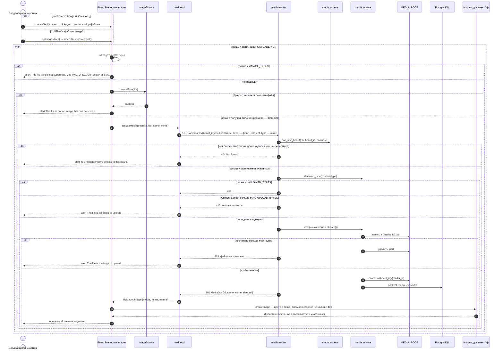
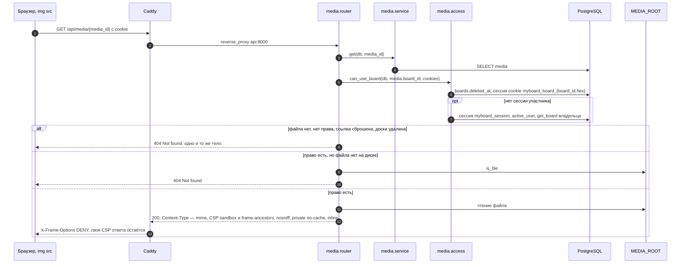
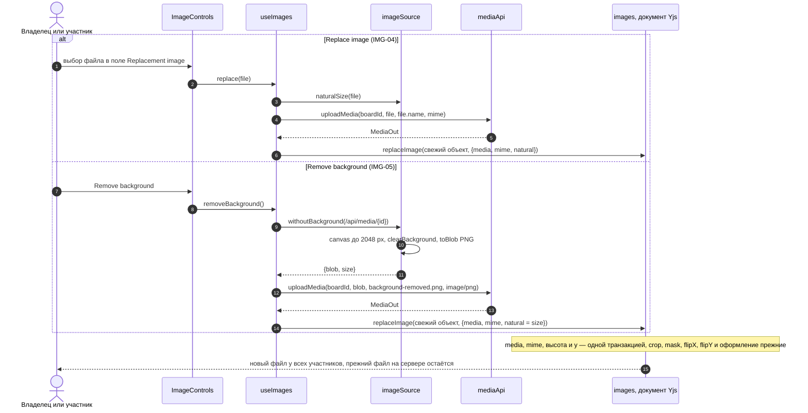
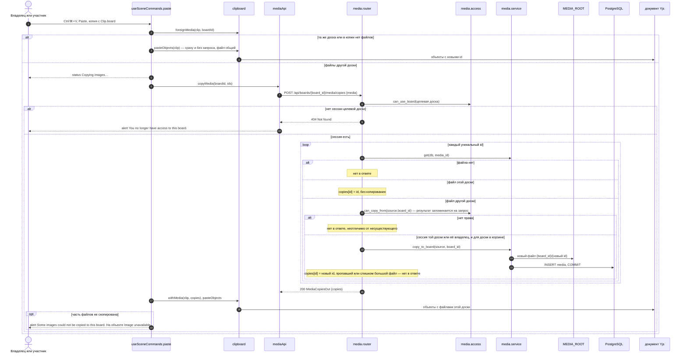

# Загрузка и выдача файла

Файлы досок (T7.1, модуль `media`): загрузка изображения из файла и из буфера (IMG-01, IMG-07), выдача только сессии этой доски, замена и удаление фона (IMG-04, IMG-05), копирование файла при вставке на другую доску (CVS-20, BUG-028). Маршруты — `app.media.router`, право — `app.media.access`, клиент — `apps/web/src/media/mediaApi.ts` и `scene/useImages.tsx`. Файл лежит в `MEDIA_ROOT/{board_id}/{media_id}`, строка — в таблице `media` ([data-model.md](../data-model.md)), объект — в документе Yjs ([board-document.md](../board-document.md)).

## Загрузка изображения

- На время загрузки видна строка `Uploading image…` (`useFileTask`, `role="status"`). Ошибка одного файла не отменяет остальные: загруженные встают и выделяются, строка `alert` показывает последнюю ошибку.
- Без `Content-Length` лимит проверяется по мере чтения потока: файл не дочитывается.
- Проверяется объявленный тип без параметров, содержимое не распознаётся (ARCHITECTURE.md, раздел 8).

## Выдача файла

- Сброс ссылки удаляет гостевые сессии доски ([link-reset.md](link-reset.md)), поэтому старая cookie сразу получает `404`, а владелец — файл.
- `Cache-Control: private, no-cache`: браузер переспрашивает сервер, прежде чем взять свою копию, и отозванное право действует сразу (SHR-06).
- `` не исполняет скрипты SVG, а открытый напрямую файл идёт под `sandbox` (IMG-07).

## Замена и удаление фона

Запись идёт по свежему `readScene`: пока файл загружался, объект могли изменить или удалить другие участники; удалённый объект не воскрешается.

## Копирование файла при вставке на другую доску

- Сбой запроса не вставляет ничего: `alert` The images could not be copied to this board. Try again., вставку можно повторить.
- Копия живёт независимо от источника: участник целевой доски получает файл без сессии исходной, удаление исходной доски копию не затрагивает (SHR-04).
- Каждая вставка с другой доски создаёт новый файл, повторы между вставками не учитываются. Дублирование и вставка на той же доске файл не копируют.

Актуально на: T7.1, 5aec139. Требования: IMG-01, IMG-04, IMG-05, IMG-07, CVS-20, SHR-04, SHR-06; ARCHITECTURE.md, раздел 8.
