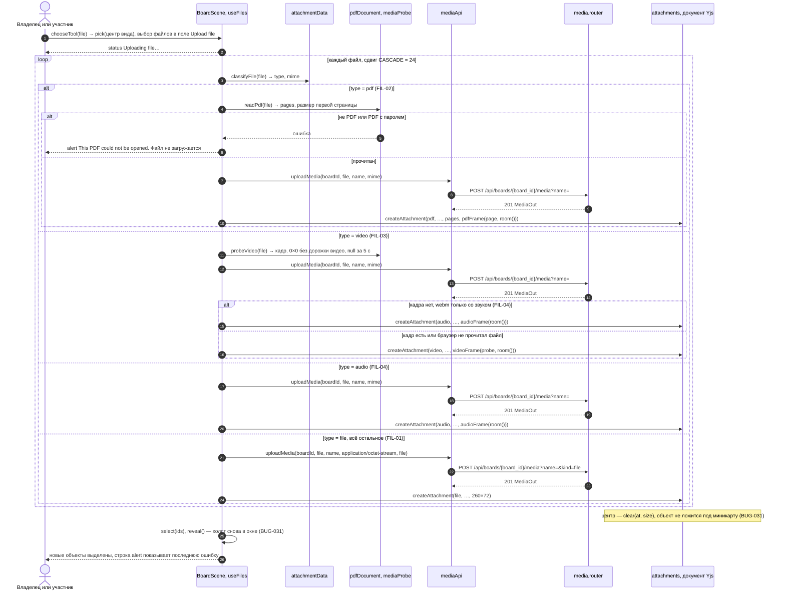
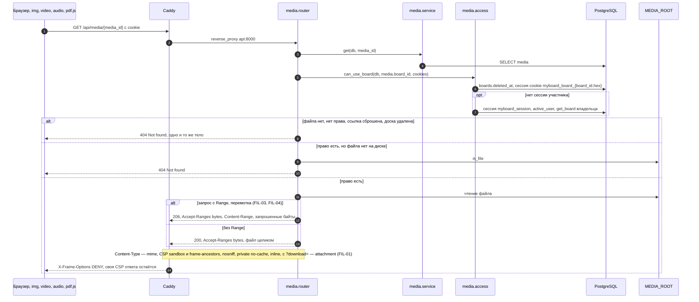
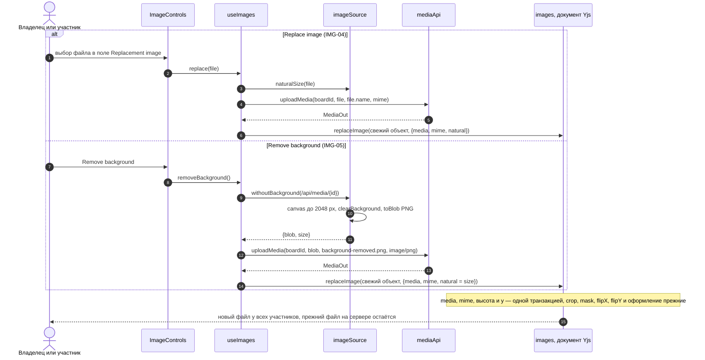
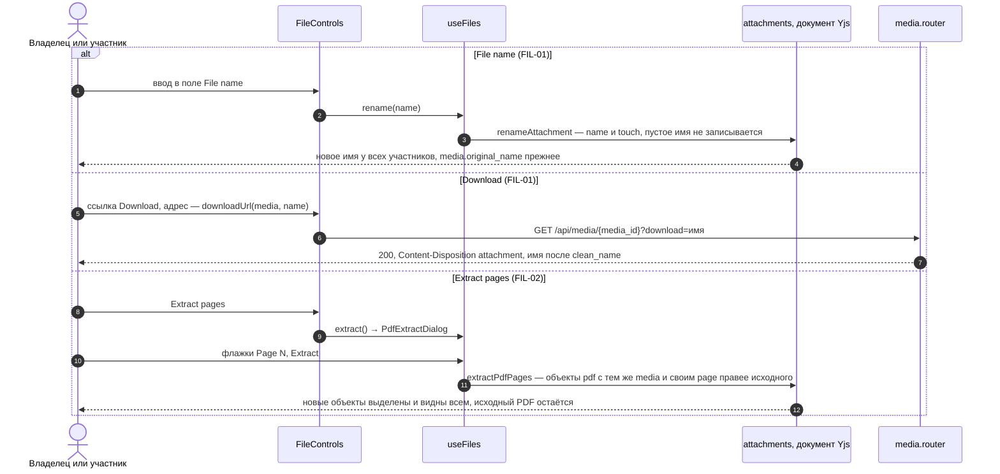
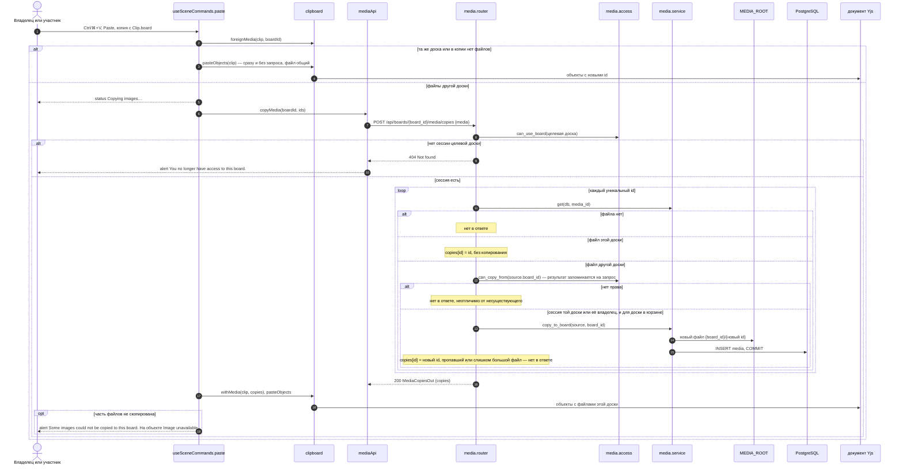

# Загрузка и выдача файла

Файлы досок (T7.1, T7.2, модуль `media`): загрузка изображения из файла и из буфера (IMG-01, IMG-07), файла, PDF, видео и аудио (FIL-01…FIL-04), выдача только сессии этой доски, замена и удаление фона (IMG-04, IMG-05), имя файла, скачивание и страницы PDF (FIL-01, FIL-02), копирование файла при вставке на другую доску (CVS-20, BUG-028). Маршруты — `app.media.router`, право — `app.media.access`, клиент — `apps/web/src/media/mediaApi.ts`, `scene/useImages.tsx` и `scene/useFiles.tsx`. Файл лежит в `MEDIA_ROOT/{board_id}/{media_id}`, строка — в таблице `media` ([data-model.md](../data-model.md)), объект — в документе Yjs ([board-document.md](../board-document.md)).

## Загрузка изображения

```mermaid
sequenceDiagram
  autonumber
  actor U as Владелец или участник
  participant S as BoardScene, useImages
  participant F as imageSource
  participant A as mediaApi
  participant R as media.router
  participant C as media.access
  participant M as media.service
  participant D as MEDIA_ROOT
  participant DB as PostgreSQL
  participant Y as images, документ Yjs

  alt инструмент Image (клавиша G)
    U->>S: chooseTool(image) → pick(центр вида), выбор файлов
  else Ctrl/⌘+V с файлом image/*
    U->>S: onImages(files) → insert(files, pastePoint())
  end
  loop каждый файл, сдвиг CASCADE = 24
    S->>S: isImageType(file.type)
    alt тип не из IMAGE_TYPES
      S-->>U: alert This file type is not supported. Use PNG, JPEG, GIF, WebP or SVG.
    else тип подходит
      S->>F: naturalSize(file)
      alt браузер не может показать файл
        F-->>S: ошибка
        S-->>U: alert This file is not an image that can be shown.
      else размер получен, SVG без размера — 300×300
        S->>A: uploadMedia(boardId, file, name, mime)
        A->>R: POST /api/boards/{board_id}/media?name=, тело — файл, Content-Type — mime
        R->>C: can_use_board(db, board_id, cookies)
        alt нет сессии этой доски, доска удалена или не существует
          R-->>A: 404 Not found
          A-->>U: alert You no longer have access to this board.
        else сессия участника или владельца
          R->>M: declared_type(content-type)
          alt тип не из ALLOWED_TYPES
            R-->>A: 415
          else Content-Length больше MAX_UPLOAD_BYTES
            R-->>A: 413, тело дочитано _discard и не сохранено (BUG-029)
            A-->>U: alert The file is too large to upload.
          else тип и длина подходят
            R->>M: save(чанки request.stream())
            M->>D: запись в {media_id}.part
            alt прочитано больше max_bytes
              M->>D: удалить .part
              R-->>A: 413, остаток тела дочитан _discard, файла и строки нет (BUG-029)
              A-->>U: alert The file is too large to upload.
            else файл записан
              M->>D: rename в {board_id}/{media_id}
              M->>DB: INSERT media, COMMIT
              R-->>A: 201 MediaOut {id, name, mime, size, url}
              A-->>S: UploadedImage {media, mime, natural}
              S->>Y: createImage — центр в точке, большая сторона не больше 480
              Y-->>S: id нового объекта, sync рассылает его участникам
              S-->>U: новое изображение выделено
            end
          end
        end
      end
    end
  end
```

- На время загрузки видна строка `Uploading image…` (`useFileTask`, `role="status"`). Ошибка одного файла не отменяет остальные: загруженные встают и выделяются, строка `alert` показывает последнюю ошибку.
- Без `Content-Length` лимит проверяется по мере чтения потока: сверх лимита на диск ничего не пишется.
- Отказ `413` приходит после чтения тела (BUG-029): соединение, закрытое раньше конца тела, браузер считает ошибкой сети и размера файла не узнаёт. `_discard` читает тело без записи, не больше `REFUSED_BODY_MAX_BYTES` = 4 ГиБ; объявленное тело длиннее не читается вовсе. При `404` и `415` тело не читается.
- Проверяется объявленный тип без параметров, содержимое не распознаётся (ARCHITECTURE.md, раздел 8).

## Загрузка файла, PDF, видео и аудио

- Права, лимит и ответы `404`, `413`, `415` — как при загрузке изображения выше. `kind=file` принимает только `application/octet-stream`, без него этот тип — `415`.
- Размер кадра и страница PDF читаются браузером до загрузки: нечитаемый PDF не занимает место на сервере.

## Выдача файла

- Сброс ссылки удаляет гостевые сессии доски ([link-reset.md](link-reset.md)), поэтому старая cookie сразу получает `404`, а владелец — файл.
- `Cache-Control: private, no-cache`: браузер переспрашивает сервер, прежде чем взять свою копию, и отозванное право действует сразу (SHR-06).
- `` не исполняет скрипты SVG, а открытый напрямую файл идёт под `sandbox` (IMG-07).
- Ярлык хранится как `application/octet-stream`: браузер его не показывает, даже если внутри HTML (FIL-01). Имя из `?download=` проходит `clean_name`.

## Замена и удаление фона

Запись идёт по свежему `readScene`: пока файл загружался, объект могли изменить или удалить другие участники; удалённый объект не воскрешается.

## Имя файла, скачивание и страницы PDF

- Поля имени нет у заблокированного ярлыка; `Extract pages` есть только у незаблокированного PDF целиком, а не у извлечённой страницы. Новых файлов на сервере извлечение не создаёт.
- Показ: `PdfView` рисует страницу через `renderPdfPage` (pdf.js читает `GET /api/media/{id}`), `MediaPlayer` — `<video>` или `<audio>` с тем же адресом. Листание, запуск, перемотка, громкость и скорость остаются в этом браузере, другим участникам ничего не передаётся (FIL-02, FIL-05).

## Копирование файла при вставке на другую доску

- Сбой запроса не вставляет ничего: `alert` The images could not be copied to this board. Try again., вставку можно повторить.
- Копия живёт независимо от источника: участник целевой доски получает файл без сессии исходной, удаление исходной доски копию не затрагивает (SHR-04).
- Каждая вставка с другой доски создаёт новый файл, повторы между вставками не учитываются. Дублирование и вставка на той же доске файл не копируют.
- Копируются файлы всех объектов с полем `media`: изображений и, с T7.2, ярлыков, PDF, видео и аудио. Тексты `Copying images…` и `Some images could not be copied…` общие для всех файлов.

Актуально на: T7.2, 254185c (файлы, `Range`, `download`, отказ `413` — BUG-029; изображения и копирование — T7.1, 5aec139). Требования: FIL-01…FIL-05, IMG-01, IMG-04, IMG-05, IMG-07, CVS-20, SHR-04, SHR-06; ARCHITECTURE.md, раздел 8.
